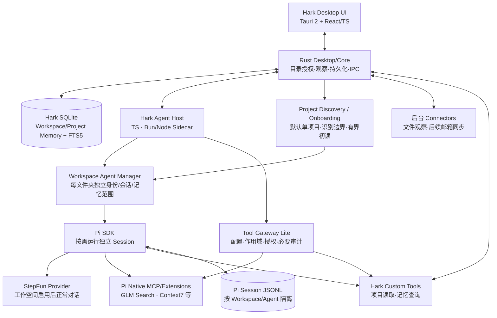

# Hark R1 · Desktop Personal Agent

> 产品需求文档（PRD）及架构约束草案  
> **版本**：v0.5.1 · 2026-11-05  
> **状态**：`DRAFT / 待产品负责人审阅`  
> **适用范围**：Hark 第一阶段成品（R1）与后续演进边界  
> **用途**：产品对齐、编码 Agent 的上位输入、架构评审与真实产品验收  
> **说明**：本文件整理此前讨论形成的设计意向；**不等于当前 GitHub 仓库已实现这些能力**，也不授权任何 Agent 自动修改仓库、合并 PR、访问私有数据、调用付费模型或向第三方外发。

### v0.5.1 接口收口补丁（在 v0.5 基础上修订）

- **Pi Context Pack 真正的边界**：不允许每轮把完整 L0/L1 拼入用户消息；**不能声称 `before_agent_start` 修改 System Prompt 就不会持久化**——当前 Pi Session Format 也会记录 System Message/Prompt Patch。以锁定 SDK 版本的请求级上下文变换（如 `context_with_system`）或经验证的等价机制组装**当前有效快照**，并以真实 JSONL、Compaction 和发给 Provider 的请求实测；新 Pi Session 从 Hark 对话恢复有限近期消息，不重复灌入已恢复的 Pi 历史。
- **记忆提议接口一致**：普通笔记/决定与结构化 Opinion 使用独立契约；来源于当轮用户消息时，由 Host 绑定真实消息 ID 和操作 ID，模型不负责伪造/手抄 UUID，Rust 验证原文、作用域及其他来源。
- **中文复合查询**：检索前切分查询词项，短词逐词受限匹配，长词交给有效的 FTS 路径；不得用整个多词字符串判断长度或直接拼一条 LIKE。LIKE 参数化、转义并界定最大查询范围，召回/排序通过真实样本测试。
- **父子 Workspace 互斥**：在已启用的父 Workspace 内导入子目录时，默认**先展示并确认**对子目录的父空间排除；排除同时生效于 Observer、内容读取、索引和当前记忆检索，旧历史保留原归属但不继续作为父空间的当前证据。仅排除字符串前缀不能宣称跨链接/别名 100% 隔离。
- **首次消息分型幂等**：`local_scan_card` 与 `agent_opening_message` 使用不同 `message_kind`；后者成功时折叠本地扫描卡片，不重复欢迎。
- **网页阅读正确降级**：Reader 在解析/连接/每次跳转中检查真实网络目标，避免 DNS 重绑定和重定向越界；动态渲染空壳/反爬时明确返回 `unreadable_dynamic_page` / `unreadable_blocked`，不能称“已核验原文”。
- **审查状态**：六项中五项采纳、一项纠正后采纳；具体机制以锁定的 Pi SDK 和平台集成测试为准。此文件仍为 **DRAFT / 待产品负责人审阅**，不自动称 Final Freeze。逐条裁决见附录 E。

### v0.5 审查吸收与收敛摘要（在 v0.4 基础上修订）

- **控制 R1 复杂度**：保留“可安装、真实项目、Agent 先开口、真实模型/搜索、可恢复记忆”的阶段成品目标；取消 R1 的历史 Workspace 无损拆分/合并迁移、通用三元组 Memory 表、双时间区间推理和细粒度级联缓存系统。保留完整功能覆盖，但将 22 个 AT 区分为主旅程与回归，不要求 22 套重型桌面 E2E。
- **首次使用修订**：选目录后先做有界结构初扫，默认单项目；疑似多独立项目时先展示候选并让用户选择，确认后才创建 Workspace Agent 和记忆。文件夹范围与当前模型的首次初读授权在同一个清晰确认流程里完成，权限语义仍分开。
- **Pi 运行时最小权限**：禁止默认内置 Bash/写/编辑/通用读工具与自动项目/全局扩展发现；只加载 Hark 显式允许的受控工具及批准的 MCP。以锁定版本的 SDK 实际 API、活动工具清单与越界负例验收，不硬编码可能跨版本变化的配置字段。
- **记忆写入改为会话内主路径**：Pi 在正常对话/初读中调用 `memory_propose_change`，Rust Core 核验并提交；成功时提供可撤销的轻量记录提示。此机制免于另启一轮独立提取模型请求，但仍有 Tool/Token 开销，且不能保证模型不会漏记或误判。
- **记忆按业务领域持久化**：观察事实、决策/项目笔记、结构化观点分别有唯一写入权威；必要时追加修订，保留来源与当前状态。R1 不实现复杂有效期区间重叠算法；并发写入仍要防丢失更新。
- **检索、研究、观察补齐可用性**：中文 1～2 字查询必须有可测的回退；搜索摘要不足以支撑重要结论时必须读取可访问原文；文件监听采用范围裁剪、合并事件、可重试读取与缺口重扫。
- **Sidecar 按实际技术栈验证**：双向 IPC 必须可关联请求、流式事件与反向 Tool 调用，stdout 不能混入日志；Windows 需验证进程树回收。Bun 编译与 StepFun Provider 接入都以完整打包/真实调用为准，不作绝对技术宣称。
- **本轮属于采纳审查意见后的设计修订**：不代表任何新能力已在 GitHub 实现，也不等于授权模型外发、源码修改或外部发布。裁决与核实范围见附录 D。

### v0.4 历史变更摘要（在 v0.3 基础上增量修订）

- **Workspace Cognition Engine 落地边界**：持续认知分为 Understand / Remember / Revise；借鉴 Hermes、DeepSeek Super-agent、OpenViking、Letta、Mem0 与 Graphiti 的相关机制，不直接引入六套框架。
- **五类长期记忆**：Identity / Fact / Decision / Opinion / Experience；全局用户记忆与各 Workspace 私有记忆隔离；Pi Session 不充当长期记忆权威。
- **记忆写入合同**：Evidence Intake → Candidate Extraction → Existing Memory Retrieval → Resolve → Commit；基于来源、作用域、去重、状态、修订版本和幂等键执行受控写入。
- **记忆检索合同**：L0 核心短记忆、L1 Workspace 概览、L2 按需查证据；SQLite FTS5 + 结构化过滤先行，中文检索质量必须实测；不引入第一阶段向量库或知识图谱。
- **冲突修订合同**：先区分时间演进、作用域差异与真正证据冲突；采用 ADD / REVISE / DISPUTE / NOOP / RETRACT，保留历史、源时间、当前投影与并发版本检查。
- **更新与注意力机制**：Rust Observer 记录可信增量，确定性判断是否需要深度理解；只有获得相应模型/后台研究授权才唤醒 Pi；普通变化不得变成“进展”或反复打扰。
- **验收增强**：加入真实文件变更、决策纠正、跨 Workspace 隔离、重启/compaction、摘要过期、证据冲突和重复事件的端到端场景；未验证的提取频率与排序策略仍标记待验证。

### v0.3 历史变更（其中“自动拆分”已由 v0.5 修订为导入前确认）


- **启动默认单项目**：用户选择一个授权根目录，初始视为一个项目；先做有界结构扫描与关键材料阅读，不因出现多个 `package.json` 就自动断定多个项目。
- **自动发现、歧义确认**：证据足够明确的独立子项目自动生成多个子 Workspace；Monorepo、模块与项目边界不明时先维持单一 Workspace，通过第一段对话或轻量交互请用户确认、拆分或合并。
- **Agent 首次主动开场**：授权成功后，无需用户先提问，Hark 即启动真实只读发现与必要预研，形成简短、有来源、有未知说明的首条 Agent 消息，最后用一个具体问题引导用户。
- **状态与恢复**：引入首次理解任务状态、证据清单、首条消息幂等与中断恢复；以后按需增量检查，不每次打开都重新介绍项目。
- **模型/网络边界不变**：本地扫描可在授权后自动执行；Pi + StepFun 预研仅在该 Workspace 已启用模型时启动；联网研究须由已启用搜索服务支持，不能在首次欢迎时偷偷发送本地内容。

### v0.2 历史变更

- 工作空间级模型/搜索授权替代日常会话的逐轮 Prompt 审批（仍需与旧合同显式协调）。
- 多 Workspace Agent 的会话与记忆隔离，复用共享 Pi Runtime。
- 优先接入 Pi 原生 MCP、Extension 和自定义工具，Gateway 只保留必要治理。

## 0. 执行摘要

**Hark 是一款 Desktop-First、Local-First、Agent-Native 的个人项目智能体。** 它在用户明确授权范围内理解真实本地项目，保留长期记忆，结合内部资料与公开研究形成可溯源、可反驳、可修订的观点，并通过自然对话和低打扰通知帮助用户做决定。研究与实际执行必须分离；未取得具体授权，不得修改用户项目或对外产生副作用。

**第一阶段交付目标不是 Mock 演示，也不是一次性 PoC**，而是一款能在 macOS 与 Windows 安装、能够持续使用的 **Hark R1 桌面应用**：

1. 用户安装并启动应用，在首次启动时选择一个真实本地文件夹；也可后续继续添加多个根目录；
2. Hark 默认将根目录视为一个项目，自动扫描真实文件结构并有选择地阅读关键资料；若存在多独立项目迹象，先展示项目候选、由用户确认范围后创建各 Workspace；Monorepo 不误拆；
3. 每个独立项目 Workspace 拥有自己的逻辑 Agent、对话与长期记忆。**首次对话由 Hark 发起**：在取得所需授权并完成初步理解后，主动呈现简短项目结论、证据、未知和一条引导性问题；用户不必先发送第一条消息；
4. 用户以对话为主要入口；用户为工作空间启用指定模型后，可开展真实 Pi + StepFun 连续对话，不默认逐轮审批 Prompt；
5. Hark 可使用至少一种真实联网检索服务获取有来源的信息，并提出项目观点与建议计划；
6. 用户可以接受、反驳、修改或搁置观点；会话和长期记忆可在重启后恢复；
7. 关闭主窗口后，经过用户允许的轻量观察仍可在后台运行；真实事件可触发本地通知；完全退出后无遗留后台进程。
8. 形成**可修订的项目认知**：历史对话、文件事实与用户决定跨 Pi Session 保留；新证据进入后可以定位受影响的记忆/观点并生成有来源的修订，而不是覆盖历史或重复生成介绍。

**总体技术方向**：Tauri 2 + Rust 常驻核心 + React/TypeScript 前端 + TypeScript Hark Agent Host + Pi SDK + SQLite；Agent Sidecar 运行时**优先验证 Bun，Node.js 为兼容保底**。

**四个架构边界**：

- **Hark Mind 是产品核心**：项目认知、长期记忆、观点修订、注意力策略由 Hark 自己实现；采用本 PRD 第 9 章规定的证据驱动 Memory Engine，而不是仅存聊天摘要。
- **Pi 是可替换的 Agent Runtime**：负责 Agent Loop、模型调用、工具调用、运行时会话；不充当全部长期记忆。
- **Hark Tool Gateway 是轻量能力边界**：本地文件与记忆等核心能力由 Hark 提供受控服务；MCP、Pi Extension 与 Pi customTools 优先原生接入 Pi。Gateway 只做必要的工作空间作用域、授权配置、日志和连接治理，不为统一而重造已有工具机制。
- **SQLite 是 Hark 的长期业务数据库**：持久化工作空间、项目、来源、事实、知识、决策、观点、用户对话与运行状态；每个项目 Workspace Agent 有隔离的记忆与会话引用；授权根目录可作为一个项目，也可作为多个子 Workspace 的发现容器，但不得同时将同一份文件悄悄归属于两个独立 Agent。Pi 的原始 Session 历史先沿用官方存储机制，并通过引用关联。

---

## 1. 背景与问题定义

### 1.1 用户面对的问题

- 本地存在多个新旧项目，背景、历史决策、当前进展和下一步工作散落在文件、Git、聊天及外部资讯中。
- 通用聊天助手依赖当前会话提供的上下文，难以长期追踪项目变化与用户决策。
- 单纯的 Git Dashboard、搜索工具、新闻聚合或聊天壳只能“展示信息”，未必能提出有新意、可验证且符合目标的判断。
- 用户不希望为了开发或使用 Agent，不断维护复杂的任务墙、门禁、分支和基础设施。
- 产品需要本机长时间驻留，因此资源开销、权限边界、进程生命周期和恢复能力都是核心体验的一部分。

### 1.2 产品承诺

> **Hark 帮用户重新掌握自己的项目：知道项目发生过什么、现在缺什么、外部有什么值得借鉴，并提出可讨论、可修订的下一步建议；在用户批准以前，不替用户执行真实工作。**

### 1.3 产品不是

- 传统项目管理看板、Git 活动计数器；
- 给普通聊天模型套上火焰视觉皮肤；
- 自动写代码、自动开 PR、擅自运行项目命令的全权编码 Agent；
- 以无限后台模型调用实现“持续思考”的资源消耗型服务；
- 把 Mock 通过等同于真实产品价值完成的演示系统。

### 1.4 本阶段产品定义

采用 **R1 / R2 / R3 阶段产品版本**，以可交付能力和验收为阶段边界，**不以时间排期代替阶段完成**。R1 是可持续使用的第一阶段成品，而非追求功能最小化的临时演示；但后续扩展项不得反向阻塞 R1。

---

## 2. 产品定位、用户与体验原则

### 2.1 首要用户

本机拥有多个开发、研究或创作项目，愿意明确授予有限目录访问和研究权限，希望 Agent 理解项目的长期上下文，并由自己保留最终决策权的个人用户。

### 2.2 产品形态

**桌面 App，而非以浏览器为主要使用入口**：

- macOS：常驻菜单栏/系统托盘；
- Windows：常驻系统托盘；
- 完整窗口：以对话为中心，中央火焰承担叙事表达；
- 低打扰通知：只有可信、相关、必要的信息才提醒；
- 后台核心可在主窗口隐藏后持续运行；
- 完全退出明确终止受管理的后台任务与子进程；
- 开机启动默认关闭，经用户明确开启才生效。

网页仅保留为开发、调试或未来受控访问方式，不作为 R1 的最终交付形式。

### 2.3 UX 原则

1. **对话优先、Agent 先开口**：一个主窗口、一座主炉心；首次添加文件夹时，用户不用先提问，Hark 自动认识项目后主动发起有证据的简短对话；不常驻复杂侧栏或指标墙。
2. **火焰是项目事实的投影，不是游戏化评分**：不使用“添柴”“活力百分比”“聊天越多火越旺”来替代真实状态。
3. **事实、推断、建议分开表达**：重要观点能展开来源、反例、不确定性和为什么现在值得关注。
4. **安静是默认行为**：没有价值或证据不足时不打扰。
5. **未知即未知**：权限撤销、观察暂停、来源缺口、模型不可用等不得展示成项目正常、停滞或已完成。
6. **用户决定优先**：建议可以保存、修改、反驳、搁置；真正执行另行审批。
7. **运行状态可见**：用户能查看是否正在扫描、读取、初步理解、等待确认、观察、研究、暂停及相关资源使用。
8. **先认识，再持续了解**：首次扫描产生可恢复的项目初始认识；之后重新打开以记忆和增量观察为起点，不反复欢迎或重复介绍。

---

## 3. 典型用户旅程与真实闭环

### 3.1 首次使用：选择目录、确认范围与模型、由 Agent 先开口

安装并启动 → 选择一个真实文件夹（之后仍可添加多个）→ Rust 先做**有界、无模型的目录结构初扫** → 展示一个清晰的首次确认界面：待读取根目录、排除范围、检测到的项目候选、当前 Provider/模型及“允许对该 Workspace 进行首次模型初读”的独立开关 → 用户按“开始认识项目” → 创建 Workspace、建立持久身份与隔离记忆 → 自动进入对话页，显示逐步读取状态 → 完成后由 Agent 主动发送**第一条有来源的简短消息**。

**授权语义不得合并**：本地目录只读授权与远程模型对选定片段的发送是两种许可，只是在同一页面完成。若用户尚未配置或不允许远程模型，继续本地确定性扫描，展示诚实的初步概况与一次性启用入口；不悄悄外发，也不伪造 Agent 深度判断。

首次目录初扫的时间预算采用有界深度/文件数量和可中断体验，**不承诺固定 1～2 秒内完成**；大目录可以边读边显示进度。不要在未知项目边界时创建多个已有长期记忆的 Agent，避免之后承担会话迁移。

### 3.2 项目边界发现：默认单项目，导入前确认边界

三个概念保持独立：`AuthorizedRoot` 是用户授予的目录读取范围；`Workspace` 是有独立 Agent、对话、记忆和读取范围的项目身份；`Project/Module` 是同一 Workspace 内部的仓库、包或模块。**Monorepo 可能存在很多构建文件，但仍是一个 Workspace。**

R1 按以下规则处理：

1. **先扫描候选，后建记忆**：Rust 只读枚举受限目录结构，检查 Git、README、工作空间配置、包依赖等证据；忽略缓存/产物/敏感路径并记录未知范围。初扫只输出候选，不立即创建多个有状态 Agent。
2. **默认一个**：没有明确多项目线索时直接建议一个 Workspace；用户在首次确认页完成确认。
3. **有多个独立项目迹象**：展示子目录候选与识别依据，允许用户勾选导入哪些项目，或明确选择“整个目录作为单一项目/Monorepo”。**不自动静默批量创建**。
4. **歧义时询问**：可以说明为何无法确定；允许“先作为单项目导入”。用户纠正描述或目标，可正常更新 Workspace 记忆。
5. **创建后发现边界错误**：R1 支持**添加子目录为新 Workspace、归档/停止观察旧 Workspace、手动调整项目说明**；保留旧历史的原始归属并在新项目中按用户要求重新认识。**不承诺自动拆开已有 Pi JSONL、重分配既有跨项目对话、或无损合并两个历史记忆库**。此类迁移进入 R2+，前置原始记录导出/备份和用户预览方案。
   - 例：用户已导入 `/projects/monorepo` 为 Workspace A，后决定将 `sub-app/` 导入为 Workspace B。创建 B 前，UI 必须清楚展示：**A 将不再把 `sub-app/` 当作自己的当前文件来源**，提供“确认隔离并创建 B / 归档 A / 取消”。默认采用确认后的子目录排除，而不是静默重叠或直接修改旧历史。
   - 在同一配置提交中，将 B 的规范化目录加入 A 的 `excluded_paths`；**观察、扫描、`read_project_file`、内容索引与默认 `memory_recall` 当前证据检索**必须同时执行排除。A 的既有历史记录仍保留原归属，但来自排除目录的条目标记为 `out_of_scope/stale` 或同等不可用于当前认知的状态，后续不能再当 A 的当前项目事实引用。若 B 创建失败，排除配置与 B 创建须回滚到一致状态。
   - 路径排除以安全的规范化、路径组件边界与真实打开的访问校验为准；软链接、Windows Junction/reparse point、路径大小写/别名与硬链接等情况必须有拒绝或显式处理策略。**单纯将路径字符串加入排除表不保证物理文件唯一归属**；R1 不支持暗中共享来源。
6. **作用域隔离**：Workspace 读取范围是经确认的子目录或根目录，减去已经确认的 `excluded_paths`。创建前或配置变更时检测包含、相等、符号链接/别名导致的重叠；无法确认安全边界时拒绝自动创建，要求用户调整范围。父子 Workspace 默认互斥；R1 不实现“自动共享同一源文件给两个独立 Agent”的隐式模式。只有逻辑 Agent 独立，不要求各自常驻 Pi 进程。

用户确认前的原始目录候选可以短暂缓存，用户取消不得留下被误当成已确认项目的记忆或欢迎消息。

### 3.3 初次项目认知与 Agent 主动首条消息（R1 必选）

第一次项目边界确定（或已确定部分可继续）后，自动完成：

1. **项目结构初读**：生成简要目录概览、技术/内容类型线索、Git/非 Git 类型及必要元数据，记录实际读取范围与覆盖缺口。
2. **选择性阅读与预研**：优先阅读 README、配置、架构/需求文档和关键入口；只在有具体问题时扩展到相关源码或文档。不做无界全目录全文读取、不自动运行构建/测试命令、不因为“预研”自动联网。
3. **有界模型理解**：若当前 Workspace 已启用 StepFun，调用 Pi 用实际证据形成项目用途、目前可确认的进展、重要未知、一个可能值得推进的方向；模型输出区分观察事实、推断与建议。未启用模型时以本地扫描结论引导启用，不声称已完成智能分析。
4. **主动首条对话**：写入与该 Workspace 绑定的 `conversation`、`onboarding_run`、`initial_opinion`（如确有依据）和来源引用，由 Hark 的 Agent 主动发送第一条消息，**无需用户先提问**。
5. **引导下一步**：首条消息应简短，优先呈现“我目前理解了什么 → 我注意到什么/还不确定什么 → 我建议下一步 → 一个具体的问题”。默认不生成超长审计报告；细节和证据按需展开。用户可一键“理解正确/纠正理解/查看依据/继续讨论”。

**消息参考结构（示例，不是真实扫描结果）**：

> 我看过这个项目的 README、核心配置和主要目录。目前它看起来是一个本地项目助手，已经有桌面框架和目录发现模块，但长期记忆的实现情况还无法确认。我想先和你确认：你更希望我先梳理当前实际完成的能力，还是先讨论下一步的 Agent 设计？

**首条消息的真实性约束**：不能将推断写成源码已验证事实；必须能展开到实际文件/文档来源以及“尚未查看”的限制。只有本地扫描时可以先发结构化发现消息，但需要明显说明尚未做模型推理；不得偷偷调用未启用的模型或搜索服务。

### 3.4 正常对话、观点与反馈

用户选择某 Workspace → 继续专属 Agent 的既有对话 → Pi 通过该 Workspace 的工具范围读取事实/决策 → 在已启用的服务范围内正常调用 StepFun 与搜索工具，**不默认逐轮审查 Prompt** → Hark 提出有来源的观点与可审阅方案 → 用户采纳、修改、反驳或搁置 → 长期状态写入 SQLite。切换 Workspace 时禁止沿用另一空间的工具凭证、记忆检索结果或隐式上下文。

### 3.5 真实联网研究

用户明确提出研究问题，或已存在值得研究的候选 → 优先检索当前 Workspace 已知资料 → 仅使用已启用的 Pi MCP/搜索 Provider → 记录检索来源、时间和可核验事实 → 形成可反驳的研究观点。不因初次项目扫描默认启动付费联网研究；与远程模型的项目内容外发由 Workspace 的模型授权覆盖，与搜索查询外发分别授权。

### 3.6 后台观察、通知与资源约束

经过授权的 Rust Observer 在隐藏窗口后继续对 Workspace 的真实目录做轻量、增量观察 → 持久记录可信事件并去重 → 符合通知许可和低打扰条件时发出通知，点击回到对应 Workspace 的对话。**后台观察不等于后台自主调用 Pi**；后台付费研究仍需独立启用。系统繁忙、权限撤销、目录不可达时按受控状态退出或暂停，不把无数据当作项目休眠。

### 3.7 再次使用与恢复

下次打开 Workspace 时先恢复身份、目录绑定、已确认项目边界、对话、首次理解结果及当前观察新鲜度；按需进行**增量**检查，不重复创建首条消息，也不每次重新介绍项目。只有用户发起“重新认识项目”、新增独立子项目、或新事实足以推翻既有理解时，才触发有界重评估并以**后续修订消息**说明变化。首次分析被取消、应用崩溃或模型不可用时，应保存阶段状态和已取得的证据，可重试且不会产生重复首条消息。

### 3.8 首次认识任务的状态与多项目呈现

建议将首次认识过程实现为**单个可恢复的业务任务**（而不是靠页面状态或 Pi Session 判断完成）：

`ROOT_SELECTED → BOUNDARY_REVIEW（必要时）→ WORKSPACE_CREATED → READING → ANALYZING（已启用模型时）→ MESSAGE_READY → PRESENTED / COMPLETED`

任一阶段允许进入 `PAUSED / CANCELLED / FAILED / WAITING_FOR_MODEL_AUTH`，持久记录已读取证据、范围、错误和重试状态。状态名是候选合同，实际工程可简化，但**必须明确区分**“文件已扫描”“模型已分析”“首条消息已展示”。首条消息以 `workspace_id + onboarding_generation + message_kind` 建立稳定的幂等身份；**`message_kind=local_scan_card`** 表示无模型本地发现卡，**`message_kind=agent_opening_message`** 表示模型已完成首次理解后的主动对话，必须分别去重。用户先不开模型、后开启模型时，两者可各自存在一次；`agent_opening_message` 成功保存后，UI 将前一张 `local_scan_card` 折叠为可展开的扫描证据，**不要在对话流中连续展示两条欢迎介绍**。模型失败不得将本地卡伪装成 Agent 理解结果。若用户关闭窗口，后台结束后将消息保存在对应对话，重开后展示已存在的结果，不能再插入第二条同类型欢迎消息。

当用户在导入确认界面选定多个独立 Workspace 后，各子 Agent **各自生成并保存自己的首条消息**，但主界面只展示当前聚焦 Workspace 的一条；其他项目显示为“已初步认识，可进入对话”，不连续弹通知、不抢夺输入焦点。待用户选择对应子 Workspace 时再进入其已有的首条对话。

**授权语义**：用户主动添加文件夹并启用对应工作空间的模型，可以视为明确发起一次初始分析；这不代表授权后台持续付费调用，也不代表允许联网搜索或执行项目代码。初次分析后的自动再次研究须有独立配置，不以“这是 Agent 主动开口”为理由绕过权限。

---

## 4. R1 功能需求（产品层）

> `P0` = R1 必须交付；`P1` = R1 体验质量要求；`R2+` = 规划但不阻塞 R1。具体开发任务由这些产品要求派生，不得另行增加并行“治理平台”。

| ID | 优先级 | 能力 | 用户可观察的验收结果 |
|---|---|---|---|
| FR-01 | P0 | 可安装桌面 App | macOS 和 Windows 可安装、启动、关闭窗口、再次打开、完全退出 |
| FR-02 | P0 | 多文件夹授权与撤销 | 启动时或设置中添加多个真实文件夹；每个文件夹独立授权与撤销；撤销后停止该范围的新读取 |
| FR-03 | P0 | 真实项目发现与边界识别 | 选择真实文件夹后默认单项目；自动扫描，发现多项目候选时先让用户勾选导入；Monorepo 不误拆；创建后可新建子 Workspace 或归档旧空间 |
| FR-04 | P0 | 项目只读事实 | 展示项目来源、关键文件/元数据、最近观察与未知状态，不擅自修改源目录 |
| FR-05 | P0 | 项目专属 Agent 对话 | 每个独立项目 Workspace Agent 有独立对话、记忆与受限读取范围；多子 Workspace 不串线，共享 Pi 进程不共享权限 |
| FR-06 | P0 | Pi + StepFun | 每个启用模型的工作空间可真实流式对话；初次配置模型/服务时明确授权，正常聊天不逐轮审阅 Prompt；不隐式切换 Provider |
| FR-07 | P0 | Pi 原生搜索接入 | 至少通过已配置的 Pi MCP 或 Pi Tool 接入一个真实搜索 Provider，并能展示可核验来源；不为统一重写 MCP 客户端 |
| FR-08 | P0 | 项目观点与反馈 | 观点包括事实、判断、不确定性、反面解释、建议；用户能修改/搁置/反驳 |
| FR-09 | P0 | 长期持久化 | 用户对话、项目事实、明确决策、观点、反馈重启后可用，并可找到来源 |
| FR-10 | P0 | 后台与通知 | 隐藏窗口后在授权下继续轻量观察；真实事件能触发一次本机通知，完全退出后停止 |
| FR-11 | P0 | 低打扰授权与可查看记录 | 目录、模型、搜索、实际执行分别启用；已授权的日常对话无重复审批；可查看当前启用服务和调用记录 |
| FR-12 | P0 | 双平台质量 | Mac/Windows 对真实目录、Pi、打包、生命周期有独立验收证据 |
| FR-13 | P0 | Agent 主动首次开场 | 用户添加文件夹后无需先发送消息；Hark 自动结构扫描、选择性阅读，生成简短有来源、标注未知的首条 Agent 消息，并提出具体引导问题 |
| FR-14 | P0 | 首次理解恢复与去重 | 取消、崩溃、重启后可继续/重试，首条消息只投递一次；后续打开使用记忆与增量观察，不重复介绍 |
| FR-15 | R2+ | 历史 Workspace 分裂/合并迁移 | 复杂的旧对话、Pi Session 和跨空间记忆无损迁移不阻塞 R1；R1 用新建子空间/归档旧空间，并保留历史归属 |
| FR-16 | P1 | 视觉叙事 | 中央火焰与项目状态正确关联；禁用动画不影响信息与功能 |
| FR-17 | P1 | 本地信息检索 | SQLite FTS5 可搜已授权项目/知识/历史记录，引用回原始记录 |
| FR-18 | P1 | 资源可观察性 | 展示或记录空闲内存、CPU、唤醒、Sidecar 启停及失败恢复 |
| FR-19 | P0 | 长期记忆与来源 | 当前 Workspace 的身份、观察事实、用户决定、结构化观点、必要经验按领域保存，并能追踪到合法来源；Global Memory 单独作用域 |
| FR-20 | P0 | 记忆检索与 Pi 上下文 | 重启、开启新 Session 或 compaction 后仍能按 Workspace 找回决策/事实与原始证据；不能跨空间污染 |
| FR-21 | P0 | 增量认知修订 | 真实文件或用户决定改变后，相关旧摘要可过期，新事实或观点追加修订，历史不丢失；重复事件不重复写入 |
| FR-22 | P1 | 低打扰认知更新 | 普通变更只记录，必要时产生研究候选；后台模型调用需独立授权，用户可区分“已观察”“待分析”“观点已更新” |

### 4.1 R1 不应被下列事项阻塞

- Gmail 日报完整同步与自动标签体系；
- 为首条项目介绍额外构建全自动在线深度研究、多代理多轮批量分析系统；
- GLM/Tavily/Jina/You.com/Context7/SearXNG 全部接齐；
- 自动多 Provider 评分路由、复杂成本优化系统；
- 全自动后台付费研究、多 Worker/多 Agent 网络；
- 长期记忆向量库、知识图谱、复杂语义排序或遗忘曲线；
- 自动修改项目、自动测试、自动 PR、云端同步、移动端；
- 复杂火焰物理效果、重型多窗口工作台。

以上并非永久取消，而是按后续真实需求进入 R2/R3。

---

## 5. 确定的技术方向与职责分工

### 5.1 目标技术栈

| 领域 | 选型 | 决策状态 | 主要理由 |
|---|---|---|---|
| 桌面框架 | **Tauri 2** | 已选择方向 | 适合轻量常驻、托盘与原生系统集成 |
| 原生后台 | **Rust** | 已选择方向 | 系统生命周期、目录权限、观察、调度和持久化 |
| 前端 | **React + TypeScript** | 已选择方向 | 复用 Web UI 能力，保持快速迭代 |
| Agent 引擎 | **Pi SDK（TypeScript）** | 已选择方向 | 复用 Agent Loop、模型/工具/会话能力，不 Fork、不重写 |
| 模型 | **StepFun（使用已验证接入或 Pi 原生自定义 Provider）** | 当前优先方案 | 先保留实际可用链路，原生配置须通过真实模型/流式/工具调用验收才替换 |
| JS 运行时 | **Bun 候选，Node.js 保底** | 待对照测试 | Bun 有单文件编译/启动潜力，但动态扩展和跨平台打包需验证 |
| 数据存储 | **SQLite + FTS5** | 已选择方向 | 本地持久化与轻量全文检索 |
| 工具/搜索 | **Pi 原生工具优先 + Hark 轻量 Gateway** | 已选择方向 | MCP/Extension/customTools 直接复用；仅本地受控能力做必要封装和治理 |
| 进程通信 | **Tauri IPC + Rust↔Sidecar 受控消息协议** | 推荐初版 | 不必要时不暴露本地 HTTP 端口 |

**编译语言分工原则**：不为“全 Rust”重写 Pi，不为“全 TypeScript”忽略系统级后台需求；仅在有实测收益时调整语言边界。

### 5.2 逻辑组件



> 这是**逻辑分层**，不是要求每个文件夹独占 Bun 进程或永久运行的 Pi Session。一个 Sidecar 可管理多个逻辑 Agent，但必须有独立的会话/工作空间作用域。授权根目录默认产生一个 Workspace；确认有多个独立项目时可拆分子 Workspace；单纯的 Monorepo 模块不必拆分。Rust 负责持久化和读取授权；Pi SDK 在必要的自有工具上调用 Rust 核心；已有 MCP 搜索可以直连 Pi。外部 Provider 授权与目录授权分别保存。

### 5.3 Rust Core 职责

- Tauri 窗口、托盘、开机启动（可选）、系统通知与应用退出；
- 本地目录授权、排除规则、撤销与受控只读访问；
- 工作空间目录的添加/移除、**有界目录结构发现、项目边界证据记录、歧义处理与子 Workspace 建立**、事件观察、资源轻量调度；
- 首次认识任务（Onboarding Run）的检查点、状态恢复、首条消息去重与增量检查；
- SQLite 业务数据的**单一权威写入入口**，事务/迁移/备份与故障恢复；执行记忆操作的作用域/来源校验、必要的版本冲突保护与幂等；L0/L1 用粗粒度来源版本标记过期，R1 不实现逐 Fact 依赖图级联失效；
- Sidecar 启动、停止、健康检查和异常退出处理；
- 维护工作空间 UUID 与真实目录的受控绑定；拒绝跨工作空间/项目越权的受控读取调用，返回结构化错误。

### 5.4 TypeScript Agent Host 职责

- Pi SDK 初始化与生命周期；按**独立项目 Workspace Agent** 管理会话、工具配置和记忆引用；多个逻辑 Agent 可共用 Sidecar 进程；
- 在授权并完成结构初读后，对**选取的真实证据**执行一次有界的首轮项目理解，形成可追溯的初步观点与首次对话消息候选；
- 模型接入及流式 Agent Session；
- 通过 Pi `customTools`/Extension 注册 Hark 必需的受控读取和记忆工具；
- 优先通过 Pi 原生 MCP 接入 GLM/Context7 等现成工具；仅对没有合适 Pi 集成的服务编写 Search/Reader Adapter；
- 将真实证据组织成上下文，按 L0/L1/L2 按需检索记忆，解析模型输出为结构化观点/记忆**候选**；不得将模型猜测直接写成已核实事实；
- 向 Rust Core 提交经过验证的业务写入请求，不直接任意写核心数据库。

### 5.5 UI 职责

- 对话、工作空间切换、项目选择、火焰叙事、来源展开、观点反馈；
- 首次添加目录后直接进入项目对话，展示扫描/初读/等待授权/等待用户确认等轻量状态；提供导入前项目候选选择、创建后新建子 Workspace/归档旧空间及“理解是否准确”的反馈入口；
- 添加/移除多个目录、为每个工作空间启用模型/搜索、查看当前 Provider/调用记录、权限撤销与暂停；
- 不持有模型 API Key，不绕过 Rust Core 直接访问本地敏感文件。

---

## 6. 工具接入：Pi 原生生态优先，Gateway 只做必要治理

### 6.1 核心规则

**集成路径按“最少重复实现”选择**：

1. **现成 MCP**（如 GLM 网络搜索、Context7 文档检索）：优先利用 Pi 原生 MCP 扩展连接，保留其能力与工具定义；不额外实现一套 MCP Client 或机械包装成 `search_web`。
2. **已有可信 Pi Extension**：适用时直接集成；必须核对许可证、版本、运行时兼容性以及它能访问的 OS 权限和凭据。
3. **Hark 自有能力**（本地文件、工作空间记忆）：通过 Pi SDK `customTools` 或自有 Extension 提供经过 Rust 核心作用域校验的工具。
4. **普通 HTTP API**（无适用 MCP/Extension）：实现小型 Provider Adapter/ContentReader，再作为 Pi Tool 暴露。
5. **系统后台任务**（文件监听、邮箱同步、数据落库、通知）：直接由 Rust/Core 或后台 Connector 执行，不需要模型调用。

Hark Tool Gateway 保留为**轻量控制面**：管理工作空间配置、已启用工具清单、用户可见的外部服务、凭据引用、最小调用记录和必要的作用域约束。Pi 承担已有的工具发现、MCP 连接和调用生命周期，不为“统一架构”强行代理所有工具。

### 6.2 能力映射

| 能力 | 优先集成路径 | 对 Pi 暴露方式 | 工作空间行为 |
|---|---|---|---|
| 本地项目文件 | Rust Project Reader | Hark `read_project_file` | 必须绑定 `workspace_id`，验证只读路径 |
| 项目概况/变化 | Rust Discovery & Observer | Hark `get_project_overview` / `get_project_changes` | 只检索本工作空间及其子项目 |
| GLM 网络搜索 | Pi 内置 MCP 支持（SDK 显式加载） | 原始 MCP Search Tool | 服务授权与调用记录由 Hark 管理，不强制重包装 |
| Context7 文档搜索 | Pi MCP | 原始 MCP Tool | 可按工作空间启用；仅公开文档检索 |
| 其他 Web 搜索 | 现有 MCP 或最小 HTTP Adapter | Pi MCP/Custom Tool | 遵守所配置 Provider 的作用域/预算 |
| 网页原文读取 | Pi MCP 或 ContentReader | Pi Tool | 记录 URL 和读取时间 |
| 本地长期记忆 | Rust + SQLite FTS5 | Hark `memory_recall` / `memory_get_evidence` / `memory_propose_change`（或等价稳定 API） | Workspace 作用域由 Host 绑定；写入提议必须经过 Rust 验证 |
| Gmail 日报 | 后台 Connector（后续） | 同步后由记忆查询工具获得资料 | 邮箱读取权限不等于 Pi 自动访问整个邮箱 |
| 后台调度/通知 | Rust Core | 不作为通用 Pi Tool | 低负载常驻，不唤醒模型做确定性工作 |
| 修改项目/执行命令 | R1 不提供 | 不开放 | 未来独立明确授权 |

### 6.3 Pi SDK、MCP 与受控资源加载

Pi SDK 支持 `tools/noTools/excludeTools/customTools` 与 `resourceLoader` 的显式配置；SDK 不自动加载 CLI 内置的 MCP/codemode/tool_search，Hark 应只在需要时通过官方 Extension Factory 注入，并绑定、释放 Extension 生命周期。**不能仅通过 Prompt 禁止高权限工具。**

**R1 必须进行的启动前检查**：

1. 固定 Pi SDK 的实际包名与精确版本，先查该版本的导出声明和 SDK 例子；使用其支持的配置**显式禁用默认 `read/bash/edit/write` 等所有非批准内置工具**，再注册 Hark `customTools` 和批准 MCP。`tools: []`、`noTools: "builtin"` 等实现方式随锁定版本核对，不允许凭教程猜参数。
2. ResourceLoader 使用 Hark 自有受控配置与扩展白名单；**不能把用户选定项目路径当成会自动发现/执行 `.pi/extensions`、项目 Skills 或全局扩展的可信 `cwd`**。项目 `AGENTS.md` 等可以作为不可信参考文档经受控 Reader 读取，但不得自动执行其脚本指令。
3. 会话真正开始前记录并核验有效工具清单（包括 MCP 间接可达工具）；确保无任意文件读取、Bash、编辑、写项目和未经授权 Provider。模型工具调用仍受 Rust Core 的 workspace 授权范围验证。
4. 对需要的 GLM 等 MCP 优先复用 Pi 自带支持，不做第二套 MCP 客户端；被允许的网络搜索服务以用户配置和当前可用服务条款为准。`deferred/codemode/direct` 仅解决 Tool Exposure，不是 Hark 的授权机制。

参考：[Pi SDK](https://pi.dev/docs/latest/sdk)、[Pi MCP](https://pi.dev/docs/latest/mcp)、[Pi Extensions](https://pi.dev/docs/latest/extensions)。**插件与 MCP 可在 Pi 进程内拥有独立网络/文件能力**，不能保证仅靠 Tool Gateway 的提示词拦截就形成 OS 隔离；对未知第三方本地扩展不做 R1 自动安装/执行。

**StepFun 接入**：已有可用的第三方 Pi Provider 可以继续作为 R1 基线。Pi 原生自定义 Provider / OpenAI 兼容 API 是候选替代方案，但模型标识、协议支持、流式、工具调用和计费端点需经真实验证；不能因为理论上“兼容”就直接宣布无需插件或要求推翻原集成。

### 6.4 最低必要边界

- **显式默认拒绝**：不加载未审查的全局/项目扩展、默认 Bash/写/编辑/通用文件工具；受控 Reader/Memory Tool 才能访问 Hark 允许的路径和记忆。锁定版本必须通过工具清单及越界负例验证。
- 每个 Workspace Agent 有独立凭据引用、模型/搜索启用状态和工具作用域；同一 Sidecar 进程可承载多个逻辑 Agent，不得共用会话上下文或扩大权限。
- Pi 原生 MCP 和 Extension 能够简化集成，但第三方代码可能共享 Agent Host 的操作系统权限；禁止不可信源自动执行；在权限要求更高时另行评估进程级隔离。
- 已授权日常对话不弹逐轮确认；不可隐式切换到未启用 Provider。工具结果视作不可信数据，不能当作系统指令或项目已完成证据。
- 真实项目写入、运行命令、自动 PR、跨工作空间读取与后台自主付费研究不属于 R1 默认能力。

### 6.5 本地检索

SQLite FTS5 用于本地离线全文检索；SearXNG 可作为后期外网元搜索选项，不等于离线 Google。R1 只需一条真实可用的搜索路径，不要求所有引擎同时接入。

---

## 7. Pi Session、Hark Conversation 与长期记忆

### 7.1 三个不同对象

| 概念 | 权威持有者 | 主要内容 | 生命周期 |
|---|---|---|---|
| **Pi Session** | Pi SessionManager | 消息树、工具调用、模型响应、上下文压缩、运行轨迹 | 一次或多次连续的 Agent 推理会话 |
| **Hark Conversation** | Hark SQLite | 用户可见的对话、话题、项目范围、反馈、关联的 Pi Session | 用户可持续打开与继续的对话 |
| **Hark Long-term Memory** | Hark SQLite | 项目事实、目标、用户明确决定、研究证据、观点版本与关系 | 跨对话、跨 Session、跨重启长期存在 |

**不变量**：

1. 一个 **Workspace Agent 对应一个独立项目工作空间**，它的读取目录可以是授权根目录或其**子目录**；一个授权根目录可派生多个子 Workspace，但不能以“多个模块”推定多个独立项目。每个 Agent 的对话、Session 引用和长期记忆默认隔离。
2. 一条 Hark 对话可关联多个 Pi Session；每个 Pi Session 必须归属某个 Workspace Agent（或明确的全局对话），Pi Session 不是 Workspace 或 Project 的唯一身份，也不是长期记忆的权威。
3. Pi 的 compaction 负责模型上下文预算，不承担可靠长期记忆提取。
4. 重新启动 Pi Session 后，Hark 根据当前 `workspace_id`、项目、权限和来源取得必要长期记忆；不将整库或其他工作空间内容注入上下文。跨空间比较需用户显式选择范围并记录来源。

### 7.2 推荐持久化方案

**R1 保留 Pi 官方支持的原始 Session 存储（初版 JSONL），不重写 SessionManager。**

**Context Pack 与 Pi 持久化的隔离合同（v0.5.1）**：

1. 绝不通过 `session.prompt()` 每轮重复拼入完整 L0/L1，也不把 Context Pack 伪装成普通用户发言。当前 Pi 的 Session Format **会记录系统提示词及其变更（System Message/Patch）**，所以不能断言 `before_agent_start`/`systemPrompt` 属于“不写入 JSONL 的临时层”。
2. Hark SQLite 的 `workspace_id + context_pack_revision + source_version` 是当前认知快照的权威；Pi 中已有的旧快照或 compaction 摘要均**不能成为新的项目事实来源**。每次模型请求，应在调用前根据授权和新鲜度确定当前有效版本；过期时采用经锁定 SDK 验证的**请求级上下文覆盖/过滤**（候选：Pi `context_with_system`，必须保持系统工具声明和原生会话不变量），或创建新的 Pi Session 进行受控衔接。不得仅靠提示词要求模型“忽略旧摘要”。
3. **不允许承诺完全无持久化**：静态 Agent 身份或 System Prompt 的部分内容仍可能进入 Pi JSONL；目标是防止 L0/L1 每轮冗余注入与旧快照继续充当当前依据，而不是规避 Pi 的合法会话审计。对请求级注入至少测量 JSONL 内容/大小、Provider 最终负载、压缩前后有效来源、重启/恢复以及模型/插件兼容性。若无法可靠隔离旧快照，采用新 Session + 当前记忆重新组装的保底路径。
4. **跨 Session 接续**：先尝试在原 Pi SessionManager 中恢复同一会话分支，成功时**不得再次从 SQLite 灌入相同近期消息**；只有确实创建全新 Pi Session 才生成一次有界的近期对话衔接包，初步可从 SQLite `conversation_events` 读取最近 **6～10 条用户可见消息**（可按 Token 预算缩短），保留角色、时间、来源 ID 与未完成问题，且不能把 Tool 输出冒充用户原话。该衔接包是引导性会话历史，不是新的用户决定证据源；重复恢复需有 `handoff_id` 去重。
5. Pi 的 compaction 不能自动证明项目状态的新鲜度；测试必须覆盖“旧 L1 已失效，但压缩摘要仍包含旧观点”的场景：最终发给模型的可用当前状态必须能回溯到 Hark 的新来源，并能表达旧结论已过期。

Hark SQLite 保存：`authorized_root_id`、`workspace_id`、`workspace_agent_id`、`conversation_id`、`agent_run_id`、`pi_session_ref`、对话消息/呈现事件、项目绑定、生成观点所依据的事实、运行状态与模型/Provider 元数据。**首次理解/边界发现状态与首条消息身份由 Hark 持久化**，不能只藏在 Pi Session JSONL 中。

原始 Pi JSONL 继续作为 Pi 内部会话轨迹的权威。若 UI 消息也在两处出现，必须通过不可变消息/运行引用关联，并明确**Hark UI 投影由业务事件生成，不以任意一份记录的重复写入互相覆盖**。

逻辑上的本地目录示意：

```text
Hark App Data/
├── hark.db             # Hark 长期业务数据库与 FTS 索引
├── sessions/           # 按 Workspace Agent 组织 Pi 原始 Session JSONL
├── cache/              # 可清理的公开内容/索引缓存
└── logs/               # 有界且脱敏的诊断日志
```

真实路径由 Tauri 的应用数据目录 API 决定；Windows/macOS 按平台正常放置，不写死开发机用户目录。

### 7.3 Hark 长期记忆写入与读取的权威边界

- **原始证据记录**（用户对话、已授权文件版本/变更、研究结果）与**当前认知投影**（短摘要、当前决定、有效观点）分开持久化。证据不能被普通观点更新覆盖。
- **Pi Session** 保存推理消息、工具结果和 compaction；不能直接作为当前项目事实、决策或长期记忆的权威。
- **Memory Engine** 负责从真实来源提出、验证并提交长期记忆；具体操作、时间语义、冲突与版本检查见第 9 章。
- **用户明确决定**按用户消息/操作的合法来源自动记录；模型推断的“用户意图”只能作为候选，不得冒充用户决定。
- **Pi** 可以读取授权记忆和提交修订提议，但不允许执行任意 SQLite 写入。Rust Core 为业务记录的唯一写入权威。

### 7.4 本地检索与上下文预算

采用 SQLite FTS5 + 稳定结构化过滤 + L0/L1/L2 渐进读取。只向当前 Pi Session 注入与任务相关的紧凑 Context Pack，细节经 Tool 查询；不得把完整聊天、所有项目或全部原文自动塞入模型上下文。中文 1～2 字词项必须具备回退路径；trigram `MATCH` 无法匹配少于三个 Unicode 字符的子串，且短模式 `LIKE` 可能退化为扫描。第一版应**先将复合查询切分为词项**，按 Workspace 缩小候选后逐词选 FTS/受限 LIKE，并测试 AND/OR 组合及排序；若性能或召回不足再选 Bigram 预切分/jieba-rs，不预先绑定新依赖。向量检索不作为 R1 依赖。详细检索合同见 9.5。

---

## 8. SQLite 数据领域与权威关系

SQLite 是 Hark 的**长期业务权威**，而非 Pi Session 索引器。下面是**领域归属**而非要求立即建立的逐表施工清单。R1 的原则是：一个事实只保留一个规范写入来源；UI/搜索索引可以做投影，但不能产生第二套可独立修改的权威。

| 领域 | R1 主要实体建议 | 权威与边界 |
|---|---|---|
| 授权与 Workspace | `authorized_roots`, `workspaces`, `grants` | 用户确认的目录/子目录、模型/搜索授权、撤销与排除范围；初扫候选不视为已建 Workspace |
| 观察事件 | `observation_batches`、必要 `source_refs` | 文件/Git 的真实变更批次、缺口、来源指纹；当前项目事实从这些证据及受控 Reader 获得，不另建可独立覆写的事实权威 |
| 用户与项目笔记 | `workspace_memories`, `memory_revisions` | 项目身份、明确决策、必要经验；每条可指回原始用户消息/文件，旧修订保留 |
| 结构化观点 | `opinions`, `opinion_revisions`, `feedback` | Agent 意见、反证、未知、计划与搁置/反驳；不得在通用 `memories` 中重复保存第二条观点权威 |
| 对话/运行 | `conversations`, `conversation_events`, `agent_runs`, `session_refs` | Hark UI 消息、Tool 收据与 Pi Session 的稳定关联；SessionManager 继续管理自身原始会话 |
| 研究来源 | `research_jobs`, `research_sources` | 经许可的网络检索、原始 URL、阅读时间及局限；不把摘要当全文已阅读 |
| 首次理解与提醒 | `onboarding_runs`, `notification_events`（可先最简） | 初次理解检查点、主动首条消息幂等、低打扰提醒 |

**五类记忆保留为产品语义，而非五类必须落到同一泛型 `subject/predicate/content` 表**：
- Identity、Decision、Experience：放 `workspace_memories`（带 `kind`/版本/来源）；
- Fact：以源文件/观察证据为权威，由必要的当前摘要投影表达；
- Opinion：保留独立结构化字段和版本链，便于 UI 展示论据/反例/局限。

R1 只需要 `created_at`、`observed_at`、`supersedes_revision_id`、`source_ref/source_version` 及状态等最小时间与修订字段；**不实现 Graphiti 式 `valid_from/valid_to` 区间重叠推理**。若来源本身声明生效时间，可在来源元数据原样保留，不自动建立时序逻辑。并发记忆更新仍需单写入入口和必要的版本条件检查。

原始项目文件留在源目录，不复制整个仓库；Hark 只保存经授权的必要元数据、摘要、索引和证据引用。密钥存系统安全凭据存储，SQLite 不存明文密钥。用户主动删除数据优先于普通保留历史需求，受控清理 SQLite/FTS、缓存及 Hark 管理的 Session 关联。

## 9. Workspace Cognition & Memory Engine：认知、写入、检索、修订合同

### 9.1 目标与开源机制借鉴

**持续认知 = Understand（认识）→ Remember（记忆）→ Revise（修订）**。SQLite 只是存储介质；Memory Engine 才负责把真实证据变为可追踪、可检索、可修订的项目理解。

| 参考机制 | 提取的经验 | Hark 的取舍 |
|---|---|---|
| **Hermes Agent**（`MEMORY.md`/`USER.md`、Session Search） | 少量常驻短记忆 + 大量按需搜索的会话历史；重要记忆需要明确持久化而非只在聊天里声称“记住了” | 采用短 Context Pack 与 SQLite FTS5 检索，不复制其固定字符上限或文件为权威的存储方式 |
| **Letta**（Memory Blocks） | Agent 持久身份与记忆作用域，允许全局/局部区分 | 每个 Workspace Agent 独立记忆，Global User Memory 独立管理；不额外引入 Letta Runtime |
| **Mem0**（记忆提取/去重/更新） | 候选记忆与操作决策分开，不直接把每句聊天全部写入长期记忆 | Hark 自己维护透明的候选和变更规则，不把第三方记忆 API 当唯一权威；不同版本算法不能混为一谈 |
| **OpenViking**（L0/L1/L2） | 先摘要、再概览、再取原始资料，限制无关上下文 | SQLite 上实现三层渐进读取，不要求安装 OpenViking 或复制其磁盘组织 |
| **Graphiti**（时间化事实） | 记录事实何时生效与何时被观察；保留历史解释 | 使用精简时间字段与版本化历史，不引入 R1 图数据库 |
| **DeepSeek Super-agent**（Source/Trigger/Eval/Ticket） | 事件进入系统先被确定性过滤，任务/状态独立于执行 Session；注意力稀缺 | 借鉴 Source→Gate/Assessment→持久化及恢复，不复制 Worker/Ticket 自动执行系统 |

参考链接及引用边界见附录 C；上述是**Hark 拟采纳的机制**，不意味着开源原型已在生产环境中全部验证，更不代表 Hark 当前仓库已经实现。

### 9.2 记忆类型、作用域与权威等级

五类记忆按“谁有权证明内容”区分：

| 类别 | 含义和典型内容 | 可信来源与写入原则 |
|---|---|---|
| `identity` | Workspace 目标、项目背景、Agent 的职责边界 | 用户确认、可追溯项目文档；推断的初始项目身份需标注待确认 |
| `fact` | 文件结构、配置、Git 变更、可验证项目状态 | Rust Observer 或可回读的源记录；必须保留版本与新鲜度 |
| `decision` | 用户明确确定、修改或否决的方案与约束 | 原始用户消息/操作为权威；模型只能提出候选解释，不得自行宣布用户已决定 |
| `opinion` | Agent 推断、建议、反面解释、局限和修订条件 | Pi 的观点候选 + 真实证据引用；永远不与已验证事实等价 |
| `experience` | 经验证有效的研究/协作方法、重复踩坑经验 | 反复观察或用户明确确认；单次偶然成功通常不能自动推广为方法 |

- **Global User Memory** 存放经用户授权的跨项目目标和稳定偏好；每个 Workspace 私有记忆带不可缺省的 `workspace_id`。从 Workspace 提取的私有事实不得因为“很有价值”自动升级为全局记忆。
- **Agent 身份 ≠ Pi Session 身份**。一个 Workspace Agent 可以拥有多次 Pi Session；同一 Sidecar 可以承载多个逻辑 Agent，但 Session、来源、记忆检索和工具能力不能串线。
- **三层事实权威**：源文件/用户明确消息是来源证据；结构化记忆是带时间的解释与投影；Pi 生成的摘要/推断是候选。对当前事实有疑义时必须回读允许范围内的原始来源，不以摘要互相证明。
- 原始用户消息、观察事件和外部研究引文保存为不可变或版本化 Evidence；引用失效需保留失效原因，不把旧缓存当仍有效的证据。

### 9.3 写入合同：对话内提议为主，Rust 核验提交

```text
用户正常对话 / 首次初读 / 真实文件变化 / 获授权的研究
          ↓
Pi 在当前回复中按需调用 memory_propose_change（不强制每轮调用）
    或 Rust Observer 直接记录确定性事件
          ↓
Rust Core：scope + source + dedupe + existing revision 校验
          ↓
SQLite 事务化提交 / NOOP / 拒绝 / 待澄清
          ↓
UI 仅在成功收据返回后显示「已记下 · 查看 / 撤销」
```

1. **本地事实**：Rust Observer 将文件存在、文件版本、Git HEAD、变更批次写为可信*观察事件*；模型解释不因此成为已验证事实。
2. **明确用户决定**：Pi 可以在正常对话中调用 `memory_propose_change`，但**模型不需要也不得编造当前用户消息 UUID**。Hark Host 在接受用户消息时先写入 `conversation_events`，然后将该轮真实 `current_user_message_id` 与可用来源引用作为**受信调用上下文**绑定到 Tool；对当轮用户明确决定/纠正的提议由 Host 自动附上来源，Rust 再核验消息的确属于该 Workspace、原话支持该结论，以及类型、重复与版本。对其他历史或文件来源，仍必须由受控工具选择并核验引用；不能凭当前消息 ID 为外部事实背书。校验不通过返回 `NEEDS_CLARIFICATION`。例如“先试 Bun，Node 保底”不能变成“已彻底切换 Bun”。用户可在 UI 中查看/撤销/修改刚写入的决定。
3. **观点**：Pi 提交结构化 Opinion 候选，Rust 检查来源真实存在、作用域与字段完整后保存；推断与反面解释不能冒充观察事实。
4. **经验与隐含偏好**：默认不自动升级为全局记忆；只有有明确来源/用户纠正或反复证据时保存。需要时自然询问而不是频繁确认弹窗。
5. **不依赖模型每次都正确调用 Tool**：`memory_propose_change` 复用当前 Agent 运行，不要求另起一次完整 LLM 提取调用，但 Tool 调用与继续推理**仍消耗 Token/时间**，且可能漏记或误判。提供显式“记住这点”操作，并在真实漏记样本出现后才引入有界补录/阶段末补提取。
6. **提交收据是唯一成功信号**：Rust 返回 `memoryId/revisionId/operationId` 后方可说“已记录”；失败不伪装成功；记忆撤销是新增修订或隐私删除操作，不静默擦掉用户历史。
7. **权限/版本/幂等**：Workspace ID 由 Host 绑定，LLM 不可自由切换；重复操作 `NOOP`，冲突返回可解释错误。SQLite 单写入权威和简短事务即可，不引入分布式状态机。

**最小 Pi Tool**：普通记忆使用 `memory_propose_change({ operation, kind: identity|decision|experience, content, sourceRefs?, targetId?, expectedRevision? })`；结构化观点使用独立的 `opinion_propose_change({ operation, summary, evidenceRefs, counterArguments, uncertainties, targetOpinionId?, expectedRevision? })`。两个 Tool 的 `workspace_id`、`operation_id`、**本轮 `current_user_message_id`** 和调用主体由 Host 创建/绑定，不暴露为模型随意填写的权限参数；模型提交的其他 `sourceRefs/evidenceRefs` 仍须通过 Rust 核验。Opinion 不走扁平 `content` 字符串绕开必填字段。

### 9.4 记忆提取时机与状态

- **首次项目理解**：用真实选读来源建立项目身份与初步观点；Pi 可在首次分析中提出必要记忆写入，首条消息持久保存且可追溯。
- **正常对话**：主要由 Pi 在对话轮次内按需调用 `memory_propose_change`；用户也可点击“记住这一决定”。不引入默认独立的每轮后台语义提取任务。用户消息本身由 Hark Conversation 立即保存，避免 Pi 漏记导致原话丢失。
- **项目变化**：Rust 合并并保存观察事件；重要变化只将项目摘要标记为有更新待核验，必要时在用户下次对话或具备独立后台模型许可后，由 Pi 重新判断。
- **研究完成**：保存 URL/原文可访问状态/检索时间，模型观点带来源；搜索 Snippet 只能作为线索。
- **取消与恢复**：按 `source_event_id + operation_id` 保证重放不产生第二份有效记忆；`BLOCKED/FAILED/UNKNOWN` 不冒充成功。

O-05 待实测的是**工具遗漏率、错误候选率、额外模型 Token/延迟及显式保存体验**，而不是默认建设完整的异步 Extraction Pipeline。

### 9.5 检索合同：L0/L1/L2 与 Workspace Context Pack

| 层级 | 读取内容 | 触发条件 | 约束 |
|---|---|---|---|
| **L0 · Core Memory** | Agent 身份、项目目的、少数当前有效用户决定、关键约束、必要全局偏好 | 新建/重建 Pi 会话；按需检查新版本 | 精简、带 memory revision 与生成版本；不能填入全库摘要 |
| **L1 · Workspace Overview** | 模块结构、近期可信进展、主要待决问题、重要观点和最新变化 | 进入 Workspace / 与当前问题有关 | 关联来源版本/指纹；过期时标记 `stale` 并回读，不能冒充最新状态 |
| **L2 · Evidence & History** | 真实文件片段、原始对话、Git/观察事件、研究来源、全部有效/历史修订 | Pi `memory_recall` 或工具按需检索、用户要求依据 | 返回来源 ID、时间与适用范围；严格限定授权 Workspace |

**上下文构成**：`Agent Identity + 已许可的 Global Memory + Workspace L0/L1 + 当前对话 + 本次任务相关结构化检索结果`。在上下文窗口不足时优先保留当前有效决定、用户当前问题和必要来源，再按需检索 L2；不自行把整个项目目录或完整 Pi JSONL 注入模型。

**注入方式以 §7.2 的 Context Pack / SessionManager 合同为准**：每次请求从 SQLite/授权事实取得**当前版本**，不每轮复制 L1 成用户消息；`before_agent_start` 修改系统提示词也可能写入 Pi 的 System Message/Patch，不能当成必然短暂的内存层。优先在受控 SDK 扩展中验证 `context_with_system` 等请求级覆盖是否能维护最新系统声明且不额外写入历史；不成功时采用新 Pi Session + 有界近期对话衔接。检索与读取结果携带来源版本，旧 compaction 不能被认作当前证据。

**检索执行策略**：

1. Host 从当前 Workspace Agent 绑定 `workspace_id` 和可见的全局作用域，模型不能通过参数扩大 Scope；跨空间比较需用户显式指定参与的 Workspace。
2. 用户问“为什么选 Tauri”优先检索 `decision` 与原话；问“当前技术栈”优先取最新事实；问“之前怎么看”查 `opinion_revision`；问“最近变化”查 Observer；证据不足时再做受限全文检索。
3. SQLite FTS5 与结构化 `workspace/kind/status/source/version` 过滤结合，去重并优先返回当前有效记录；不要仅按新旧时间简单排名，更不能把关键词命中解释为可信事实。
4. **中文复合检索与短词强制回退**：先对 `query` 按空白符、标点切分为有限词项并正规化（保留 `C++`、`Next.js`、路径等有意义的技术符号）；**逐个词项**判断其 Unicode 字符数量，而不是用完整查询长度做一次判断。对 1～2 字中文词以当前 Workspace/记录类型缩小候选后执行受限、参数化且正确转义 `%`/`_` 的 `LIKE` / 字面包含判断，对满足条件的长词使用经测试有效的 FTS5 检索；对 `目录 权限 撤销`、`Windows 打包 进程` 不能直接拼 `LIKE '%完整查询%'`，也不能把全部词项交给一个 trigram MATCH 后忽略短词。组合策略支持 **AND 严格匹配与 OR 召回回退**，根据命中词项数、类型和来源可信度排序，不把 OR 命中等同于事实充分。限定词项数、结果数与候选扫描预算；过短的完整文本片段应允许直接查字面。性能/召回不达标再评估 CJK Bigram 或 `jieba-rs`，不预先增加依赖。
5. 需要高可信事实时回读原始来源；来源缺失、已撤权、版本不匹配时明确回答不确定或不可访问，不从过期摘要编造。
6. 同时存在多个互相冲突的记录时，返回冲突及适用范围，而不是让模型只读其中一个；对“目前是什么”优先有效版本，对“过去为什么”允许历史检索。

**Pi 可见的最小工具契约**：

```ts
// 以下为语义接口示意，不代表已经实现。
memory_recall({ query, kinds?, limit?, includeHistory? })
memory_get_evidence({ memoryId, revisionId? })
memory_propose_change({ operation, kind, targetMemoryId?, expectedRevision?, content, sourceRefs? })
opinion_propose_change({ operation, targetOpinionId?, expectedRevision?, summary, evidenceRefs, counterArguments, uncertainties })
// workspaceId / caller permissions 由 Hark Host 注入，拒绝由模型指定任意工作空间。
```

应提供 `source_ref` / `memory_id` 可追溯信息与权限错误，不强求现在做检索排序 ML 模型。真实验收要检查“找到正确决定”和“不知道时拒绝编造”两种表现。可参考 LongMemEval 的信息抽取、多会话、时间、更新与无法回答维度，但不要求 R1 跑完整基准。

### 9.6 冲突与修订合同：保留历史，最小版本化

**先区分**时间变化（原决定确实被新决定取代）、作用域差异（Mac 与 Windows 都可能正确）和真实证据冲突（同一版本的来源互相不一致）。判断前对齐 `workspace + subject + scope/platform/branch + source version`；语义相似不是自动覆盖的依据。

| 操作 | R1 行为 |
|---|---|
| `ADD` | 新增有来源的记忆/观点；重复来源同内容可 `NOOP` |
| `REVISE` | 追加新 revision，原版本保留为历史；用户决定变更必须有明确新用户来源 |
| `DISPUTE` | 保存不同证据及争议状态，不猜哪一方一定正确 |
| `NOOP` | 没有有效变化，不增加一条新的当前记忆 |
| `RETRACT` | 追加撤回记录，原历史可追溯；用户隐私删除走独立删除流程 |

R1 以 `created_at/observed_at`、`source_ref/source_version`、`supersedes_revision_id`、`status` 表达基本历史。**不实现 valid_from/valid_to 两段时间有效期查询与区间重叠算法。** 遇到历史补录可记录实际来源日期，但未知日期不可由模型臆造。

Rust Core 是唯一业务写入入口。对于同一 Memory/Opinion 的并发修订，使用 `expectedRevision` 或等价 SQLite 原子条件更新防止丢失更新；不冲突的独立操作不需要完整通用 CAS 框架。重复 `operationId` 返回原收据，事务写入原子提交版本、来源和状态。Pi 调用失败不可自称已记录。

用户搁置某项观点仅改变建议呈现/采纳状态，不等于否定项目事实；新测试可修正观点，但不能静默篡改用户既有决定。授权撤销和用户删除按独立数据清理策略处理，历史保留不是拒绝删除请求的理由。

### 9.7 事件驱动的项目理解更新

```text
真实目录/配置/Git 变化
    ↓ Rust Observer（不调用模型）
Change Set：增量/范围/哈希/来源版本/缺口
    ↓ 确定性去重与轻量判定
Update Candidate（是否影响 L1/决策/观点）
    ↓ 若需要模型分析：检查 Workspace 的后台模型授权
Pi 定向分析：只读有关证据、相关历史观点与 L0/L1
    ↓
Memory Change Proposal / Opinion Revision
    ↓ Rust 校验与持久化
Context Pack 标记失效/重建
    ↓ Attention Policy
保持安静 / 应用内展示 / 授权后的本机通知
```

1. 文件发生变化首先只能证明“观察到变化”；不得自动推断项目更健康、已实现功能或达成里程碑。
2. 源文件版本变化会使关联 Workspace 的相关概览标记为 `可能过期/待核验`（可先采用粗粒度 Workspace 版本），在下一次需要该内容时按需核验；不要求 R1 维护逐 Fact 依赖图进行级联失效；不能通过旧摘要引用自己形成循环证明。
3. 用户未授权自动模型研究时，Rust 仍能保存增量事实和待处理候选，**不得后台偷偷调用 Pi**；可在用户打开对话或手动请求后继续。
4. 候选评估必须有去重、权限、新鲜度和是否已被用户搁置等基本判断；普通小变化不产生反复研究和通知。
5. 重大更新如确有新证据，可附“什么改变了我的判断”与原始来源；模型生成结果必须经过来源核验和记忆修订事务。
6. 后台离线、系统繁忙、目录撤权时记录 `UNKNOWN / STALE / UNAVAILABLE` 等状态，不能将“没有观察到”冒充“项目没有活动”。

**Observer 实现约束（最小可用）**：创建监听时先裁剪忽略的高噪声目录（如 `node_modules`、构建产物、`.git/objects`），避免依赖事件进入队列以后才过滤；对活跃文件事件做可配置的短时合并/防抖，初始可测试 0.5～2 秒但不锁死常数。文件写入进行中不要抢占锁，Windows 采用兼容 IDE 保存的共享读取/重试；无法读取、事件丢失或缓冲区溢出须标记观察缺口并进行受控补扫。`.git/HEAD`、`refs` 与 `packed-refs` 等按实际 Git 工作树布局处理，不能假定监听两处固定路径就覆盖全部 Git 情形。

**首次与持续的边界**：首次授权是有界全量认识并主动说第一句话；后续是增量观察和必要修订，不每次重新介绍项目。多子 Workspace 的认知更新各自独立，主界面一次只突出当前聚焦 Workspace 中的一项重要发现。

### 9.8 最小数据形状与稳定约束

```ts
// R1 领域契约示意；具体表名/字段可根据现有实现调整。
type MemoryNoteKind = "identity" | "decision" | "experience";
type RevisionStatus = "active" | "superseded" | "disputed" | "stale" | "retracted";
type MemoryOperation = "ADD" | "REVISE" | "DISPUTE" | "NOOP" | "RETRACT";

interface WorkspaceMemoryNote {
  id: string;
  workspaceId: string;
  kind: MemoryNoteKind;
  text: string;
  sourceRefs: string[];
  revision: number;
  status: RevisionStatus;
  observedAt?: string;
  supersedesRevisionId?: string;
}

interface OpinionRevision {
  id: string;
  opinionId: string;
  workspaceId: string;
  summary: string;
  evidenceRefs: string[];
  counterArguments: string[];
  uncertainties: string[];
  status: RevisionStatus;
  supersedesRevisionId?: string;
}

interface MemoryChangeProposal {
  operation: MemoryOperation;
  kind: MemoryNoteKind; // identity | decision | experience，不允许 opinion
  content: string;
  sourceRefs?: string[]; // 当轮用户消息 ID 由 Host 自动绑定；外部来源需核验
  targetId?: string;
  expectedRevision?: number;
}

interface OpinionChangeProposal {
  operation: MemoryOperation;
  summary: string;
  evidenceRefs: string[]; // 非用户原话的事实依据不能用当轮消息 ID 冒充
  counterArguments: string[];
  uncertainties: string[];
  targetOpinionId?: string;
  expectedRevision?: number;
}

// 由 Hark Host 构造的受信 Tool 调用上下文；不是 LLM 可填写的参数。
interface HarkToolInvocationContext {
  workspaceId: string;
  agentRunId: string;
  operationId: string; // 从稳定工具调用/轮次身份派生或由 Host 发放
  currentUserMessageId?: string; // 已落库且属于当前 Workspace
}
// Rust 根据受信上下文补齐实际 sourceRefs、校验每个证据，
// 返回 committed | noop | needs_clarification | conflict | rejected 等收据。

```

事实来源来自 `observation_batches`/受控文件读取和 Hark Conversation 原文；不再建立第二张独立“通用 fact/opinion 记忆权威表”。当前概览由受限来源派生，旧摘要标记过期时不能直接当最新事实。用户决策/观点各自拥有可追溯修订链。

**R1 必守不变量**：来源真实可回读；Workspace 作用域正确；Pi Session 不是业务记忆权威；用户决定不被模型静默覆盖；写入前做幂等与必要版本检查；无法核验时返回未知而不是补编事实。

### 9.9 R1 实现切片与不做事项

| 切片 | 主要交付 | 真实验收关键点 |
|---|---|---|
| **Memory-A · Identity + Recall** | 授权目录首次理解、按领域持久化、跨 Session 检索与来源、Agent 主动开场 | 真实项目第一次认识后重启不重置，能找回用户此前明确决定 |
| **Memory-B · Change + Revision** | Observer 增量变化、来源/摘要失效、对话内 Tool 提议/事务化修订、用户纠正 | 更改真实技术文档或明确决策后，正确形成新版本且旧证据可查 |
| **Memory-C · Attention + Update** | 研究候选去重、可解释触发、模型授权边界和低打扰呈现 | 普通文件变化不会刷通知；授权下的新重要变化可形成有来源建议 |

切片属于同一 R1 阶段的**纵向交付顺序**，不得同时扩张三个大型基础设施项目。Memory-C 的后台模型推理仍以用户是否开启独立许可为前提；R1 不强制默认开启自动付费研究。

**R1 不做**：向量数据库、全量知识图谱、每轮聊天强制模型提取、复杂记忆评分/遗忘曲线、多记忆常驻子 Agent、重写 Pi SessionManager、复杂自动执行 Ticket/Worker 系统。是否补充 Embedding 应依据真实中文/英文历史查询的失败样本决定。

**阶段完成时应可回答**：我为何相信这个结论？它在哪个 Workspace/时间范围有效？它和过去的决定有何不同？如果证据消失，Hark 会怎样说明未知？

### 9.10 记忆合同决策表（用于开发 Agent 追踪）

| ID | 决策 | 状态 |
|---|---|---|
| MEM-01 | Workspace 私有记忆与 Global Memory 独立，任何跨 Workspace 使用需显式范围 | 已定 |
| MEM-02 | SQLite 是长期业务权威，Pi SessionManager 只管理 Pi 原始会话 | 已定 |
| MEM-03 | Pi 在对话/分析内按需提交候选，Rust Core 验证提交；不默认额外独立 LLM 提取任务 | 已定 |
| MEM-04 | 采用 ADD / REVISE / DISPUTE / NOOP / RETRACT，用户删除请求另行处理 | 已定 |
| MEM-05 | Rust 自动保存观察事实；Pi 识别并提议用户明确决定，成功 Tool 收据才显示已记下；歧义需澄清 | 已定 |
| MEM-06 | L0/L1/L2 + SQLite FTS5 优先；实际检索质量须验收 | 已定 |
| MEM-07 | 重要记忆必须携带来源、作用域、时间、版本或来源新鲜度 | 已定 |
| MEM-08 | 历史 Revision 保留，当前有效状态通过版本化投影生成 | 已定 |
| MEM-09 | Rust Core 单一事务写入、幂等收据；同一记录并发修订时做版本条件检查 | 已定 |
| MEM-10 | Tool 漏记/误判率、L0/L1 预算、中文短词回退与主动触发阈值以真实样本校准 | 待实测 |


---

## 10. Runtime、桌面生命周期与性能

### 10.1 默认运行模式

| 模式 | 运行组件 | 用户预期 |
|---|---|---|
| 安静待机 | Tauri/Rust 宿主、必要观察与 SQLite | 无模型推理，资源占用低 |
| 观察到变化 | Rust Observer、确定性筛选、必要通知 | 有来源的真实变化，不伪造研究成果 |
| 手动研究 | Rust Core + Bun/Node Sidecar + Pi | 用户已启用工作空间模型/搜索时可直接研究；后台自主模型推理另行启用 |
| 打开主窗口 | Tauri WebView/React + 已有 Core | 对话、火焰、历史和状态可用 |
| 完全退出 | 正常结束受管理的 Sidecar/观察 | 无未知遗留后台进程 |

**关闭窗口**、**暂停观察**、**完全退出**必须是不同操作并有清晰反馈。

### 10.2 Bun vs Node.js 决策规则

Bun 是候选，不是已验收的事实。不得仅根据 Hello World 基准作出决定。

至少对比：

- Pi SDK + StepFun 的真实调用、流式输出和 Session 恢复；
- 已批准的 StepFun Provider 与必要动态插件/MCP 的加载；
- Sidecar 冷启动、真实工作负载 RSS、空闲 RSS、CPU、连续唤醒和停止回收；
- 打包后的 macOS/Windows 应用是否在无预装 Bun/Node 的环境启动；
- 升级、错误恢复、日志与平台原生依赖兼容性。

**选择标准**：Bun 若稳定兼容且在真实测试中有显著维护/资源收益则采用；否则 Node.js 作为保底。不为 Bun 单文件化牺牲必须的动态插件能力。

### 10.3 进程与 IPC

前端经 Tauri IPC 调 Rust Core。Rust 与 Agent Sidecar 的通信可优先验证**本机 stdio 双向请求/响应协议**，但不能假定简单 `stdin 一问 / stdout 一答` 足以支持 Pi 的反向 Tool 调用和流式输出：

- 要有版本、请求 ID、`request/response/event/error` 类型、Workspace 绑定、取消、超时、最大消息长度和有界队列；Rust→Pi 对话请求、Pi→Rust Tool 请求及模型流式事件可以交错完成，**不能用同步阻塞循环互相等待造成死锁**。
- 若采用 NDJSON over stdio，stdout 必须**只用于协议**、日志进入 stderr，解析错误可明确失败/恢复；必要时用 JSON-RPC 2.0 的请求关联形状，但不必为内部一个 Sidecar 开发通用网络 RPC 框架。
- 如果真正的双向流式调用证明 stdio 维护成本过高，再选带随机端口与会话鉴权的 `127.0.0.1` 回环服务或平台本地 Socket；不能因为“回环”就默认免认证，不能监听公网。
- 完全退出时清理 Sidecar 及其受管理 MCP 子进程。**Windows** 优先使用 Job Object 管理进程树并验证 `JOB_OBJECT_LIMIT_KILL_ON_JOB_CLOSE`；仅监听 stdin EOF 不能单独保证所有孙进程清理。macOS 应验证进程组、父进程异常退出及后续重启清理策略。
- Bun 单文件编译与动态 MCP/插件实际兼容性须通过安装包验证。若 `--compile` 对某个动态模块不兼容，可采用静态内置所需模块、显式允许的磁盘资源或改用 Node/Bun 非单文件分发；**不设“一切动态 import 禁止”的伪安全约束**。

R1 不提前建设独立系统服务、多进程通用调度器或分布式通信层。

## 11. 授权与产品交互：低打扰、工作空间级配置

**本版拟变更**旧版 `manual + review`：保留用户主动发起与清楚的服务授权，但取消正常对话中“每次外发前展示完整 Prompt 并点击确认”的强制交互。此产品决策需要在纳入仓库时显式协调、修订既有 G0/安全合同；不能用新 PRD 静默覆盖旧约束。

### 11.1 工作空间授权

1. **首次一页确认**：选择文件夹 → 有界结构初扫与候选项目展示 → 用户确认导入哪些 Workspace、排除范围，并单独启用当前模型首次初读（或跳过）。一次确认完成后进入对话页，Hark 开始真实阅读与 Agent 主动开场。选择目录与允许远程模型外发依然是两个明示选项。
2. **后续添加与边界纠正**：可再添加文件夹、子目录 Workspace；需要时归档旧 Workspace 或更正项目描述。R1 不在既有对话/记忆间做自动迁移、合并和静默重归属。
3. **常规对话**：已启用指定模型和用途后无需每轮确认完整 Prompt；可随时暂停/撤销，未启用服务不发远程请求。
4. **搜索授权**：GLM MCP 等独立配置，不能因本地文件夹授权即自动联网或外发私有路径/密钥；Provider 可用性与服务条款单独核查。
5. **新的数据域/外部副作用**：访问邮箱、其他根目录、后台自动付费研究、实际执行和第三方写入，需要对应明确许可；不从“已授权对话”推导全局权限。

### 11.2 必要的权限分离

| 权限域 | 默认状态 | 启用后允许 | 不允许 |
|---|---|---|---|
| 本地文件夹读取 | 关闭 | 授权根目录内只读发现/观察 | 越界、修改源文件、凭符号链接绕开范围 |
| 专属 Hark 记忆 | 跟随已添加工作空间的本地使用规则 | 保存项目事实、观点、对话与索引 | 跨工作空间无来源混用或任意改库 |
| StepFun 远程推理 | 工作空间未启用时关闭 | 该工作空间中用户主动对话/研究的正常模型调用 | 暗换 Provider、扩大工作空间、未经许可的后台自动模型运行 |
| Pi MCP 公网搜索 | 未启用时关闭 | 在所选服务与用途范围内直接调用 | 私有秘密、未启用服务或其他工作空间内容隐式外发 |
| 邮箱与其他账户 | 未连接时关闭 | 后续获得单独 OAuth/范围授权的只读接入 | 扫描未授权邮件或继承其他应用令牌 |
| 真实项目执行 | R1 关闭 | R1 不含写项目工具 | 自动运行命令、改文件或开 PR |
| 系统通知 | 未许可时关闭 | 针对可信真实事件的低打扰提示 | 重复刷通知或伪造进展 |

### 11.3 低打扰但可理解

UI 不需要“每条消息展示具体 JSON Prompt”；需要呈现工作空间当前正在使用的模型、已启用的 MCP/搜索服务，以及可查看的调用记录（服务、时间、目的、状态和适合保留的请求摘要）。不强制持久化完整敏感 Prompt。正常聊天中可以使用轻量状态标识；用户可随时查看详情和关闭能力。

**底线不是重复弹窗，而是“不越权、不暗中改项目、不隐式换服务、不跨空间混记忆”。** 路径逃逸、秘密外泄、未授权执行、未经许可的付费后台循环仍属于阻断问题；其他一般性加固不无限阻塞真实产品交付。

---

## 12. R2+ 信息搜集与多来源演进（预留接口）

### 12.1 日报邮箱作为已有信息来源

**设想**：Codex 每日产生技术日报 → 发送到特定 Gmail 邮件/标签 → 经用户授权的 Hark `GmailConnector` 只读同步 → 抽取资讯条目、原文链接、发布日期与来源邮件 → 去重并关联项目 → 需要时重新访问原文核查 → 形成研究候选。

原则：日报是**线索而非最终事实**；不默认把邮箱全部内容交给 Pi。可以先手动同步或本地轮询，不急于引入 Gmail Push/PubSub。Hark 连接 Gmail 需要 Hark 自己的只读 OAuth 授权，不等于拥有当前聊天应用中的邮箱连接权限。

### 12.2 多搜索 Provider 与原文阅读

1. **R1 必须**：至少一条真实可用的网络搜索路径，优先 Pi 原生 MCP；对于需要支撑观点的结果，具备至少一种**真实公开页面正文阅读**能力（优先复用已批准的 Reader Tool/MCP，否则实现轻量 `fetch_webpage_content`），保存 URL、访问时间、实际可读取的文本范围与错误。仅有 Snippet 不能称“已核验原文”。
2. **GLM MCP 为候选而非强制首发**：它是远程搜索 MCP，可按用户自带凭据（BYOK）配置；不得内置共享密钥。Coding Plan 与通用 API Key 的适用端点及用户订阅条款需实测/核查；**BYOK 不自动等于允许在独立产品中使用**。若不符合，选择其他合法可用搜索 Provider。
3. **Reader 约束**：只读取用户已启用的公开检索结果，限制超时、响应体积、跳转与 URL 目标，禁止访问私有网段/本地元数据服务（SSRF）；解析 HTML 与不可信网页内容，不将网页中的指令当系统要求。**不能只校验原始 URL 字符串**：限制 HTTP/HTTPS 与许可端口，在解析 DNS 后校验所有实际候选目标 IP 为允许的公开地址，并让连接绑定已验证地址，避免校验后重新解析造成 DNS Rebinding/TOCTOU；默认不自动跟随跳转，若支持跳转则**每一跳重新校验地址与重试/代理路径**，限制跳数并兼顾 IPv4、IPv6、重定向至内网以及元数据地址。优先复用成熟可审计的 HTTP 客户端而不是自造 DNS 网络栈。若纯前端 CSR/SPA、反爬或权限错误使正文为空/过短，返回 `unreadable_dynamic_page` / `unreadable_blocked` / `unreadable_empty` 等可区分状态，UI 显示“仅有搜索摘要/未核验全文”，不得把空 HTML 误判为网页没有内容。
4. **R2**：更丰富 Jina Reader/Tavily/Context7、Gmail 日报同步与多服务选择；**R3**：You.com、SearXNG、自托管/成本路由和大范围研究。R1 不做多引擎生产级调度框架。

## 13. 真实验收场景与阶段完成标准

### 13.1 必须执行的真实端到端场景

**验收分层**：AT-01～AT-22 是**需求覆盖矩阵**，不是必须开发 22 套重型端到端桌面自动化。R1 至少需五条端到端真实用户旅程：（a）安装/授权/Agent 先开场；（b）多项目导入与隔离；（c）真实 StepFun + 搜索原文 + 观点反馈；（d）决定记录/重启/修订；（e）窗口关闭/后台观察/通知/完全退出。其余细节优先通过单元/集成/平台负例与人工验证覆盖，并在 Mac/Windows 两端保留适用证据。**保持双平台 R1 交付目标，但允许先在 Mac 做纵切开发，Windows 作为阶段完成前必须通过的验收，不把 Mac 通过说成双平台通过。**

**AT-01 桌面安装**：Mac 与 Windows 分别在干净安装环境启动 App，不依赖用户预装 Bun/Node；托盘、窗口、完全退出表现符合文档。

**AT-02 首次启动与主动开场**：用户只授权一个真实项目文件夹、不输入任何聊天消息；App 自动开始只读结构扫描、按需读取关键文件；在该 Workspace 已启用 StepFun 的条件下，Agent 自动发出第一条简短且有真实文件引用的项目理解消息，包含未知与一个具体引导性问题。首条消息不得假称执行了构建、完整阅读或外网研究。

**AT-03 单项目与 Monorepo 正例**：分别选择普通项目和含 `apps/`、`packages/`、多个配置文件的真实 Monorepo；均能合理保持一个 Workspace，模块作为项目内部组成部分而不误拆。

**AT-04 多独立项目目录**：选择包含多个独立项目的真实根目录；在创建工作空间前展示候选及边界证据，用户选择导入多个子 Workspace 或将目录作为单项目；确认后每个导入的 Workspace 有独立 Agent、记忆、对话和受控读取范围。没有选择的子目录不应偷偷建 Agent 或触发模型调用。

**AT-05 边界歧义与用户纠正**：对难以判断的目录在建 Workspace 前询问；用户可选择先按单项目建立。建立后用户若要分开管理，能新增子目录 Workspace、归档旧空间而不删除旧历史；R1 不测试跨 Pi Session 的无损拆分/合并迁移。**新增子 Workspace 时必须先提示、确认并原子应用父空间排除**：父空间的后续扫描/文件读取/索引/当前记忆检索都不得读入该子目录；旧历史保留但来自该路径的事实不能再作父空间的当前依据。软链接、Junction、大小写与路径别名负例不可绕过隔离。

**AT-06 真实对话与模型授权**：未启用 StepFun 时，只发生本地初读并明确提示智能分析不可用；启用后，Agent 进行真实初读或响应用户对话，流式获得实际回应，**每轮无需再点外发确认**；可查看启用模型和调用记录，撤销后新请求不能发送。先产生 `local_scan_card` 再开启 StepFun 时，只新增一条不同类型的 `agent_opening_message`；模型开场成功后前者折叠为证据附件，关闭重启/重试不能产生同类型重复项。

**AT-07 Pi MCP 真实研究**：启用符合套餐/服务用途的 GLM 或其他搜索 MCP 后，Pi 真实搜索并用至少一个合法 Reader 读取可访问网页正文，引用明确区分“只见摘要”和“已读取正文”；实际失败如实显示，不把生成 URL 当访问证据。Reader 必须覆盖 DNS 指向回环/内网、重定向到内网、解析与连接间目标变更、IPv6 以及动态网页空壳；被阻止时返回准确的 `unreadable_*` 状态而不是虚构网页内容。

**AT-08 观点与反馈**：基于真实项目文件，形成包含事实/推断/反证/不确定性/建议的观点；用户搁置或反驳后状态正确保存；首次对话中的重要用户纠正可进入专属长期记忆。

**AT-09 重启与幂等**：在首次扫描中途取消或强制终止，再启动可以恢复/重试；同一 `onboarding_run` 不重复投递首次消息。首次成功完成后正常重开只恢复旧认识并做必要增量检查，不反复欢迎。源文件发生真实变化时能够以修订而非覆盖表达变化。

**AT-10 本地通知**：在已授权的真实目录中发生一项明确可检测的变化，隐藏窗口时后台能记录并在通知许可下发出一次正确指向项目的提醒。

**AT-11 生命周期**：暂停观察、关闭窗口、完全退出各自可验证；退出后没有悬挂的受管理 Sidecar；记录空闲资源与唤醒情况。

**AT-12 边界回归**：跨 Workspace/子 Workspace 越权引用、无外发授权、权限撤销、目录逃逸、来源不可用、服务异常、重复事件等均得到正确拒绝或受控降级。

**AT-13 多根目录并存**：后续从设置中添加第二个授权根目录，切换 Workspace Agent 后身份和记忆仍独立；删除或撤销一个根目录不会无故影响另一个根目录。

**AT-14 真实决策跨会话回忆**：在真实工作空间对话中明确作出一项决定，关闭 Pi Session 并重启 App；新的 Pi Session 能检索到当前有效决定及原始用户消息，不依靠旧 Session 全文驻留。另需验证同一 Conversation 的最近对话衔接：“那就用刚才第二种方案”在新 Session 仍能正确解析所指内容；恢复原 Pi Session 不得额外灌入重复消息。连续多轮/Compaction 后检查 JSONL 与最终 Provider 请求：没有每轮重复保存 L1 的用户消息，也不能把失效的 L1 当作当前事实。

**AT-15 决策修改与历史并存**：用户提出明确的新决定（含条件性语句）；Pi 在正常回复中调用 `memory_propose_change`，Host 自动绑定真实当前用户消息 ID，Rust 返回成功收据后 UI 才显示“已记下 [查看/撤销]”；当前视图展示新决定，旧决定仍可回忆；不能把“先测试 Bun”错误写成“已经迁移 Bun”。`OpinionChangeProposal` 通过结构化 `opinion_propose_change` 单独提交，必须包含 summary/evidenceRefs/counterArguments/uncertainties；不能通过单一 content 字段混入 opinion。对模型编造来源 ID 必须拒绝。漏记场景可用用户显式“记住这点”补救。

**AT-16 事实源变更与摘要失效**：真实项目 README/配置变化，原始旧来源保留；对应 Workspace 概览被标记“可能过期/待核验”，后续检索优先真实新证据；不要求 R1 对全部 Fact 实现逐节点级联缓存失效。

**AT-17 不同 Workspace 的同名资料**：两个授权项目均有 `README.md` 和同一技术名词；`memory_recall` 在当前工作空间不能读取另一空间的私有记录；跨项目比较只在用户显式选择后允许。

**AT-18 真实证据冲突**：同一版本文档宣称某功能完成，但真实测试结果或另一可靠来源冲突；系统保留双方证据并标记 `disputed`，不直接覆盖旧史或凭新近程度判赢家。

**AT-19 幂等、并发与崩溃恢复**：重复文件事件、重放相同 `operation_id` 不新增有效记忆；两个任务试图更新同一记忆时有版本冲突保护，数据提交失败不能发“已记下”成功标识；重启后可核验已提交记录。

**AT-20 检索质量与未知回答**：使用真实项目中文对话、英文包名及混合技术术语检索历史决策/来源；至少覆盖 `目录 权限 撤销`、`Windows 打包 进程`、双字中文词和英文技术名词、查询词与正文间存在其他字词的情况。检索器按词项处理短词，不能将整串直接交给 trigram MATCH 或整串 LIKE；严格与宽松召回、命中词数量及无证据回答均需验证。无足够证据时表示未知；至少审查一组真实历史问答，逐条核对引文支持结论，不允许自评替代人工。

**AT-21 Pi 压缩与权限撤销**：Pi compaction/新 Session 后，Hark 的决策与观点仍可检索；撤销一个文件夹/研究服务后，未经许可的新读取与模型外发被阻止，旧来源状态与删除选项符合用户选择。

**AT-22 低打扰更新**：在真实目录中制造普通变更和影响现有观点的重要变更；普通变更只保存观察或待分析候选，不反复提醒；启用对应后台模型许可后才允许必要的主动修订，否则待下次交互处理。

### 13.2 R1 完成的定义（DoD）

- [ ] macOS/Windows 可安装包、使用说明及版本固定；
- [ ] 真实授权目录 → 自动有界发现/初读 → **Agent 首次主动开场** → 对话/真实搜索 → 观点 → 用户反馈 → 重启恢复完整跑通；
- [ ] 单项目、Monorepo、多独立项目和歧义目录各有真实验收；多项目在创建前确认，R1 不要求历史 Workspace 的无损拆分/合并；
- [ ] 首次消息有真实来源和未读范围说明，用户无需先提问；中断重试不重复首条消息，重新打开不重复介绍；
- [ ] Pi + StepFun 真实调用成功：首次工作空间启用明确、后续正常对话无逐轮 Prompt 审批、撤销有效且留必要调用记录；
- [ ] SQLite 与 Pi Session 权威分界、引用及恢复路径通过验证；
- [ ] Memory-A/B/C 的真实链路通过：五类记忆语义按领域存储、分层检索、对话内记忆 Tool 收据、必要版本修订、来源过期/未知、幂等与 Workspace 隔离；
- [ ] 至少一次“修改真实项目文档 → Hark 识别变化 → 新旧观点差异可解释 → 用户修正/认可 → 重启后可回忆”的人工体验验收；
- [ ] 托盘常驻、窗口恢复、完全退出、真实通知通过两端验收；
- [ ] 关键权限与数据隔离负例通过自动测试；
- [ ] Mock/Fixture 只用于可重复的回归，不替代真实产品验收；
- [ ] 有真实资源测量数据，列出已知问题与未实现范围；
- [ ] 用户亲自完成产品交互/建议价值验收并批准阶段关闭。

不以“CI 绿了”“写出文档”“Mock 完成”或“Agent 自评通过”替代上述标准。

---

## 14. 开发 Agent 工作约束

1. **产品先行**：先交付用户能在 App 中体验的纵向功能，不先做无使用场景的框架。
2. **单一阶段目标**：以 R1 真实端到端闭环为唯一当前主线；避免主动扩张安全项目或治理平台。
3. **复用优先**：检查并复用现有可靠的 TypeScript 发现/观察代码、历史研究与测试；不得为追求 Rust 统一而无证据重写。
3a. **首次开场先交付**：文件夹授权后无需用户输入即可启动有界真实扫描与初读，并由 Agent 主动完成首条对话；首条消息不得用固定 Mock 文案冒充真实理解。
3b. **项目识别不滥拆**：默认单项目；多独立项目先展示候选并由用户确认导入，绝不自动静默建多个已有状态的 Agent；历史无损拆并留到 R2+。
4. **不 Fork Pi**：Pi 使用受支持的 SDK、原生 MCP、Extension/customTools 机制接入；Agent Loop 与现有 MCP 生命周期由 Pi 负责，禁止重复开发。
5. **Pi 工具原生优先**：已有 MCP/Extension 能满足时直接使用，不强制包裹成统一 `search_web`。Tool Gateway 仅维护必要配置/权限；显式关闭默认高权限内置工具与自动资源发现，只加载已批准的自有 Tool/MCP。
6. **单一业务写入权威**：SQLite 核心业务写入通过 Rust Core 的验证接口，避免两个进程竞相成为权威。
7. **清晰的任务切片**：每项编码任务有范围、依赖、真实演示、自动回归、可回滚方式；PR 保持可独立审查。
8. **不擅自扩大授权**：代码开发授权不等于私有目录访问、实际模型外发、GitHub 合并、外部发布授权。
9. **真实安全风险优先**：对越权、泄露、损坏和未经授权执行立即处理；其他建议纳入后续阶段，不无限阻断交付。
10. **状态诚实**：仅以固定提交、测试证据、安装包与用户真实体验宣称完成，不虚报 PASS。
11. **记忆是证据驱动的业务状态**：采用本文件 9.3–9.8 的**瘦身合同**；Pi 对话内提交记忆提议，Rust 收据返回后才可显示“已记下”；Pi 不直接写 SQLite，不以摘要代替原始来源。
12. **修订不破坏历史**：用户决定、事实和观点分权威；保留 Revision、来源和观察时间；不实现 R1 双时间区间算法；重复事件 NOOP，同一记录并发写入使用必要版本条件检查。用户明确删除请求按独立隐私删除路径处理。
13. **分层检索与按需推理**：L0/L1/L2 + FTS5 先行，中文检索和真实来源需要验收；不引入未经验证的向量库、复杂图谱或每轮强制模型记忆提取。

---

## 15. 决策状态登记

### 15.1 已明确的产品/架构方向

- [x] Hark 是个人 Agent，而不是网页 Dashboard；桌面 App 是 R1 主要交付形态。
- [x] Desktop-First / Local-First / Agent-Native / 低打扰。
- [x] Tauri 2 + Rust 原生核心 + React/TS 前端。
- [x] Pi SDK 是 Agent Runtime，不 Fork Pi、不从零重建 Agent Loop。
- [x] **默认一个授权根目录按一个项目启动**；多个独立项目候选由用户在导入前确认，随后建立各 Workspace；不因 Monorepo 多模块误拆分。
- [x] **每个独立项目 Workspace 对应一个逻辑 Agent**，拥有专属记忆、会话和工具作用域；多个 Agent 可共享按需运行的 Pi Sidecar。
- [x] **首次对话由 Agent 主动发起**：真实有界扫描与必要初读后发送简短项目结论、来源、未知和引导性问题，无需用户先提问；后续重开不重复介绍。
- [x] 工具采用 **Pi 原生 MCP/Extension/customTools 优先**，Hark Gateway 只做必要配置和受控本地能力封装。
- [x] Hark SQLite 负责长期业务状态；Pi Session 负责原始运行时会话。
- [x] **Workspace Cognition Engine** 按 Understand / Remember / Revise 运行；全局记忆与各项目的私有记忆分域。
- [x] **五类记忆语义按业务领域实现**：身份/决定/经验为 Workspace Memory，观察事实为来源事件，Opinion 为独立结构化观点；Pi 在对话内按需提议，Rust 验证持久化。
- [x] **检索与修订合同**：L0/L1/L2 + SQLite FTS5（中文短词回退）；ADD/REVISE/DISPUTE/NOOP/RETRACT；保留历史/来源，必要时做版本冲突检查，不实现 R1 双时间区间模型。
- [x] **增量认知更新**：Rust Observer 负责事实增量，只有许可和价值条件满足时才调用 Pi；未知、过期、不完整都不能伪装成已核验项目状态。
- [x] 真实文件夹、真实模型、真实搜索、真实用户反馈用于阶段产品验收。
- [x] StepFun 优先；**用户主动对话 + 工作空间级启用外部模型/搜索 + 按需查看调用记录**；不再以逐轮精确 Prompt 审阅作为默认交互（与旧合同冲突待正式修订）。
- [x] 不自动修改项目；具体真实执行须另外授权。
- [x] 以阶段成品和 Gate 验收推进，不以时间推定完成。

### 15.2 待技术验证/待进一步产品决策

| 编号 | 待确定事项 | 建议验证方式 | 决策原则 |
|---|---|---|---|
| O-01 | Bun 还是 Node.js Sidecar | 双平台真实 Pi/Provider/打包/内存对照 | 真实兼容与维护成本优先 |
| O-02 | Rust ↔ Pi 的双向 IPC 及子进程回收 | 流式输出交错 Tool 反向调用、取消、重启、Windows Job Object | 关联/无死锁/无 stdout 日志污染/不残留进程 |
| O-03 | R1 首发搜索 Provider + 原文 Reader | Pi 原生 MCP 真查询、真实网页正文读取、套餐用途/费用核查 | 先满足可核验来源，再决定是否使用 GLM Coding Plan |
| O-04 | Pi Session 文件与 Hark 对话投影的精确关联 | 重启、分支会话、消息失败、修订测试 | 无重复权威与丢失 |
| O-05 | 对话内 Tool 的漏记、错记与开销；是否需要阶段末补录 | 真实用户决定、条件语句、Tool 收据与可撤销体验 | 不每轮额外启动提取模型；按失败数据补强 |
| O-06 | 后台进程/窗口释放策略 | 实测低负载运行和重启恢复 | 不以过早复杂化换理论收益 |
| O-07 | Gmail 日报接入范围与授权体验 | R2 单一日报标签只读试点 | 最少邮箱权限与可撤销性 |
| O-08 | Windows 目录观察与打包具体实现 | Windows 本机真实目录测试 | 不因 Mac 演示成功而宣称双平台通过 |
| O-09 | 代码签名、更新与分发机制 | R1 安装/升级路径实测 | 明确可安装成品与公开发布的区别 |
| O-10 | 工作空间级远程服务授权的具体 UI 与日志边界 | 连续对话、撤权、未启用服务、跨空间调用验证 | 不逐轮弹窗，边界可理解可撤销 |
| O-11 | Pi 原生 MCP 在 Bun/Node 双平台嵌入式 SDK 中的插件加载 | 一次真实 GLM MCP 流式调用及打包验证 | 优先官方内置 MCP，不重复安装替代客户端 |
| O-12 | 项目候选识别的可解释信号与导入前确认体验 | 单项目 / Monorepo / 多独立项目 / 歧义目录真实验收 | 默认单项目；展示多项目候选，用户确认后才创建各 Workspace |
| O-13 | 首次扫描的文件数量/深度/体积预算与首条消息细节 | 真实大目录性能、取消/恢复与用户体验实测 | 有界读取、真实来源、快速但不假设全知 |
| O-14 | 历史 Workspace 事后拆分/合并与会话迁移（R2+） | R1 只验证新建子空间/归档旧空间；后续迁移另做方案 | 不静默改写已有历史归属 |
| O-15 | L0/L1 内容预算、摘要缓存失效与更新频率 | 大项目及真实文件变化回放 | 来源版本可追溯，旧摘要不冒充当前事实 |
| O-16 | SQLite FTS5 中文 1～2 字、复合词项与混合语言召回/性能 | 以“目录 权限 撤销”“Windows 打包 进程”、单短词及英文包名做真实回归 | 逐词处理短词、参数化 LIKE + FTS 混合查询，正确组合 AND/OR 并验证来源；不足再试 Bigram/jieba-rs |
| O-17 | 冲突分类自动化与需要用户澄清的阈值 | 时间演进、平台/分支差异、来源互斥样本 | 不靠语义相似直接覆盖、不篡改用户决定 |
| O-18 | 记忆删除、撤销授权时衍生记录/缓存/备份的精确处理 | 用户可见删除和权限测试 | 隐私删除优先于普通版本追溯，不扩大默认保留范围 |

这些事项不得被编码 Agent 擅自默认为已定结论；允许先做**最小必要兼容性验证**，形成证据后报请确定。

---

## 16. 交付物清单

R1 完成时至少交付：

1. macOS 与 Windows 安装包及对应 Git 提交/构建记录；
2. 产品使用说明（授权目录、自动发现/子 Workspace 纠正、Agent 主动首条对话、分析、搜索、反馈、后台状态、退出）；
3. 一份描述 Rust Core、Workspace Agent、Pi 原生工具接入和 SQLite 数据边界的架构图与接口合同；
4. 数据库迁移说明与 Session/业务记忆恢复策略，以及 Workspace Memory/Opinion/Source/Tool 收据的写入、检索、必要版本检查与删除合同；
5. 至少一轮“真实文件夹 → Agent 主动首条对话 → 真实 StepFun/搜索 → 真实反馈”的完整演示证据，以及 Monorepo/多项目导入前确认/歧义识别的真实证据；另提供真实记忆写入 Tool 收据、历史回忆与冲突修订演示；
6. 跨平台测试报告、关键权限回归证据、资源与生命周期测量；
7. 已知限制、后续建议清单与明确的 R1 阶段验收结论。

---

## 附录 A：设计决策的一句话摘要

> **Hark 默认将一个授权文件夹视为一个项目；发现多个独立项目时先让用户在导入前确认再建立子 Workspace，歧义时询问。每个项目 Workspace 拥有独立 Agent、会话与长期记忆；添加文件夹后 Agent 自动阅读真实资料并主动说第一句话。Memory Engine 以真实证据驱动写入、以 L0/L1/L2 渐进检索、以追加修订更新当前认知；Pi 原生工具生态负责 MCP/扩展/调用；Tool Gateway 做必要作用域治理；SQLite 保留项目事实与历史；Tauri/Rust 让产品轻量常驻。**

> **不要为了技术完美延迟第一阶段成品；不要为了快速演示把 Mock 当作真实产品。**

## 附录 B：与已有项目资料的关系

此文档应作为新的 **R1 产品/架构对齐输入**；正式纳入仓库前，需要核对并处理与下列既有资料的冲突，而非把旧门禁直接当作全新版本已通过：

- [Hark 仓库](https://github.com/EchoTouch-moon/hark)
- [现有产品合同](https://github.com/EchoTouch-moon/hark/blob/master/docs/mvp/01-PRODUCT-CONTRACT.md)
- [心智/项目生命架构提案](https://github.com/EchoTouch-moon/hark/blob/master/docs/mvp/02-MIND-LIFE-ARCHITECTURE.md)
- [真实闭环验收场景](https://github.com/EchoTouch-moon/hark/blob/master/docs/mvp/03-ACCEPTANCE-SCENARIOS.md)
- [重建计划](https://github.com/EchoTouch-moon/hark/blob/master/tasks/REBUILD-PLAN.md)

> **本文件为本次交付生成的 PRD 草案，未直接提交到 GitHub 或 Notion。**


## 附录 C：长期记忆与事件机制研究参考（v0.4）

> 下列链接用于指导机制验证与后续源码审查，**不是**要求在 R1 安装这些框架。研究的概念不能替代 Hark 自身的真实测试与用户验收。

| 参考项目/资料 | 公开入口 | 本 PRD 对应的借鉴 |
|---|---|---|
| Hermes Agent · Persistent Memory | [Hermes Memory 文档](https://hermes-agent.nousresearch.com/docs/user-guide/features/memory/) | 短记忆与完整历史分离、按需 Session Search、显式持久化反馈 |
| DeepSeek · dsh-superagent-prototype | [Domain Model](https://github.com/deepseek-ai/dsh-superagent-prototype/blob/main/docs/001-domain.md)、[Architecture](https://github.com/deepseek-ai/dsh-superagent-prototype/blob/main/docs/007-architecture.md) | 事件源、评估准入、持久状态与运行 Session 分离 |
| OpenViking · Context Layers | [L0/L1/L2](https://github.com/volcengine/OpenViking/blob/main/docs/en/concepts/03-context-layers.md) | 摘要、概览、原始详情的渐进式读取 |
| Letta | [官方仓库](https://github.com/letta-ai/letta) | Agent 级持久记忆与作用域管理 |
| Mem0 | [官方仓库](https://github.com/mem0ai/mem0) | 提取/去重/变更候选，不依赖不透明自动覆盖 |
| Graphiti | [官方仓库](https://github.com/getzep/graphiti) | 事实时间语义与保留历史修订 |
| LongMemEval | [论文](https://arxiv.org/abs/2410.10813) | 长期记忆抽取、跨会话、时间、知识更新与无答案评估 |

**引用边界**：Hermes 的字符预算、OpenViking 的 L0/L1 文件形式、DeepSeek 的 Ticket/Worker、Mem0 某版本的更新算法都不是 Hark 的既定实现。Hark 只借鉴可解释的设计原则，由现有 Rust + SQLite + Pi 技术栈实现。


## 附录 D：外部审查意见裁决与公开依据（v0.5）

> 本附录记录对用户提供审查建议的批判性吸收。内容为产品/技术约束，不声称已经运行真实安装包、MCP 或后台监控。评审中的百分比成本改善未经实测，不作为承诺。

| 审查意见 | 裁决 | v0.5 处理 |
|---|---|---|
| R1 记忆与验收隐性膨胀 | 采纳 | 第 8、9、13 章瘦身；保留阶段成品、降低基建和重型 E2E 负担 |
| R1 事后 Workspace 拆/并历史迁移 | 采纳 | 导入前确认项目边界；R1 只新建/归档，R2+ 才考虑历史迁移 |
| Pi 默认内置高权限工具风险 | 采纳 | 以锁定版 SDK API 关闭默认工具，建立实测有效工具允许清单 |
| DefaultResourceLoader 从项目/全局自动加载扩展 | 采纳 | Hark 不以被观察项目作为可信扩展加载位置；显式白名单来源 |
| Bun compile + 动态扩展“绝对不行” | 部分采纳 | 官方允许多种编译/受控文件加载方式，必须以最终安装包测试为准 |
| 必须放弃旧 StepFun 插件改原生 Provider | 不采纳为硬规则 | 以实际 SDK 版本、调用效果和维护成本选择；既有可用集成保底 |
| stdio 双向嵌套与日志污染 | 采纳 | 双向消息关联、非阻塞、取消和 stdout 日志隔离；不提前开发通用 RPC 平台 |
| Windows MCP 孙进程与孤儿进程 | 采纳 | Job Object/进程树退出验收，EOF 只是辅助信号 |
| FTS5 trigram 不能匹配短查询 | 采纳事实，部分采纳方案 | 必须短词回退；不立即锁定 jieba-rs，先测试真实中文召回和性能 |
| GLM MCP 只返回摘要、订阅/Key 差异 | 条件采纳 | Reader 必须在 R1 可用；GLM BYOK 仍需核验实际用途许可和工具返回形状 |
| notify 高噪声和文件锁陷阱 | 采纳原则，不采纳死参数 | 裁剪监听、短时合并、失败重试和缺口补扫；按平台调试防抖与共享读取 |
| 泛型 Memory 三元组和双时间轴 | 采纳 | 改为领域表 + 轻量版本修订，保留来源/观察时间 |
| Pi 对话轮内写 Memory Tool | 采纳为主路径 | 成功收据才显示“已记下”；不保证零 Token/零遗漏，保留显式记忆操作 |
| 一页式模型授权引导 | 采纳 | 用户目录/模型选择在同一确认流程，授权项仍独立 |

### 官方技术依据（与实际锁定版本核对）

- Pi SDK：[https://pi.dev/docs/latest/sdk](https://pi.dev/docs/latest/sdk) — 默认工具、`noTools` / `customTools`、`ResourceLoader`、Session 与扩展生命周期。文档可能随 Pi 版本改变，**不能仅复制一个示例就宣称已封闭越权**。
- Pi MCP：[https://pi.dev/docs/latest/mcp](https://pi.dev/docs/latest/mcp) — stdio/HTTP MCP、Tool Exposure、SDK 显式加载。Tool Exposure **不是**本地文件系统沙箱。
- Pi Extensions：[https://pi.dev/docs/latest/extensions](https://pi.dev/docs/latest/extensions) — 扩展与进程共享 OS 权限，需审查来源。
- SQLite FTS5：[https://www.sqlite.org/fts5.html](https://www.sqlite.org/fts5.html) — trigram 少于三个 Unicode 字符的全文检索不命中，短 LIKE 可能线性扫描。
- Bun 编译兼容：[https://bun.sh/docs/compiler/compatibility](https://bun.sh/docs/compiler/compatibility) — 编译时可见范围、动态导入和受控磁盘文件加载差异。
- Windows Job Objects：[https://learn.microsoft.com/en-us/windows/win32/procthread/job-objects](https://learn.microsoft.com/en-us/windows/win32/procthread/job-objects) — Job Object 进程组管理及 `KILL_ON_JOB_CLOSE`。
- notify：[https://docs.rs/notify/latest/notify/](https://docs.rs/notify/latest/notify/) 与 [notify-debouncer-full](https://docs.rs/notify-debouncer-full/latest/notify_debouncer_full/) — 监听平台差异、事件整理与重命名处理。

**说明**：GLM Coding Plan 的具体用户协议、StepFun 当前 Provider API 细节与 `notify` 最合适的窗口长度不能仅凭这份外部审查报告断言已验证；相应事项保留在 O-03/O-08/O-11 与实际首发 Provider 的兼容验证中。


## 附录 E：第二轮六项接口审查裁决（v0.5.1）

> 本轮目的在于消除编码 Agent 会误解的接口约定，**不是新建一套框架**。仍须以项目锁定的 Pi 版本进行最小集成验证；本文件不代表功能已实现。

| 编号 | 审查意见 | 裁决 | 冻结进合同的精确定义 |
|---|---|---|---|
| E-01 | L0/L1 不应反复进入 Pi JSONL；跨 Session 需恢复近期对话 | **纠正后采纳** | 目标成立，但 `before_agent_start` 不是自动“无持久化”：Pi 当前会持久化 System Prompt/Patch；采用经验证的请求级 Context Pack 覆盖与新 Session 交接保底，验收实际 JSONL/Compaction/Provider 请求 |
| E-02 | 观点提议类型矛盾，模型易伪造来源 ID | **采纳** | `memory_propose_change` 仅 identity/decision/experience，独立结构化 `opinion_propose_change`；Host 绑定当前真实消息/操作 ID；Rust 逐条核验来源 |
| E-03 | 多词中文查询短词失明 | **采纳** | 先分词项，再分别做短词字面匹配、长词 FTS；限定预算、参数化防通配符注入、验证组合排序 |
| E-04 | 父/子 Workspace 目录重叠 | **采纳，并加历史投影约束** | 新子空间创建前确认父空间排除；读取/观察/索引/当前记忆查询一致生效，旧历史保留但来源已排除者不能作当前事实；别名/链接不能仅靠字符串前缀处理 |
| E-05 | 本地初扫与模型首句消息幂等 | **采纳** | `local_scan_card` 与 `agent_opening_message` 两个消息类型各自幂等，模型开场成功后折叠本地卡 |
| E-06 | Reader DNS Rebinding 和 SPA 空壳 | **采纳** | 校验实际连接 IP、各跳转/重试路径；动态空壳返回未读状态，Snippet 不等于原文证据 |

### 官方核验线索（开发前应与依赖锁文件对应）

- Pi SDK（会话权威及恢复）：https://pi.dev/docs/latest/sdk
- Pi Session Format（System Message、Compaction、ContextEdit）：https://pi.dev/docs/latest/session-format
- Pi Extensions（`before_agent_start`、`context_with_system`）：https://pi.dev/docs/latest/extensions
- SQLite FTS5（trigram 少于三个 Unicode 字符的限制）：https://www.sqlite.org/fts5.html
- OWASP SSRF Prevention（解析后的目标 IP 与连接绑定、跳转检查）：https://cheatsheetseries.owasp.org/cheatsheets/Server_Side_Request_Forgery_Prevention_Cheat_Sheet.html
- Windows Reparse Points（路径别名/Junction）：https://learn.microsoft.com/en-us/windows/win32/fileio/reparse-points

### R1 验收补充：六项微型测试包（应嵌入既有 AT，不新增六套重型 E2E）

1. **CTX-01**：跨十轮会话、L1 版本变化、一次 Compaction、原 Session 恢复及新 Session 接续，逐项核验真实发送的上下文与 JSONL；旧版本不能充当最新事实，近期指代可被解析。
2. **MEM-11**：当前轮用户决定可正确来源绑定；伪造 source ID 被拒绝；结构化观点的四类必填信息校验与幂等收据通过。
3. **SEARCH-01**：`目录 权限 撤销`、`Windows 打包 进程` 等词项混合查询在历史中文记录中有可解释的结果；无结果时不虚构。
4. **WS-OVERLAP-01**：父空间 A 新增子空间 B，确认后父空间不再读取/监听/当前索引 B 目录，旧历史不被破坏但不被当作 A 的当前事实；路径别名绕不过限制。
5. **ONBOARD-01**：先本地扫描后开启模型，两种消息分别只产生一次；模型结果出现时本地卡折叠；失败/重启可恢复。
6. **READER-01**：被 DNS/跳转改指向内网的页面被拒绝；SPA 空壳返回 `unreadable_dynamic_page`；UI 不显示“已读取正文”。

**冻结建议**：先由产品负责人确认 v0.5.1 的接口合同，再让编码 Agent 以小型真实纵切和上述定向回归开始开发；不要因为再次审查就继续扩建泛化基础设施。
