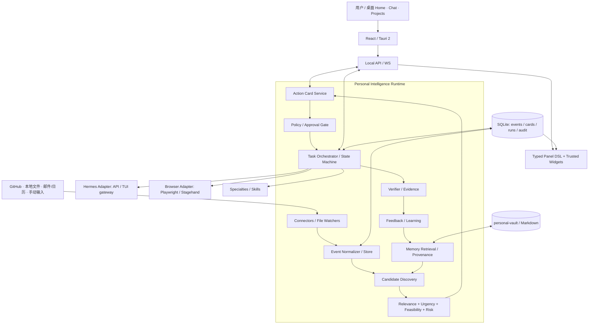

# Hark Pro 深度调研与本地个人智能体实施方案

> **结论**：Hark 不是一个“会说话的 Agent + 浏览器”。核心体验是 **个人上下文 → 主动发现需求 → 呈现可执行建议 → 经适当授权完成任务 → 验证并学习** 的闭环。建议以现有 Hermes Agent 和 personal-vault 为资产，单独建设「Personal Intelligence Runtime」，先打通 3 条高价值闭环，再做动态 Panel 和通用 Computer Use。

## 0. 调研边界与证据级别

- 对象是 **Hark Labs 的 Hark Pro（hark.com）**，不是 GitHub 上的同名开源语音助手、coding agent cockpit 或其他 Hark 产品。
- 调研时点：**2026-10-28**。依据官方介绍、帮助文档、安全/隐私说明、TechCrunch/Fast Company/Axios 以及所选开源项目公开文档；**没有获得 Hark 私有源码、内部训练架构或运营数据，也未对用户自己的 Hark 账号进行远程测试**。
- **[事实]** 官方明确提供 Home、Chat、Projects、Action Buttons、Panels、Specialties、Scheduled Tasks、Handoff、Memory，支持服务集成，云端浏览器操作；详细以官方资料为准。
- **[推断]** 下文事件模型、评分公式、内存分层、数据 Schema、权责划分是本地替代方案的设计，不代表 Hark 的内部实现。
- **[计划]** 所有开发期、质量门槛、性能值均为团队设计目标或估计，并不是实测结果。

## 1. 产品画像与核心机制

Hark 于 2026-10-06 广泛推出 Hark Pro，定位为“operating system for your life”。交互不是大量独立聊天窗口，而是单条持续对话搭配 Projects；Home 则承载可点击完成具体任务的 Action Buttons 与由自然语言构建的小型应用 Panels。Handoff 是有独立浏览器、文件系统和终端的云端 Computer Use 环境，可操作没有 API 的网站。官方还披露 Memory、Specialties 和 Scheduled Tasks。参见 [S1][S2][S3]。

### 1.1 六项产品能力

| 机制 | 用户可感知体验 | 隐含系统设计要求 | 本地复刻优先级 |
|---|---|---|---|
| Persistent Memory | 知道常用偏好、近期上下文和长期目标 | 来源可追溯、纠错、过期、选择性检索、遗忘 | P0 |
| Proactive Intelligence | 在用户提问前指出值得做的事 | 连续事件处理、候选发现、排序、去重、打扰预算 | P0 |
| Action Buttons | 一下就能完成“处理”，而不是仅获通知 | 动作合约、权限核查、审批和幂等状态机 | P0 |
| Handoff | 替用户真实操作网页、文件、软件 | 会话生命周期、浏览器操控、审计、失败恢复 | P1（先窄后广） |
| Personalized Panels | 用简洁小应用持续展示有用的数据 | 安全的视图 Schema、受控组件、数据源绑定 | P1 |
| Specialties | 把熟练的多步骤行为沉淀为可重用流程 | 成功轨迹挖掘、人工确认、版本化、回归 | P2 |

### 1.2 真正的“灵魂”

**(1) 从问答变成行动**：不是提醒“你有一件事”，而是提供“这里有一个可执行解法”。

**(2) 把认知成本前移**：系统负责发现需求、聚合上下文和准备任务，用户只作关键决策。

**(3) 不把技术概念暴露给用户**：Agent、工具、MCP、Tokens 都被折叠到“做什么”与“做得怎样”。

**(4) 正确地打扰**：相关性、时效性和可执行性缺一不可；优秀的主动性包含“选择保持沉默”。

**(5) 可观察和可信任**：能看见 Handoff 在做什么，风险操作需同意，最后要看执行凭证而非模型一句“搞定”。

**(6) 界面是任务入口**：Panels 是可交互的动态 UI；Action Cards 是随上下文出现的动作界面，而非静态待办事项。

### 1.3 观察到的限制，不宜照单全收

- Hark 声称的专用 Computer Use 模型与高基准得分不等于我们能在普通 API 模型上复现：训练数据、评测 Harness、设备环境都可能不同。[S3]
- Hark 官方说明 Handoff 运行在云端，而不是用户本机。我们的目标是 **本地优先版本**，二者的隔离与可用性前提不同。[S3]
- Axios 2026-10-20 报道促销买披萨场景出现多次执行失败，说明端到端可靠性、异常处理比演示更困难。[S6]
- 官方数据安全声明是供应商声明，不能简单等同于独立审计结论；本地运行也**不自动**意味着沙箱安全。密码和金融动作的权限边界仍要单独设计。[S4][S5]

## 2. 为什么不从零重新开发 Agent

已有技术资产：Hermes Agent、个人 `personal-vault`（Profile/Inbox/Journal/Knowledge/Areas/Decisions/Connections/Templates/Policies）、项目只读 `memory-vault`、Skills；另有 Context Runtime/PI 的观测与上下文治理研究。正确策略是**复用已有执行内核，增强其前置主动规划和后置验证**。

Hermes 公开文档支持多种可编程入口：`hermes -z` 一次性文本调用、ACP、TUI gateway JSON-RPC、HTTP/SSE API Server；也有 Cron、Hook、插件和 Skills。[S7][S8] 不宜一开始通过模仿 CLI 终端交互控制核心 Agent。

### 2.1 构建/采购边界

| 模块 | 处理方式 | 理由 |
|---|---|---|
| 模型推理、工具调度、现有 Skills | **复用 Hermes** | 已有身份、经验和生态，避免双份 Agent 内核 |
| 个人权威记忆 | **复用 personal-vault** | 避免独立副本冲突，继续人可读 Markdown |
| 事件监听、归一化 | **新建** | 需要统一外部来源和时间语义 |
| 主动需求生成、排序、抑制 | **新建核心研究模块** | 这是“像 Hark”的决定性能力 |
| Action Card/审批/回执 | **新建** | 可靠的行动闭环无法靠 prompt 补齐 |
| 浏览器操作 | **集成 Playwright 或 Stagehand** | 降低 CUA 自研复杂度 |
| Panel 生成 | **新建受控渲染器** | 需要交互与可信数据绑定，不能直接运行任意 AI JS |
| Context Runtime 观测 | **适配层、可选实验模式** | 留出实验价值但不阻塞主产品 |

## 3. 产品定位：Local-first Personal Intelligence Runtime

名称工作代号：**Hearth**（可修改），不是 Hark 商标衍生产品。

目标用户：先是自己；不以多用户 SaaS 为 V0.x 目标。首发 macOS，Windows 应保持代码兼容；跨设备同步和移动客户端推迟。

承诺：**用户可掌控、能解释为什么建议、能审查怎么行动、可证实真的完成**。

非目标：自训基础模型、初期全系统控制、从第一天自动买东西/转账、无上限常驻监听、抢先做精美 3D 天气背景、多 Agent 复杂网络、全面重做 Hermes 记忆系统。

## 4. 最小闭环与示例

### 4.1 第一批场景（首选 3 条）

**A：项目进展提醒 → 可执行下一步。**
- 输入：授权的 GitHub 仓库 PR/CI/Issue 数据、项目说明和本地研发计划。
- 发现：例如特定 PR 有未过的测试，或某里程碑超过约定时间没有更新。
- Card：『某 PR 的测试失败，已整理失败信息与修复范围。』按钮：`查看证据`、`交给 Hermes 诊断`、`稍后`。
- 动作：先只读诊断；创建 Issue/提交修复前再次确认。
- 验证：生成报告、附上来源链接、运行结果和任务 trace。

**B：个人研究计划 → 下一步行动。**
- 输入：个人 `Goals.md`、Decision、项目进度、明确输入的期限。
- 发现：研究事项临近承诺日期、连续多天受阻或上次会话留下明确下一步。
- Card：『你上次决定先验证 X，但 Y 还未跑完。』按钮：`生成实验清单`、`开始安全的只读检查`。
- 验证：产出可追溯工作清单/文件，不臆造最新进度。

**C：邮箱/日历辅助 → 草稿与审批。**
- 输入：用户明示授权的 Gmail/Calendar（或模拟数据）。
- 发现：有需要回复的邮件、时间冲突或会议准备事项。
- Card：『明天的会议与已确认安排冲突，给出 2 种调整建议。』按钮：`生成草稿`、`查看依据`。
- 操作：MVP 只能创建草稿，实际发送/改日程必须再次确认；证实远端接受了修改才标记成功。

### 4.2 禁止把 demo 当成完成

- 不能根据网页显示“已点击”就断言下单成功；成功必须来自明确的订单编号/服务端状态或同等证据。
- 不得未经许可将私人个人资料传给云端 LLM；需要来源分级和发送前脱敏策略。
- 卡片必须展示至少一个可理解的证据来源、发生时间、失效时间和执行风险。

## 5. 总体架构



**关键原则**：事件中心与 Agent 调用分离。静默事件扫描和规则筛选优先；仅通过初筛后才调用模型。所有外部副作用都通过 Policy Gate、Orchestrator 和 Verifier，不允许任意 Panel 或 LLM 输出直接执行。

## 6. 模块详细设计

### 6.1 Connector / Event Bus

统一事件 Schema：`event_id, source, source_ref, occurred_at, observed_at, type, entity_ids, project_id?, summary, payload_ref, sensitivity, dedupe_key, ttl, permissions`。

- V0.1：`personal-vault` 文件变更（watch + 定期重扫）、用户手动捕获、GitHub 已授权项目状态；真实邮件服务置于可选配置，先 mock。
- V0.2：邮件/日历 API read scopes、断连后自动失效、分页游标、速率与配额管理。
- V0.3：浏览器操作事件、Hermes 任务完成事件、通知渠道。
- 文件变更不能立刻变成事实；先解析与差异校验，优先将用户明确确认的 Decision 作为权威。

### 6.2 Memory / Context

三层，而非单一向量库：

1. **Canonical**：`personal-vault` 中用户审核的长期资料、目标与决策（权威内容）。
2. **Episodic**：近期事件、工具结果和 task outcomes（SQLite，带原始链接、时间戳与保留期）。
3. **Derived**：Agent 推断的偏好或新事实，以 `candidate` 状态保存，确认后才晋级到 canonical。

检索先按项目、时间、权限过滤，再做 FTS5 / 可选 sqlite-vec 相似度检索，再根据来源可信度与时效性重排；输出必须带 `source_ref`。针对敏感来源默认不发往云端，允许配置本地模型或禁用该来源参与推理。

记忆的 `forget` 必须覆盖 canonical、SQLite 索引、向量、缓存和导出副本的本地可控范围；第三方系统日志和已发送远程提供商数据需明确告知并依各自规则处理，不能承诺全网删除。

### 6.3 Proactive Discovery：最值得研究的模块

**候选生成两阶段**：
- **低成本阶段**：硬规则和事件窗口。如 PR 失败、截止前 N 小时、明确项目阻塞、日程重叠、邮件待复核等。
- **高成本阶段**：在裁剪后的工作集上由 LLM 判断“这个发现是否确实能帮助用户”，输出结构化 Candidate，禁止伪造不存在的需求。

输出 Candidate：`candidate_id, problem, opportunity, evidence[], suggested_action, why_now, valid_until, project_id, expected_benefit, estimated_effort, risk, uncertainty`。

建议的 **启发式打分**（非 Hark 算法）：

`score = 0.30*relevance + 0.25*urgency + 0.20*actionability + 0.15*benefit + 0.10*confidence - 0.25*intrusion - 0.20*risk`

每项输入归一化 [0,1]；权重只作为起点，依据反馈校准。风险不应只靠扣分：超过权限阈值的候选**直接禁止执行**，不能通过高收益分抵消。

**主动性不等于每隔 5 分钟调用模型**：事件触发 + 例行批次（例如每天 2～4 次候选评估）、用户自定义安静时段、同主题 cooldown、每日展示预算（建议初期 3 张/天）、dismiss 后抑制、近似候选合并。

### 6.4 Action Card / Human-in-the-loop

建议状态机：

`detected → proposed → ready → awaiting_approval → executing → verifying → completed`

替代分支：`dismissed | snoozed | expired | blocked | failed | cancelled`。

Card 必填：`title, why_now, evidence[], action_spec, expected_outcome, permissions, required_approval, risk_level, expires_at, idempotency_key`。

每次点击并非把自然语言直接发给 Agent：必须转成经 Zod 验证的 **ActionSpec**，包含输入、允许工具、目标资源、最大步数、预算/最大运行时间、preconditions、verification_plan、rollback_plan（若支持）。

审批粒度：
- L0 只读、本地搜索/总结：预授权范围内可自动执行。
- L1 生成草稿/本地受控文件：默认可执行，覆盖原文件需确认。
- L2 发消息/发布 PR/改日历/批量文件改动：每个具体目标需显式批准。
- L3 支付/购买/金融交易/账户安全设置/删库：V0.x 默认禁用；将来独立授权和二次确认。

审批必须绑定 **规范化参数哈希 + 目标 + 期限 + 风险**，用户点击“批准给 A 发邮件”不能被 Agent 偷换成 B。外部事件源和网页文本均视为不可信指令；prompt injection 不能绕开 Gate。

### 6.5 Handoff / Computer Use

本地三层能力优先级：**有稳定 API → Playwright 确定性步骤 → Agentic browser fallback**。

- Playwright 处理已知站点、重复操作、明确 DOM 选择与可观察断言。
- Stagehand 的 `act / observe / extract` 可用于变化较多的站点；Browser Use Python 是可替换的实验后端。[S9][S10]
- 独立 browser context/profile、独立下载目录、允许域名列表、录制轨迹与 screenshots；不要直接借用日常 Chrome 个人 profile。
- BrowserContext 隔离 cookies 等**不是 OS 级安全沙箱**；本地浏览器仍可能读写被授权的文件及网络。默认对网页下载/上传、终端、跨站登录和支付增加授权门槛。[S11]
- 本机运行不强依赖 Docker；后续更强隔离可以选择受限本机账号、OS 原生沙箱或远端微型 VM，按威胁模型评估。

### 6.6 Panels（动态微应用）

**V0.1 不允许 LLM 返回可执行 JS/HTML 代码直接渲染在高权限桌面 UI**。只生成强类型 JSON PanelSpec：

`panel_type, data_source, query_spec, refresh_policy, layout, components[], allowed_actions[]`。

组件白名单先支持 `Metric / List / Timeline / Table / MiniChart / ActivityFeed / Button / Status`；每个组件需要数据源权限、空态、错误态和加载态。用户自然语言修改面板 → LLM 产出 schema diff → 校验/预览 → 确认保存。未来才研究隔离的代码生成式 mini-app。

### 6.7 Specialties / 可沉淀技能

与用户已有 Skills 研究高度契合，但不要对所有任务自动总结 Skill：

- 至少有 **2～3 次成功、语义接近且步骤稳定** 的操作轨迹才触发候选工作流（阈值为实验假设）。
- 生成 `SpecialtyDraft`：触发条件、参数、权限、步骤、不可变前提、失败边界、回归样例、引用的成功 trace。
- 用户审阅→保存为 versioned skill/workflow，保持人可读，允许回滚；变更网页结构后跑小回归。
- 不要学习或保存密码、一次性验证码、隐私网页中的操作敏感数据。

## 7. 具体技术选型

| 层 | V0.1 首选 | 替代与注意点 |
|---|---|---|
| 前端 UI | React 19 + TypeScript + Tailwind / shadcn/ui | 贴合已有前端经验；优先做浏览器本地版 |
| 桌面封装 | Tauri 2（V0.2 集成） | macOS/Windows；需 Rust 工具链与平台构建环境；权限能力单独配置 [S12] |
| 本地服务 | Node.js TypeScript + Fastify（或 Hono） | 保留后续切换 Rust 后端的可能；只监听 loopback |
| Schema | Zod（统一合同） | 前后端共享类型、run-time validation |
| DB | SQLite + FTS5 | WAL + migration + backup；早期无需 Redis/Postgres [S13] |
| 向量检索 | sqlite-vec（后置） | 初期关键词/元数据足够，embedding 不是必选 [S14] |
| 文件记忆 | Obsidian Markdown | 通过 path 白名单、source_ref 与校验 hash 绑定 |
| Agent 执行 | Hermes Gateway/TUI JSON-RPC 或 API server | 先实现一个 Adapter，避免重复记忆和冲突 [S7][S8] |
| 调度 | 轻量 scheduler + persisted jobs | 可桥接 Hermes Cron；需要去重与重启恢复 |
| 浏览器 | Playwright，探索型加 Stagehand | M0 先不自动下单；记录截图和结果断言 |
| Secrets | macOS Keychain / Windows Credential Manager | 不把令牌/密码写在 MD 或明文 SQLite |
| 遥测 | 本地 structured log + action trace | 默认关闭远端遥测，P0 打通审计 |
| 集成协议 | connector interface；可选 MCP/ACP | MCP 管工具，不自动解决授权/主动推荐/验证 |

**为什么不强推 LangGraph？** 编排图在固定多阶段任务中有价值，但 Hermes 已有执行内核；引入第二层通用 Agent DAG 可能造成职责重复。除非实际复杂度证明必要，先采用明确状态机加 Adapter。PI 可作为第二执行后端或实验对照，不作为唯一生产执行器。

## 8. 建议目录与数据模型

```text
hearth/
  apps/
    desktop/              # Tauri + React，V0.2
    web/                  # 早期 localhost UI，V0.1
  packages/
    contracts/            # Zod schemas + events + action state machine
    core/                 # discovery/ranking/card/orchestration/policy
    connectors/           # filesystem/github/email/calendar adapters
    memory/               # vault bridge + episodic store + search
    agent-adapters/       # hermes; future pi
    browser-runtime/      # playwright + optional stagehand
    panels/               # PanelSpec schemas and renderer
    evaluation/           # fixtures, replay, graders
    storage/              # sqlite migrations and repositories
  docs/
    00-research.md
    01-product-contract.md
    02-architecture.md
    03-threat-model.md
    04-benchmark.md
    05-privacy-data-flow.md
    adr/
  tests/
    contract/
    integration/
    e2e/
    adversarial/
```

关键表：`events`, `sources`, `memories_index`, `memory_candidates`, `proactive_candidates`, `action_cards`, `approval_grants`, `task_runs`, `task_steps`, `execution_evidence`, `panel_specs`, `feedback`, `specialty_drafts`, `audit_log`, `scheduler_jobs`。

最小 ActionSpec 示意（合同设计，不等于可直接执行的实现）：

```json
{
  "type": "research.repo.diagnose",
  "target": { "repo": "EchoTouch-moon/agent-internet-lab", "pr": 3 },
  "allowed_tools": ["github.read", "local.read"],
  "risk": "L0",
  "requires_approval": false,
  "preconditions": ["repo_access_authorized"],
  "verification": { "kind": "artifact_exists", "path": "reports/diagnosis.md" },
  "max_steps": 15,
  "timeout_seconds": 180,
  "idempotency_key": "sha256:..."
}
```

任务状态迁移应由 application service 管控，不允许 Agent 自由填写 `completed=true`。关键出站动作采用 request id / idempotency key 防重试重复副作用；不支持幂等的第三方页面，失败重试前必须读回核查。

## 9. 开发阶段、交付与 Gate

时间是 **1 位开发者借助 Coding Agent 的粗略估算**，不代表已经完成或一定能达成。采用 M0 → M1 → M2 → M3 → M4，每一阶段单独交付可运行增量，不跳 Gate。

### M0 — Research Contract & Baseline（约 2～4 天）

交付：边界、威胁模型、需求说明、3 个真实场景的匿名化 fixtures、Event/ActionCard/ActionSpec/PanelSpec Zod Schema、状态机、Source ACL、2 份 ADR（Hermes first; local-first），CI 基线。

Gate：所有 Schema 有正反例；同一 action id 不能重复造成副作用；风险动作无法跳过审批；禁止随机示例事实进入真实记忆。

### M1 — Closed-loop MVP（约 1～2 周）

交付：本地 UI（Home/Chat 骨架）、personal-vault 只读连接、一个 mock Connector、SQLite 事件与 Card 服务、规则化发现与去重、Hermes Adapter、只读 Action 执行、回执展示。

**演示必须端到端**：修改授权 Markdown 项目计划 → 产生候选 → Home 显示 Card → 点“生成实验清单” → Hermes 输出受控文件 → Verifier 确认 → Card 完成。

Gate：10 次固定 replay 没有重复执行；重启后状态恢复；授权范围外文件不可读取；卡片有来源/时间与“为什么现在”。

### M2 — Proactive & Real Connectors（约 1～2 周）

交付：GitHub 只读真实连接、LLM 候选审查器、静默时段/频率预算、反馈学习、真实执行错误态、项目空间；邮件日历先只读择一接入。

Gate：针对 50 条合成/脱敏事件集评估 precision@3 ≥ 0.75、无越权候选执行、重复推荐率 ≤ 10%、每卡的来源可验证；阈值是设计目标而非已有实测。

### M3 — Local Handoff & Trust（约 1～2 周）

交付：Playwright 受控浏览器 profile、固定网站的只读交互，审批暂停/继续/取消、执行轨迹与截图、重试读回核查、签名批准的操作合同、提示注入测试。Tauri 桌面封装可在本阶段实现。

Gate：20 条网页工作流样例端到端验证 ≥ 80%，绝不自动支付/对外发送；每次运行可看到各 step、授权与证据。

### M4 — Panels & Skill Learning（约 1～2 周）

交付：PanelSpec + 组件白名单、语言化改 Panel、刷新调度、3 个 Panel 模板、SpecialtyDraft、候选回归、Windows 兼容构建探索。

Gate：恶意 panel 参数不能运行脚本/读取任意文件；每个 Panel 可解释来源和刷新状态；重复成功轨迹可提出但不能擅自安装 Skills。

**总体建议**：先争取 4～8 周获得稳定的个人 V0.3；不是对第三方 Hark 全功能的等价复刻。

## 10. 验收矩阵与实验策略

### 10.1 功能验收

| ID | 验收项 | 通过条件 |
|---|---|---|
| F01 | 候选从真实事件而来 | Card 有有效 `source_ref`、事件时间和授权来源 |
| F02 | 记忆引用可信 | 对过期/冲突信息标明不确定，不把推测写成确认事实 |
| F03 | 点击有结果 | action 状态流可追溯，结果能独立验证 |
| F04 | 控制打扰 | 相同问题重复事件不会刷屏；dismiss 使相关候选冷却 |
| F05 | 错误恢复 | 超时/断网/重启后不重复外部动作 |
| F06 | 人工批准 | 无批准绝不执行 L2/L3，批准绑定目标和参数 |
| F07 | UI 可用 | Home/Chat/Projects 可浏览；Panel 不执行非白名单代码 |
| F08 | 删除与断连 | 撤销连接后停止摄取、后续检索遵守选择性删除策略 |

### 10.2 对照实验（突出研究价值）

实验 A：「普通聊天型 Agent」vs「加 Memory」vs「Memory + Proactive」vs「闭环含 Handoff」。固定 30～50 条任务，按用户体验而非模型炫技评价。

指标：**有用卡片准确率 Precision@K、真正被接受的比例、任务最终成功率、主动误报、重复率、平均人类点击数、总处理时长、单次有效完成的 token/成本、权限违规次数（必须 0）**。

实验 B：规则候选与 LLM 候选的增益，观察基线 precision、补全率和成本；不假设 LLM 一定更好。

实验 C：确定性 API/Playwright vs Agentic browser 在固定场景的可靠性；记录阶段失败原因、可复现 trace。

实验 D：是否连接 Context Runtime：对比有/无 working-set/provenance 裁剪时，token 占用、记忆来源正确率、跨项目泄漏率。

### 10.3 Prompt Injection/Threat Model 最低测试

- 恶意网页文本：诱导 Agent 忽略审批、访问本地私密路径；应拒绝。
- 恶意仓库 README：让 Agent 向外站发密钥；应拒绝。
- 跳变的审批参数：批准目标 A，执行变目标 B；应阻断。
- 失效候选：来源已变化但卡片未刷新；须回读前置条件。
- 网络错误：外部服务已处理但未返回确认；不盲目重复。
- 模型生成恶意 PanelSpec：试图携带脚本、任意 URL/动作；schema 与 renderer 必须拒绝。
- 跨项目上下文：保密 Project B 的记忆不能在 Project A 的卡片中出现。

## 11. UI 规划与交互规范

三主视图直接借鉴产品信息架构，但做自己的设计：

**Home**：顶部一句简短当下摘要；优先展示最多 3 张 Action Card；下方 2～4 个 Panels（研究进度、最近任务、今日计划、Agent 运行）。

**Chat**：单条持续对话（或可选择 Project 隔离），每个 Handoff 在消息流内嵌小型实时进度组件；失败可见且有恢复按钮。

**Projects**：左边轻量项目索引，右边聚合项目上下文、相关 Actions、历史运行证据；没有强制每个任务开新对话。

**设计语言**：轻量、信息优先、苹果式简洁但不盲目复刻；微动画 150～250ms 优先 reduced-motion，避免把复杂图形背景列为 MVP 核心投入。

## 12. 风险与决策建议

1. **主要产品风险：高频无效打扰。** 先做“不出现垃圾建议”，再追求覆盖率。
2. **主要工程风险：操作成功幻觉。** 工具输出只是线索，需要外部状态验证，未确认就标 `unknown/pending_verification`。
3. **主要安全风险：越权和提示注入。** 授权由代码与安全策略执法，不能只在 system prompt 写“不要”。
4. **本机隔离风险：** Playwright profile 隔离不能替代受限 OS 进程和文件/网络边界。无 Docker 并不意味着“全权限直接运行”。
5. **记忆污染风险：** 长期记忆应区分用户确认/工具观察/模型推断三种可信等级。
6. **维护成本：** 不要从第一天覆盖“所有网站”；先重点覆盖高频、可验证、API 优先的 3 个场景。
7. **项目范围风险：** 当前多项 Agent 研究在并行，应将 Hark 项目当成独立产品实验；`memory-vault` 只读、`personal-vault` 独立，避免冲突写入。

## 13. 可以直接交给 Coding Agent 的第一阶段实施任务

> 在一个**新仓库**实施 M0，不要直接修改现有 Hermes 或 personal-vault。环境 macOS 优先 / Windows 兼容，不使用 Docker。
>
> 目标：完成一个本地优先 Personal Intelligence Runtime 的合同层与测试门槛。先审计工具链和接入能力，选定 Hermes 的一种正式程序化入口；不要创建第二套 Agent 内核。建立 pnpm workspace + TypeScript strict + Zod + Vitest + SQLite migration（可选先 stub）。交付事件、候选、卡片、ActionSpec、审批授权、TaskRun 和审计 Schema/状态机，建立 3 个脱敏可复放场景、威胁模型和基线实验，形成 docs 下 PRD、Architecture、ADRs、Benchmark、Data Flow；执行合同测试与敌对输入测试后给出 Gate 报告。
>
> **禁止**：在线支付、真实对外发信、删除文件、连接个人敏感账号、修改 personal-vault 原文件、无审批浏览器动作。先只实现 mock Connector、mock Executor，后续 M1 再连 Hermes 与真实数据。任何未验证信息不能写成实际测试结果。提交交接文档与可执行命令。

## 14. 尚需在动工前做的真实验证

- 检查本机 Hermes 版本是否具备文档中的 API/TUI gateway 与具体审批事件协议；若 API 只支持回答，不提供执行步骤流，考虑 gateway/Hook 组合。
- 对现有 `personal-vault` 样例文件做权限审计，确定哪些区域可以读取、哪些需要独立用户同意。
- 测试浏览器上下文和 macOS Keychain 访问边界、Windows sidecar 兼容，确认完全不依赖 Docker。
- 获取用户的 5～10 个 Hark 真正打动他的真实交互记录，对“主动发现”“最少点击”做本地真实场景对标，而不是只照官方宣传开发。

## 15. 参考资料（2026-10-28 检索）

- [S1] Hark 官方产品介绍 https://hark.com/articles/introducing-hark-pro
- [S2] Hark 官方帮助 / 功能列表 https://hark.com/using-hark
- [S3] Hark Handoff 技术介绍 https://hark.com/articles/introducing-hark-handoff
- [S4] Hark Security https://hark.com/security
- [S5] Hark Privacy Policy（2026-10-01）https://hark.com/privacy-policy
- [S6] Axios（2026-10-20）：Hark pizza promotion 执行可靠性问题 https://www.axios.com/2026/10/20/hark-ai-agent-startup-free-pizza-doordash
- [S7] Hermes Programmatic Integration https://hermes-agent.nousresearch.com/docs/developer-guide/programmatic-integration
- [S8] Hermes CLI Commands https://hermes-agent.nousresearch.com/docs/reference/cli-commands
- [S9] Browser Use repo https://github.com/browser-use/browser-use
- [S10] Stagehand repo/docs https://github.com/browserbase/stagehand
- [S11] Playwright Isolation https://playwright.dev/docs/browser-contexts
- [S12] Tauri v2 Capabilities https://tauri.app/security/capabilities/
- [S13] SQLite FTS5 https://www.sqlite.org/fts5.html
- [S14] sqlite-vec https://github.com/asg017/sqlite-vec
- [S15] Fast Company（2026-10-06）https://www.fastcompany.com/91618831/how-hark-designed-an-ai-assistant-thats-actually-helpful
- [S16] TechCrunch（2026-10-06）https://techcrunch.com/2026/10/06/hark-releases-an-ai-personal-assistant-with-a-focus-on-privacy/

---

**最终路线**：**Hermes 负责执行，Personal Intelligence Runtime 负责感知、主动发现、优先级、授权和验收，personal-vault 保存用户可控的长期知识。** 用三条真实任务闭环验证产品价值，再依次扩展 Handoff、Panels、Specialties。这比只做“另一个会聊天的 Agent”更接近 Hark 的核心价值，也更适合逐步沉淀研究成果。
