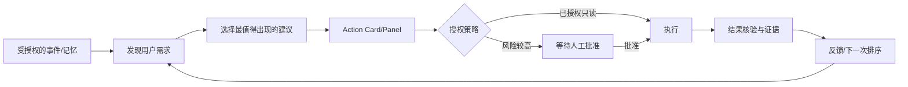

# 00｜研究依据、产品灵魂、验证范围

> 本章以官方公开页面与可查阅的工具文档为外部依据；《RESEARCH-BASELINE.md》为前一轮完整调研。绝不能把推断说成官方实现。

## 2026-10-28 核验事实

1. **产品**：Hark Pro 的核心主视图 Home/Chat/Projects；Home 包含 Action Buttons 与 Panels；Chat 承载 Handoff；长期 Project 作为主题线程。官方页面：https://hark.com/using-hark
2. **核心组合**：官方将 memory、proactive thinking、Handoff computer-use 三者结合描述为个人智能；行动建议强调合适时机与降低人类操作。官方发布：https://hark.com/articles/introducing-hark-pro
3. **Handoff**：官方描述为每个请求启动独立云端虚拟计算机（浏览器/文件/终端），**不是在用户本机执行**；本地仿作的隔离强度不可虚假等价。https://hark.com/articles/introducing-hark-handoff
4. **Specialties & Scheduled Tasks**：分别对应重复多步工作流与自然语言定时执行。https://hark.com/using-hark
5. **安全**：Hark 官方公开声明对凭证、可观看执行、权限等的产品原则；属公司披露，不等于我们得到其内部审计结果。https://hark.com/security
6. **工程适配**：Hermes 公开列有 HTTP API Server、ACP、TUI Gateway，可按需要选择不同粒度的适配；以用户机器能力探测结果为准。https://hermes-agent.nousresearch.com/docs/developer-guide/programmatic-integration
7. **浏览器隔离**：Playwright BrowserContext 实现 cookie/storage/session 级隔离，不代表 OS 级沙箱。https://playwright.dev/docs/browser-contexts
8. **桌面权限**：Tauri v2 通过 capabilities 限制各 webview/window 的允许行为；真实安全还取决于后端策略。https://tauri.app/security/capabilities/
9. **Stagehand**：是可能的 browser action/extraction SDK，留作 M3 adapter，不应在 M1 引入复杂度。https://github.com/browserbase/stagehand

## 核心体验模型（架构推断、非 Hark 内部架构）

## 需要复刻的“灵魂”
- **主动但不过度打扰**：有价值时出现、没价值时沉默；要有去重、冷却、每日预算和静默时段。
- **行动闭环**：卡片不能只告诉你有事，更要带可信上下文、可操作解决方案和结果证明。
- **记忆有边界**：清楚当前事实来自哪里、何时获知、是否过期、用户可纠正。
- **低认知负担**：Home 是“下一步行动面板”，不是堆满 agent 技术指标的控制台。
- **透明授权**：读、写、发送、支付分级；执行链路与失败理由都可见。

## 明确不复刻的部分
不复制 Hark 品牌、UI 资产、源代码、宣传性性能指标、账号凭据系统或云端虚拟机集群；不用用户 Hark 登录数据作为爬取素材。视觉做原创 Minimal Premium，保留信息架构思路。

## 证据边界 / 产品不确定性
- 我们没有 Hark 私有实现、模型训练细节、API、用户账户内部数据或用户实际截图。
- 一晚的目标是**可交互垂直切片**，不可能证明对等 Hark 全产品。
- 如遇网上文档版本差异，以**安装在本机的工具帮助和 capabilities 探测结果**为准，记录 ADR。
