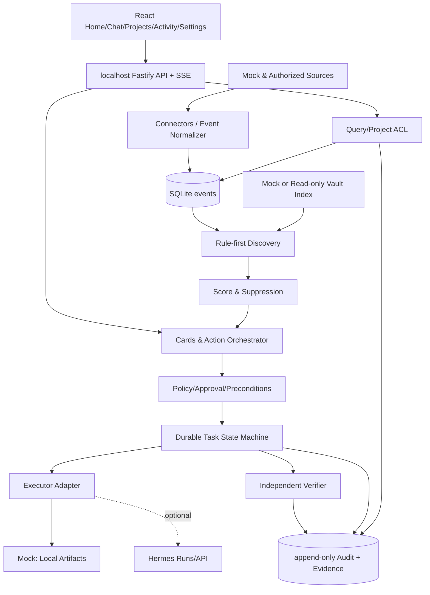

# 03｜系统架构与工程边界

## 目标架构


## 单机运行拓扑
- `apps/web`: Vite + React，localhost UI；仅 UI，不直接读文件/DB/密钥。
- `apps/server`: Fastify + Zod 校验，默认 bind `127.0.0.1:4317`；HTTP + SSE 推送 TaskRuns，检测 Origin、会话 token / CSRF；**loopback 并不能免除跨站请求伪造风险**。
- `packages/contracts`: Zod DTO、枚举、状态转换表（单一事实来源）。
- `packages/core`: Discovery/Ranking/Card/Policy/Run orchestrator/Verifier；所有规则可脱离 HTTP 测试。
- `packages/storage`: SQLite WAL, migration, repo, audit。`data/dev.sqlite` 在 `.gitignore`。
- `packages/connectors`: `FixtureConnector`, `VaultReadOnlyConnector`（只预留接口）、`GitHubReadOnlyConnector`（M2）；必须声明 scopes。
- `packages/agent-adapters`: `MockAgentAdapter`（P0），`HermesApiAdapter`（P1）及能力协商；禁止 UI 直接转发任意工具调用。
- `packages/panels`: 第一夜内置只读 UI cards，不接受可执行 JS；M4 才开放 LLM-generated PanelSpec。
- `packages/eval`: replay, scoring, trace evidence。

## 推荐 repo 结构（由 Agent 创建）
```
hearth/
  apps/web/src/{app,pages,components,features,styles}/
  apps/server/src/{http,controllers,sse,config}/
  packages/contracts/src/
  packages/core/src/{discovery,policy,orchestration,verify}/
  packages/storage/src/{migrations,repositories}/
  packages/connectors/src/
  packages/agent-adapters/src/
  packages/eval/src/
  fixtures/
  docs/ ...
  handoff/EVIDENCE/
  scripts/
  pnpm-workspace.yaml
  package.json
  tsconfig.base.json
  AGENTS.md
```

## 数据流
1. 事件入站必须附 `source_ref`, `occurred_at`, `observed_at`, `sensitivity`；服务端持久化 `dedupe_key` 唯一键。
2. Candidate 由纯规则生成，可插拔 LLM 评判；LLM 不生成直接执行令牌。
3. Card 含固定 `ActionSpec` 参数；执行前从 DB 重读 Card 和 Source 新鲜度，按用户角色/风险/allowlist 审核。
4. `run`、`step`、`evidence` 分事务记录。外部动作完成、Verifier 校验成功，才可 `completed`；确认未知用 `pending_verification`。
5. UI 只消费经过 server 过滤的投影；Run 是状态权威，浏览器不能直接写 `completed`。

## 错误与恢复
- 唯一键保证相同事件/动作默认不重复创建；UI double-click 两次返回同一 run 或 `409 already_running`。
- 持久化队列启动时 `executing` 未完成：Mock L0 本地幂等动作可以回读核查后恢复；非幂等远端动作必须置 `pending_verification` 不盲目重放。
- SSE 掉线→客户端 GET 最新状态 + `Last-Event-ID`（如实现），否则 polling fallback；需测试刷新一致。
- sqlite busy_timeout, migrations 在单进程 leader 下执行；锁/事务边界明确。
- 延迟、失败、缺来源都可在 UI 有可见错误状态，不能无限 loading。

## 边界与不合理实现
- **不要**把 Agent 框架重写为第二套工具系统；优先 adapter。
- **不要**用浏览器 LocalStorage 做权威的审批/任务结果；后端必须核验。
- **不要**将个人原始 Markdown 内容作为 LLM prompt 的“system instructions”。
- **不要**做 direct OS mouse/keyboard 权限；本次只模拟/localhost。

## 性能/成本原则
P0 无需 LLM 调用也能展示核心闭环；每轮规则发现尽量无模型成本。未来 LLM candidate审查实行批量处理、token budget、来源裁剪与缓存，同一事件不可重复无限推理。
