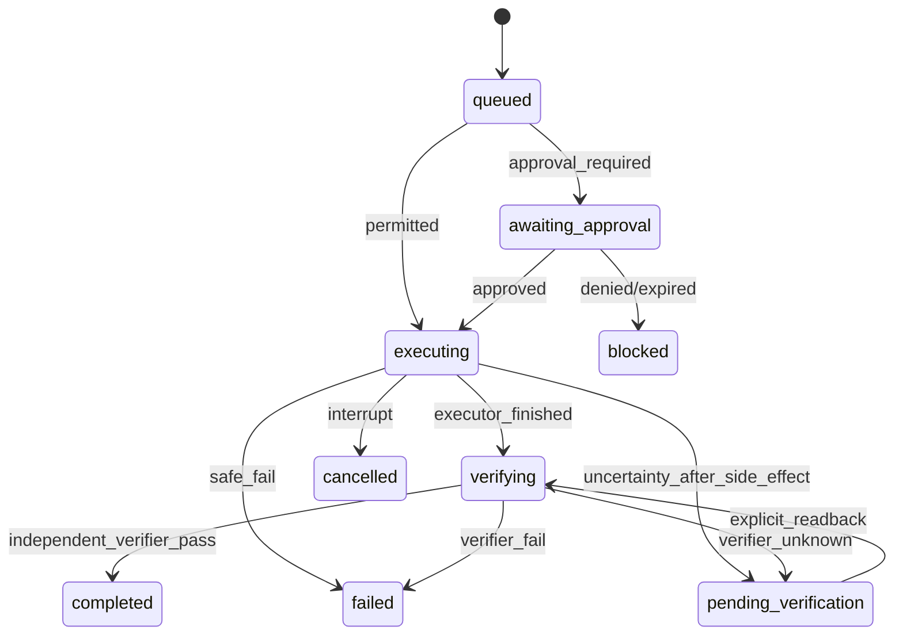

# 04｜数据合同与 API（实现必须遵守）

> 所有 JSON 输入使用 Zod `.strict()`（或显式剔除未知字段），类型兼容 JSON serialization；在 server boundary、connector boundary、Model-output boundary 各验证一次。这里是**规范**，具体代码由 Agent 实现并附 tests。

## 规范类型 / 字段

```ts
type Risk = 'L0' | 'L1' | 'L2' | 'L3';
type Sensitivity = 'public' | 'personal' | 'restricted';
type Provenance = 'user_confirmed' | 'tool_observed' | 'model_inferred';
type SourceRef = { sourceType: 'fixture'|'vault'|'github'|'calendar'|'mail'; uri: string; sourceId: string; observedAt: string; contentHash?: string };

type Event = {
 id: string; type: string; projectId: string; source: SourceRef;
 occurredAt: string; observedAt: string; expiresAt?: string;
 summary: string; dedupeKey: string; sensitivity: Sensitivity;
 provenance: Provenance; payloadRef?: string; tags: string[];
};

type Candidate = {
 id: string; projectId: string; eventIds: string[]; title: string;
 whyNow: string; evidence: SourceRef[]; suggestedAction: ActionSpec;
 score: number; confidence: number; risk: Risk; expiresAt: string;
 suppressionKey: string; status: 'candidate'|'suppressed'|'proposed';
};

type ActionSpec = {
 id: string; actionType: 'report.generate'|'checklist.generate'|'draft.generate'|'repo.read_diagnose';
 projectId: string; target: { resourceId: string; path?: string };
 params: Record<string, unknown>; allowedCapabilities: string[];
 risk: Risk; effect: 'read'|'local_create'|'external_write';
 maxSteps: number; timeoutMs: number; maxCostUsd: number;
 idempotencyKey: string; expectedSourceVersion?: string;
 verification: { kind: 'artifact_sha256'|'json_schema'|'remote_readback'; artifactPath?: string; expectedHash?: string };
};

type ActionCard = {
 id: string; candidateId: string; projectId: string; title: string;
 whyNow: string; evidence: SourceRef[]; action: ActionSpec;
 createdAt: string; expiresAt: string; status: 'proposed'|'dismissed'|'snoozed'|'expired'|'ready'|'awaiting_approval'|'executing'|'verifying'|'completed'|'failed'|'blocked';
 snoozedUntil?: string; userFeedback?: 'useful'|'not_useful'|'irrelevant';
};

type ApprovalGrant = {
 id: string; principalId: string; cardId: string; actionDigest: string;
 targetDigest: string; risk: Risk; authorizedCapabilities: string[];
 expiresAt: string; grantedAt: string; consumedAt?: string;
};

type TaskRun = {
 id: string; cardId: string; actionId: string; idempotencyKey: string;
 state: 'queued'|'awaiting_approval'|'executing'|'verifying'|'completed'|'pending_verification'|'failed'|'blocked'|'cancelled';
 createdAt: string; startedAt?: string; endedAt?: string;
 resultArtifactRefs: string[]; verificationVerdict?: 'pass'|'fail'|'unknown';
 failureClass?: 'timeout'|'policy'|'dependency'|'executor'|'verification'|'unknown';
};

type PanelSpec = {
 id: string; kind: 'metric'|'list'|'timeline'|'activity'; projectId?: string;
 dataQueryId: string; refreshSeconds: number;
 components: Array<{ type: 'text'|'metric'|'list'|'status'|'link'; field: string; label?: string }>;
};
```

### 不可变原则
- `Event.source` 与 `Evidence.sourceRef` 是不可丢失的来源链；`whyNow` 必须可解释，不能只有空洞判断。
- `idempotencyKey` 稳定绑定 `(actionType, projectId, canonical target, params normalized, sourceVersion)`；同一 key 在 DB 存有唯一结果。
- `maxSteps/timeoutMs/maxCostUsd` 都是上限，executor 自报次数并由 orchestrator 计数；默认 maxCostUsd=0（无真实模型费用）。
- artifact path 必须 normalize + realpath 后证实落在专用 `./.hearth-demo-artifacts` 根下；禁止 `../` 与符号链接越界。
- Event 有 TTL 和 `observedAt`；执行前重新读取并校验 source version 或明确降级 `blocked/stale`。
- UI 无权提交风险等级或修改批准状态；服务器对 actionType 使用静态动作注册表推导风险下限和效果类型。

## 幂等审批参数规范
1. 使用规范化 JSON（键排序、稳定值编码）得到 action canonical representation。
2. `sha256` 计算 actionDigest，目标 digest 单独计算；ApprovalGrant 同时绑定 principal/card/action/target/risk/expiry。
3. UI 可发起批准请求，但审批由 server 写入且必须再次展示**具体动作信息**；不能仅靠 token 或 Card ID 宣布所有相似动作批准。
4. 每次真正执行前再次校验 grant、source_version、scope、target digest、expiry、consumedAt；一次性 grant 先预留占用，外部失败不简单复用。
5. `L3` 无论是否有 grant 都拒绝；`L2` 需用户在线明确确认，夜间无人值守保持待审批。

## 状态机（核心不变量）


**严禁**：`queued→completed`、`executing→completed`、`pending_verification→executing`（在有潜在外部副作用时）、`blocked→completed`。状态转换在 DB transaction 内原子执行；前端客户端无法直接更新。

## API 合同 (localhost /api/v1)
| Method | Path | 作用 | 特别约束 |
|---|---|---|---|
| GET | `/health` | DB、provider、demo mode 状态 | 不返回密钥 |
| GET | `/projects` | 仅授权项目 | server ACL |
| GET | `/projects/:id` | 项目快照 | server ACL |
| GET | `/events?projectId=&limit=` | 事件投影 | default limit 30，上限 100 |
| POST | `/demo/seed` | 初始化合成数据 | 只允许 DEMO_MODE，保护既有实际数据 |
| POST | `/discover` | 触发一次规则扫描 | 同源幂等、频控 |
| GET | `/cards?status=&projectId=` | 分页 Card | 权限和时效过滤 |
| GET | `/cards/:id` | Card 和 Evidence | 不显示 restricted payload |
| POST | `/cards/:id/dismiss` | 忽略 | 记录反馈、抑制 |
| POST | `/cards/:id/snooze` | 稍后提醒 | 合法时间窗 |
| POST | `/cards/:id/execute` | 创建或查询 Run | 策略在后端；幂等/审批 |
| POST | `/approvals/:runId` | 明确同意/拒绝 | 仅 L2，需要参数哈希及有效期 |
| GET | `/runs` | 列表 | 限授权 scope |
| GET | `/runs/:id` | 详细执行步骤/验证证据 | no secrets |
| GET | `/runs/:id/stream` | SSE 任务进度 | 重连时 GET 快照 |
| POST | `/runs/:id/cancel` | 取消/停止 | 允许已完成返回 terminal state |
| GET/PUT | `/settings` | budget/quiet-hours | Zod 验证 |
| POST | `/chat` | mock/适配 Hermes 回复 | SSE 可延后；声明真实模式 |

**注**：每个写操作从本地 UI 发起也必须校验 session/origin/CSRF 与 scope；不能仅因 127.0.0.1 就省略认证。首晚可用 server 生成随机 ephemeral bearer+cookie 验证方案，但禁止把 bearer 编入前端构建静态资产；最低要求固定 allow-Origin + JSON-only + CSRF 防护并在风险评审中记录限制。

## DB migration 最小集合
`projects(id,name,description)`, `sources(id,scope,type,enabled)`, `events(id,dedupe_key UNIQUE,...)`, `candidates(id,suppression_key,status,...)`, `cards(id,candidate_id,status,...)`, `runs(id,idempotency_key UNIQUE,state,...)`, `run_steps(run_id,sequence,status,...)`, `evidence(id,run_id,source_ref,sha256,...)`, `approvals(id,principal_id,action_digest,...)`, `settings(key,value)`, `feedback(...)`, `audit_log(id,at,event_type,actor,object_id,sanitized_details_json)`。
必须明确 `foreign_keys=ON`、WAL 与 busy_timeout、迁移表唯一版本；DB 退出后重新启动需可读写。

## 版本化
`contractVersion: "1"` 启用显式版本；破坏性变更必须改版本并写 migration/compat 测试。Demo fixtures 跟随同一合同验证。
