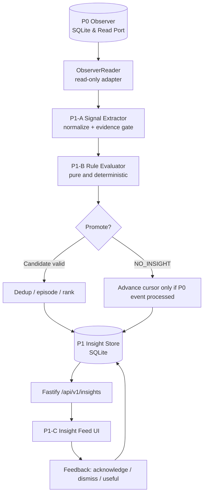
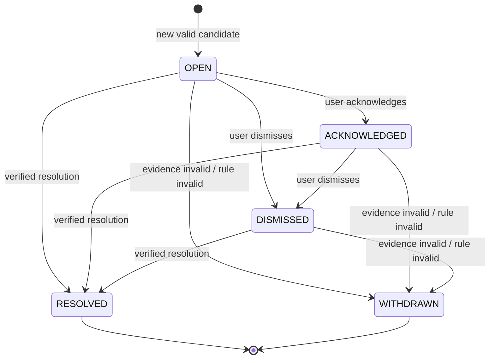

# Hearth · Project Insight Engine P1 详细设计规格 v0.1

> 文档性质：可执行设计基线（Draft for Implementation）  
> 编制日期：2026-10-28  
> 建议仓库落点：`/Users/v/new-idea/hark/docs/16-PROJECT-INSIGHT-P1.md`  
> 归属：Hearth / Project Intelligence  
> 前置阶段：Project Observer P0.5 `CONDITIONAL_PASS`  
> 覆盖阶段：P1-A Change Intelligence、P1-B Insight Engine、P1-C Insight Feed  
> 不包含：LLM 分析、Hermes/Pi 运行时、主动通知、任务完成率、代码修改

## 0. 设计基线与事实边界

### 0.1 已知事实（源自 P0.5 交接；实施时须本机核验）

- P0 实现位于 `packages/project-observer/`，使用独立 `data/observer.sqlite`，Fastify 路由 ` /api/v1/observer/*`，Hearth UI 包含 `/projects` 和 `/observe/:id`。
- 观察内容：Git porcelain v2 `-z`、已声明 JUnit XML、状态快照与追加式事件、文件提示防抖、周期对账、`OBSERVATION_GAP`。
- P0.5 已实现单实例 writer lock、`current_revision` CAS、同仓库 in-flight 合并、A→B→A 保留、重复状态和重复同类适配器故障去重、安全路径检查、Git 超时与输出上限、事务失败注入和在线备份。
- 用户报告最终门禁 G0–G5/G7/G8 PASS，G6 两个真实试点通过，`agent-internet-lab` 本地路径缺失，整体 `CONDITIONAL_PASS`；188 项测试通过。
- 性能基线：Apple M1、synthetic 10,001 tracked files、无变化扫描 p95 约 72ms；空闲 30 分钟 CPU 约 0.06%、RSS 峰值 121MB。真实 10k–50k 仓库仍 `BLOCKED_ENVIRONMENT`。
- 1,000 次无变化扫描没有产生变化事件，但 observation run 写入会导致 SQLite/WAL 增长。
- 验收材料：`docs/verification/observer-p05-gate-review.md`；基准原始数据 `docs/verification/data/observer-p05-bench-2026-10-28T13-13-18-000Z.json`。

**注意**：本设计基于用户交接摘要与 P0/P0.5 规格，而非对 `/Users/v/new-idea/hark` 当前源码的直接审查。具体表、字段、API 名称属于建议契约，只有完成 S0 代码审计并冻结接口之后才能当成“已存在”。不得假设 P0 当前已经提供全局单调事件序列、报告与 HEAD 的绑定或测试用例级明细。

### 0.2 P1 的一句话目标

> 让 Hearth 在不依赖 LLM 的条件下，把已验证的项目观察事实转化为低噪声、可解释、可追溯的候选洞察，供用户按需查看和反馈；无充分证据时输出 `NO_INSIGHT`。

### 0.3 P1 的不可变设计约束

1. **观察与评价分离**：P0 继续负责事实，P1 只能派生洞察，不能修改或回写 P0 快照与事件。
2. **证据优先**：每条 Insight 至少拥有一个可访问的 P0 事件、快照或运行证据；没有证据不能发布。
3. **语义克制**：普通 commit、dirty、文件保存不能直接推断“任务完成”“进度停滞”“准备发布”或“代码质量变差”。
4. **默认保持安静**：无值得展示的变化时返回 `NO_INSIGHT`，不写入用户可见卡片、不刷新卡片的 `updated_at`。
5. **边界稳定**：不依赖模型 API、Docker、Hermes、Pi、远端服务或 GitHub；无需读取源码正文。
6. **幂等可恢复**：重复消费、服务崩溃、重放和重启不导致重复洞察、状态回退或证据丢失。
7. **安全隔离**：不得主动运行测试或任意脚本、修改真实仓库、扫描家目录、上报源码、泄露本机敏感路径。
8. **结果可质疑**：每项判断标明 rule ID/version、证据质量、局限与可核验的原始来源。
9. **存储节制**：无变化扫描不触发 P1 写入；不复制 P0 的全部快照和 observation runs。

## 1. 产品范围

### 1.1 核心使用场景

- 使用 Pi/Codex 修改代码并产生 Git 变化后，Hearth 可以检测相关证据是否出现，但不会因为单纯提交就制造建议。
- 一份已配置 JUnit 报告变成失败，Hearth 展示“观察到失败测试报告”，允许用户跳转到 P0 证据。
- HEAD 更新后，旧测试报告仍存在，Hearth 能在满足明确前提时提示“当前版本缺乏验证证据”，而不说“测试失败”。
- 观察器连续报错，Insight Feed 汇总一个持续性问题，不连续生成数十张重复卡片。
- 重启之后，已处理事件不会重复生成洞察；用户已处理的卡片不会无故重新弹出。
- 切换分支、保存文件、同一状态重复扫描，默认不产生新洞察。

### 1.2 P1 必须交付

| ID | 模块 | 必须完成 |
|---|---|---|
| P1-FR-01 | Observer Read Port | 读取 P0 事件、快照、健康信息及其来源；稳定游标与边界校验 |
| P1-FR-02 | Signal Extractor | 事件规范化、证据质量和可比较性检查、信号分类 |
| P1-FR-03 | Rule Engine | 确定性规则、否决条件、`NO_INSIGHT`、规则版本 |
| P1-FR-04 | Insight Store | 独立持久化、幂等键、处理游标、生命周期、证据引用 |
| P1-FR-05 | Replay/Recovery | 重启补偿、至少一次消费、原子落库与游标推进 |
| P1-FR-06 | Dedup & Episode | 重复去重、同一问题续期、解决与再次发生的边界 |
| P1-FR-07 | Ranking | 可解释的优先级和明确的不确定性表达 |
| P1-FR-08 | HTTP API | 分页查询、详情、人工刷新/重评估、反馈、权限控制 |
| P1-FR-09 | Insight Feed UI | 总览、项目筛选、证据展开、无洞察态与错误态 |
| P1-FR-10 | Verification | 单元、集成、故障注入、浏览器、性能和真实试点验收 |

### 1.3 明确不做

- 不调用 Hermes/Pi/Codex/GLM 或任何 LLM；不做语义代码审查。
- 不自动分析 README/TODO 推断项目完成百分比；不接自动任务分派。
- 不发系统通知、邮件、Telegram、手机推送；P1 的 Insight Feed 为 **pull-based**。
- 不进行跨项目技术建议、实验科学结论、提交影响评估、项目停滞主观判定。
- 不运行测试、构建、git fetch/pull、自动修复或执行修改；不接入新增云服务。
- 不把规则引擎做成通用 DSL 平台或引入消息队列/向量数据库。

## 2. 系统架构



### 2.1 代码落点建议

```text
packages/
  project-observer/               # P0：保持原有事实与采集职责
  project-insight/                # P1 新增独立 package
    src/
      contracts/                  # Zod 边界契约、版本与枚举
      observer-adapter/           # 只读查询与稳定游标封装
      signals/                    # normalize + evidence quality
      rules/                      # 显式规则类/纯函数
      engine/                     # 消费、评估、聚合、重放
      store/                      # migration、SQLite、repository
      ranking/                    # 确定性排序与解释
      index.ts
    tests/
apps/
  server/                         # Fastify 路由、session/CSRF 集成
  web/                            # /insights 页面、/projects 摘要入口
scripts/
  insight-replay.ts               # 针对 fixture 的受控重放
  insight-bench.ts                # 独立性能基准
  insight-fixtures.ts            # 测试数据生成（仅临时仓库）
docs/
  16-PROJECT-INSIGHT-P1.md
  verification/insight-p1-gate-review.md
```

目录仅为目标分工，不得覆盖已有工程的实际命名；S0 优先复用 monorepo 已存在的 Zod、SQLite、router 和测试封装。

### 2.2 存储方案决策

**建议 P1 使用单独的 `data/insights.sqlite`，P0 的 `data/observer.sqlite` 不改写。**

优点：错误隔离、迁移边界清楚、未来可以替换 Agent/规则引擎，P1 不与 P0 单 writer 争夺写锁。代价是两库之间没有跨库事务。采用 **P0 追加式事件 + P1 原子提交（洞察、去重状态、消费游标）+ 幂等重放** 保证最终一致性。

不得将 P0 的事件标记为“已消费”写回 P0。数据库路径要位于 Hearth 数据目录并遵守已有配置，不写入真实被观察仓库。遵循 P0.5 的 SQLite 版本、单 writer、备份和 WAL 安全策略。

若 S0 发现 Hearth 现有数据访问层有更合适的标准方式，可调整物理 DB 布局，但**逻辑独立、所有权与原子性不变量不得改变**，须留 ADR 说明。

## 3. P0 → P1 稳定消费契约

### 3.1 ObserverReader（设计目标）

```ts
export interface ObserverReader {
  listProjectIds(): Promise<string[]>;
  listEvents(input: {
    projectId: string;
    after?: string;             // opaque, stable cursor
    limit: number;              // max 200
  }): Promise<{ events: ObserverEventView[]; nextCursor?: string; hasMore: boolean }>;
  getSnapshot(snapshotId: string): Promise<ObserverSnapshotView | null>;
  getHealth(projectId: string): Promise<ObserverHealthView>;
  getProject(projectId: string): Promise<ObserverProjectView | null>;
}
```

- 这里的 `ObserverEventView` 仅包含 P1 真正需要的 `eventId`、`projectId`、`type`、`observedAt`、`before/after snapshot IDs`、`runId`、`evidenceQuality`、经确认的安全摘要。
- **游标必须绑定稳定的追加顺序**（例如由 P0 显式提供的单调 append sequence），不允许依赖 `observedAt` 时间字符串、随机 UUID 或事件内容哈希推断顺序。
- 如果 P0 只有按时间倒序的 UI 分页接口，S0 必须先研究如何建立安全的内部只读消费接口；不能直接使用 `ORDER BY observed_at` 并声称不会漏事件。
- 不需要复制整个事件 payload。P1 通过适配器按需查询快照/证据，返回最小必要的字段。
- 全局游标与逐项目游标都可；首版建议**逐项目游标**，便于隔离错误与项目增删。
- 当一个项目被暂停时停止新增推理；重新启用后沿事件游标对账，不猜测空窗里的真实过程。

### 3.2 启动时的历史数据处理

- 默认启用时建立 **evaluation baseline**：把当前历史事件读取到稳定边界，但不将项目旧事件当作今天新发生的异常推送到普通 Feed。
- 启用之后的新事件正常评估；如有显式的“分析历史”动作，允许对指定时间段重评估，并标记 `historical=true`，不能伪装成实时发现。
- 若启动时发现旧记录存在已知的持续故障，可按 `current health` 的明确观察事实生成一张“当前仍存在问题”的卡片，而不是补发历史上的多张卡片。
- 历史深度、首次基线策略都要有回归测试；UI 必须注明“已启用监测时间”。

### 3.3 数据质量与可比较性

| P0 状态/证据 | P1 可做什么 | 禁止什么 |
|---|---|---|
| OBSERVED | 陈述观察到的事实 | 推断代码质量或业务结论 |
| UNKNOWN | 陈述缺乏证据 | 视作 PASS/FAIL |
| STALE | 说明证据过期或不能覆盖当前状态 | 当作当前 HEAD 已验证 |
| UNAVAILABLE | 陈述采集源不可用 | 推断用户删除/放弃项目 |
| OBSERVATION_GAP | 提醒中间过程不可知 | 重建空窗内精确步骤 |
| REPORT_TOO_LARGE / ADAPTER_ERROR | 标注无法解析报告 | 当作报告 FAIL |

### 3.4 测试报告与 HEAD 的绑定

定义三种归属状态：`BOUND_TO_HEAD | NOT_BOUND_TO_HEAD | UNDETERMINED`。

- 只有来源元数据含可验证提交 SHA/版本标识，且与扫描 HEAD 匹配（或者另有严格、文档化的绑定机制），才可标记 `BOUND_TO_HEAD`。
- 普通 JUnit XML 中没有提交 SHA 时，通常只能为 `UNDETERMINED`；“报告比 commit 新”不等同于绑定。
- `NOT_BOUND_TO_HEAD` 是有相反证据（例如报告显式标记其他 SHA），不是简单的“年龄大”。
- 对没有版本绑定、没有生成时间的报告，只允许说“最近观察到的报告显示 X”；不能说“当前分支回归”。
- 适配器仅在原数据确实具备可比较信息时输出比较结果，无法证明时降级到较弱的表述或 `NO_INSIGHT`。

## 4. 核心对象与类型契约

### 4.1 Signal（由 P0 事实派生）

```ts
type SignalKind =
  | "TEST_REPORT_FAILURE_OBSERVED"
  | "TEST_REPORT_RESULT_CHANGED"
  | "TEST_EVIDENCE_NOT_CURRENT"
  | "OBSERVATION_GAP_DETECTED"
  | "OBSERVER_HEALTH_DEGRADED"
  | "REPOSITORY_UNAVAILABLE_PERSISTENT"
  | "REPOSITORY_RECOVERED";

type Signal = {
  signalKey: string;                   // deterministic; input event(s) + kind + parserVersion
  projectId: string;
  kind: SignalKind;
  observedAt: string;                 // P0 observed time, not actual occurrence time
  sourceEventIds: string[];
  fromSnapshotId?: string;
  toSnapshotId?: string;
  evidenceQuality: "OBSERVED" | "UNKNOWN" | "STALE" | "UNAVAILABLE";
  comparable: boolean;
  facts: Record<string, unknown>;     // strict per-kind schema in implementation
};
```

Signal 可在内存中产生；不要求建立一个永久保留每个文件提示或每次扫描的信号表。必须提供稳定的测试构造器和 JSON 调试输出，便于回放验证。

### 4.2 Candidate / NO_INSIGHT

```ts
type EvaluationResult =
  | { kind: "NO_INSIGHT"; reasonCode: string }
  | { kind: "CANDIDATE"; candidate: InsightCandidate };

type InsightCandidate = {
  ruleId: string;
  ruleVersion: number;
  projectId: string;
  subjectKey: string;                 // stable subject, e.g. report source ID
  episodeKey: string;                 // distinct recurrence after a real resolution
  evidenceRefs: EvidenceRef[];
  severity: "info" | "attention" | "important";
  confidence: "high" | "medium" | "low";
  titleKey: string;                   // predefined template; NOT model-generated
  detailKey: string;
  templateData: Record<string, string | number | boolean | null>;
  reasonCodes: string[];
};
```

`NO_INSIGHT` 是明确的评估结果，不是异常和数据库写入动作。可把规则命中/拒绝计数聚合进进程指标，但不能因每次扫描而插入一条 `NO_INSIGHT` 记录。

### 4.3 EvidenceRef

```ts
type EvidenceRef = {
  kind: "observer_event" | "observer_snapshot" | "observation_run";
  projectId: string;
  id: string;
  observedAt: string;
  quality: "OBSERVED" | "UNKNOWN" | "STALE" | "UNAVAILABLE";
  role: "trigger" | "baseline" | "context" | "resolution";
};
```

**必须至少一个 `role=trigger` 且可实际查询的证据。** 若 P0 证据被清理，P1 不得继续将断链 Insight 标为高可信，应改为 `evidence_unavailable`、降级可信度，并使 UI 明确提示。为避免持久引用失效，P0 的证据保留期不得短于 P1 未解决 Insight 的必要保留期；若目前无法保证，S0 必须先制定保留策略或冻结最小不可变、脱敏的证明摘要。

### 4.4 Insight（用户可见的长期对象）

```ts
type InsightStatus = "OPEN" | "ACKNOWLEDGED" | "DISMISSED" | "RESOLVED" | "WITHDRAWN";

type Insight = {
  id: string;
  projectId: string;
  ruleId: string;
  ruleVersion: number;
  dedupKey: string;
  episodeKey: string;
  status: InsightStatus;
  severity: "info" | "attention" | "important";
  confidence: "high" | "medium" | "low";
  titleKey: string;
  detailKey: string;
  templateData: Record<string, string | number | boolean | null>;
  firstObservedAt: string;
  lastMaterialObservedAt: string;
  createdAt: string;
  updatedAt: string;
  evidenceRefs: EvidenceRef[];
  reasonCodes: string[];
  historical: boolean;
};
```

**时间语义**：`firstObservedAt`/`lastMaterialObservedAt` 来自 P0；`createdAt`/`updatedAt` 是 P1 持久化时间。报告生成时间若可信另存来源时间，不能混淆。

### 4.5 Zod 的使用范围

- 仅在 P0 Adapter 输入、数据库 JSON 解码、HTTP 请求/响应、规则模板数据边界使用 Zod。
- 规则纯函数之间以 TypeScript 类型传值，避免每层重复 parse。
- `templateData`、信号 facts 不得无限制存储任意 payload；每种 `kind/ruleId` 对应明确 schema、字段长度和脱敏规则。

## 5. 规则引擎

### 5.1 实现方式

第一版采用**显式注册的 TypeScript 纯规则函数**，不使用动态 JS 执行、从仓库加载规则代码或复杂 DSL。

```ts
interface InsightRule {
  id: string;
  version: number;
  evaluate(input: Readonly<EvaluationContext>): EvaluationResult[];
}

interface EvaluationContext {
  project: ObserverProjectView;
  events: readonly ObserverEventView[];
  before?: ObserverSnapshotView;
  after?: ObserverSnapshotView;
  health: ObserverHealthView;
  policy: Readonly<InsightPolicy>;
  evaluatedAt: string; // injected clock: deterministic tests
}
```

每条规则必须列出：前提、hard veto、证据来源、标题模板、去重主体、解决条件和误报测试。

### 5.2 首批规则目录（优先级）

| Rule ID | 触发条件 | 必须具备的证据 | 默认级别 | 解决/消失条件 |
|---|---|---|---|---|
| `R-TEST-FAILURE` | 新的有效 JUnit 报告有失败 | 当前可访问的报告更新事件+报告摘要 | attention | 后续同一报告源有效结果不再失败 |
| `R-TEST-REGRESSION` | 同一可比较报告源从无失败转为失败 | 前后两次有效可比较报告、相同口径 | important | 有效同口径结果恢复，或证据不再可比较时撤回过强表述 |
| `R-TEST-EVIDENCE-GAP` | HEAD 变化后，声明的测试证据缺乏当前版本绑定并超过等待窗口 | HEAD 变化+报告配置+当前证据状态 | info | 出现明确覆盖当前 HEAD 的测试证据；否则保持“未证实” |
| `R-OBSERVER-HEALTH` | 观察器连续失败或持续不可用 | observation runs/health 的可核验记录 | attention | 恢复达到明确稳定窗口 |
| `R-OBSERVATION-GAP` | 发生明确的观测空窗 | P0 `OBSERVATION_GAP` 事件 | info | 用户确认，或在新周期已有可靠连续观察后按策略自动解决 |
| `R-REPOSITORY-UNAVAILABLE` | 仓库持续不可用 | 有界时间内连续不可用记录 | attention | P0 报告恢复并重新扫描成功 |

#### R-TEST-FAILURE

- 只接受有效且通过大小/格式校验的 JUnit 结果。
- 结果明确包含 failures/errors，报告源 ID 明确且已声明。
- 输出用语：“观察到一份含失败用例的测试报告”，并显示报告观测时间与是否绑定当前 HEAD。
- `REPORT_TOO_LARGE`、XML 错误、缺失报告、UNKNOWN 不能触发测试失败 Insight。
- 同一报告指纹重复观察不新增 Insight；相同故障持续发生只更新**有实质变化**的证据摘要。

#### R-TEST-REGRESSION

- 需相同 reportSourceId、同一套有效结果口径、相同统计定义；如果套件集合/口径变化，则不做数值回归推断。
- 前次 0 失败 → 本次至少 1 失败可描述为“该测试报告来源的观测结果由无失败变为有失败”。
- 仅当明确两次结果与对应 HEAD 绑定时，才可使用“当前版本测试回归”的更强表述；否则优先展示较弱 `R-TEST-FAILURE`，避免两张同义卡片。
- 不推断回归由哪个 commit 导致；不自动运行 `git bisect` 或测试。

#### R-TEST-EVIDENCE-GAP

- 仅适用于**已经声明应有测试报告**的项目；未配置报告时默认 `NO_INSIGHT`。
- HEAD 变化后设置建议默认 grace period = 20 分钟且至少经历一次成功对账；在此期间用户可能正在运行测试，不要即时打扰。
- 只说明“当前 HEAD 尚无可核验的绑定测试证据”。仅凭 report 文件时间比 HEAD 旧也不能证明测试报告的版本关联；必须显示归属状态。
- 如果整个 P0 观测已 `UNAVAILABLE`/`DEGRADED`，不得把采集故障伪装成测试证据不足。先处理观察器健康规则。
- 该规则应为**可配置、默认关闭或低优先级实验规则**，直到真实项目中确认不会持续误报（许多项目本来不为每次提交生成测试报告）。

#### R-OBSERVER-HEALTH / R-REPOSITORY-UNAVAILABLE

- 建议初始阈值：连续 3 次采集异常，或相同问题持续 15 分钟；至少满足一个，并由真实 observation run/health 记录证明。
- 单次偶发失败只存 P0 事实，P1 默认 `NO_INSIGHT`。
- 同一种持续故障聚合为一张 Insight；恢复后自动 `RESOLVED`，不可原地覆盖历史事实。
- 当 P0 无法提供足够长的 run 历史，应降级为明确阈值下可验证的“持续不可用”事实，不猜连续次数。

#### R-OBSERVATION-GAP

- P0 明确产生 gap 才触发，不以两个扫描时间差自行推定精确遗漏过程。
- 按 gap episode 去重；若同一次空窗被重放，仍只展示一张。
- 默认 info，可在项目详情展示，普通 Insights 总览默认不置顶。

### 5.3 默认 `NO_INSIGHT` 清单

- 仅分支切换、HEAD 前进、一次 commit、新增 untracked 文件、工作区 dirty/clean、编辑器重复保存。
- 仅无变化重扫；没有有效 P0 新状态事件。
- 缺少声明的测试报告、无法解析的报告和未知测试结果（若没有独立的持续健康异常证据）。
- 证据质量不足以支持拟议标题、数据源无法比较或用户已明确暂停该项目的洞察。
- 重复信号、仍处于 grace period、已经被相同 episode 覆盖的变化。

## 6. 洞察去重、事件剧集与生命周期

### 6.1 两层幂等

1. **事件消费幂等**：`(consumerVersion, projectId, p0EventId)` 为唯一处理标识，解决重复投递和崩溃重放。
2. **洞察语义去重**：`(projectId, ruleId, ruleMajorVersion, subjectKey, episodeKey)` 构成稳定业务身份。

`dedupKey = sha256(canonicalSerialize({projectId, ruleId, majorVersion, subjectKey, episodeKey}))`。序列化顺序、字符串规范化和版本规则需有 golden tests。**不能只按正文文本、时间戳或整个 payload 哈希去重。**

### 6.2 Episode 语义

- 同一报告持续失败：相同 episode，不新增卡片。
- 同一问题确实恢复后又出现：**新 episode**，产生一张新卡片，保留上一次历史。
- A→B→A 是新的状态转移，不能因历史曾出现 A 而忽略。
- `ACKNOWLEDGED` 不是“问题已恢复”，仅说明用户已看到；同一 episode 继续合并。
- `DISMISSED` 不等于事实消失；同一 episode 不重新出现，除非规则判定了实质性升级并写明新触发原因。P1 MVP 可简单规定相同 episode 永不重新创建。
- 如果规则修订改变含义，必须进行规则版本迁移策略检查，禁止把所有旧洞察无缘无故重新发布。

### 6.3 生命周期状态机



`RESOLVED` 必须由明确的恢复证据支持；`WITHDRAWN` 用于之前表述不再成立（例如证据不可比较、误匹配）。已解决 episode 不应被原地重新打开，新的问题使用新 episode。

### 6.4 同义规则冲突

- `R-TEST-REGRESSION` 命中时优先展示一张更具体的卡片，`R-TEST-FAILURE` 成为补充原因/证据；不展示两张同义卡。
- `R-OBSERVER-HEALTH` 对同一问题的源不可用优先合并 `R-REPOSITORY-UNAVAILABLE`，避免用户看到重复故障。
- 冲突规则配置必须显式列在源代码，并有测试，不靠 LLM 判断语义相似。

## 7. 优先级、可信度与排序

### 7.1 不引入黑盒分数

P1 用枚举和明确的排序因素，而不是模拟“AI 置信度 97%”。

- `severity`: `important > attention > info`，表示对用户是否值得处理的工程优先级，不表示项目完成率。
- `confidence`: `high | medium | low`，表示证据与规则的可靠性，不能把“来源存在”当成“结论属实”。
- `recency`: 根据 **观测时间** 而非猜测实际发生时间排序。
- `status`: 默认首页只列出 `OPEN`/`ACKNOWLEDGED`，已处理记录按需筛选。

排序建议：`status priority → severity → confidence → lastMaterialObservedAt DESC → id DESC`，同等条件稳定分页。

### 7.2 Hard veto（必须拒绝）

- 没有可访问的触发证据；P0 数据版本不受支持或归属项目不一致。
- 当前数据为 UNKNOWN/UNAVAILABLE，但候选标题声称 PASS/FAIL。
- 需要关联当前 HEAD 的规则没有 BOUND_TO_HEAD 证据。
- 当前项目暂停观察或显式关闭洞察（除允许显示的历史已有条目）。
- 已知同义卡片存在且本次没有实质升级。
- 规则输入超过体积限制或在异常状态下不能安全解释。

## 8. SQLite 存储方案（设计草案）

### 8.1 最小表

| 表 | 内容与主键 | 不变量 |
|---|---|---|
| `insight_meta` | schemaVersion/engineVersion | migration 可重复执行 |
| `project_cursors` | PK(project_id)，opaque_cursor，baseline_at，consumer_version | 成功提交后才推进 |
| `consumed_events` | PK(consumer_version,project_id,p0_event_id) | 崩溃重放幂等；有保留策略 |
| `insights` | id、dedup_key UNIQUE、project_id、rule、episode、status、模板、严重度、时间 | 一张卡片一个 episode |
| `insight_evidence` | PK(insight_id,kind,source_id,role) | 强制同项目并有来源指针 |
| `insight_feedback` | id、insight_id、action、created_at | 用户操作审计与幂等 |
| `insight_rule_state` | PK(project_id,rule_id,subject_key)，当前 episode/最近恢复状态 | 支持跨重启判定恢复与复发 |
| `insight_engine_health` | 最近评估成功时间、错误码、读取游标延迟 | 与 P0 健康分离 |

`insight_rule_state` 只存严格必要的聚合元数据，不能存复制来的整个 Git/测试报告。对 `insights` 建 `(project_id,status,last_material_observed_at,id)` 索引；对 `consumed_events` 设置可验证的安全清理策略，只有在 checkpoint 和保留窗口保证不可能重放到被清理区间时才可删。

### 8.2 一个批次的事务边界

```text
Read P0 events after cursor (read-only)
  -> validate source + normalize
  -> evaluate pure rules
  -> BEGIN IMMEDIATE on insights.sqlite
       verify engine writer ownership / revision
       INSERT OR IGNORE consumed_event IDs
       UPSERT changed insight episodes only
       INSERT evidence refs / resolution refs
       UPDATE rule state if materially changed
       ADVANCE project cursor for contiguous successfully processed events
     COMMIT
```

- 任意写入或迁移失败：整段回滚，保留旧游标；下次重放，不能丢事件。
- 无 P0 新事件且无显著到期规则：**P1 零写入**；即使 P0 observation run 继续增长，也不跟随插入 P1 run。
- 到期规则（如 20 分钟 grace）由受控计划触发，在确实需要复核的期限执行；不能每隔几秒全量改写评估记录。
- 读 P0 与写 P1 之间可能出现新 P0 事件，只推进已确认连续批次的 cursor，后续消费新增事件。
- 多个项目独立游标、独立错误；一个项目失败不能让其他项目积压。
- P1 只能有一个 writer；进程重启必须释放锁；独立 Reader 不能持有无限时长的读事务。

### 8.3 意外删除、游标失效与重建

- P0 DB 重建 / 项目 ID 变化 / cursor 失效：标记 `SOURCE_RESET_REQUIRED`，阻止把旧事件重新当作新事件发布；要求按新 P0 baseline 显式重建映射。
- P1 DB 可用、P0 暂时不可用：显示已有 Insight（标记 `SOURCE_UNAVAILABLE`），不擅自当作已解决。
- P0 证据被归档或清理：保留最小脱敏摘要与断链状态，UI 不可显示“证据完整”。
- 数据库损坏：按 P0.5 验证过的安全备份/恢复路径处理，不直接删除 WAL 文件，不自动空库重置。
- P1 schema 迁移失败必须保持旧版数据可读或允许离线恢复；迁移前记录 schema 和备份校验。

## 9. 进程调度与规则配置

### 9.1 调度建议

- 主触发：P0 新的**有意义事件**产生后调用 P1 消费入口（同进程轻量异步触发，不阻塞 P0 事务）。
- 兜底触发：建议 60 秒轮询**新事件游标**；无新事件直接退出，不访问全套快照，也不写库。
- 到期任务：仅为规则时间窗/持续异常复核定时安排；不可依赖每 60 秒重算全部仓库。
- 启动：先 schema/version 校验和项目游标检查，再批量有限消费；每次最多 200 条，分页直到追平，处理每项目设置有界预算；无法完成标记 lag。
- 规则错误独立处理：记录 `RULE_EVALUATION_ERROR`，不能写入虚假洞察；保持游标停在安全边界，其他项目继续处理。

### 9.2 初版配置

```ts
const DEFAULT_INSIGHT_POLICY = {
  enabled: true,
  pollIntervalMs: 60_000,
  consumeBatchSize: 200,
  testEvidenceGraceMs: 20 * 60_000,
  persistentErrorMinConsecutive: 3,
  persistentErrorMinDurationMs: 15 * 60_000,
  maxEvidenceRefsPerInsight: 12,
  feedPageSize: 20,
  feedPageMax: 100,
  rules: {
    "R-TEST-FAILURE": true,
    "R-TEST-REGRESSION": true,
    "R-TEST-EVIDENCE-GAP": false, // start experimental, avoid noise
    "R-OBSERVER-HEALTH": true,
    "R-OBSERVATION-GAP": true,
    "R-REPOSITORY-UNAVAILABLE": true
  }
} as const;
```

以上都是**建议默认值**，需要 S0 对照实际 P0 事件粒度与业务试点调整；测试需在注入时钟下无等待地验证到期逻辑。

## 10. Fastify API 设计

沿用 Hearth 现有 session/CSRF 权限和错误 envelope。后端负责读取 Insight DB，浏览器不得直接访问本机文件、P0/P1 SQLite。

| Method | Path | 功能 | 权限与要点 |
|---|---|---|---|
| GET | `/api/v1/insights` | 全局/项目分页 Feed；projectId/status/severity/cursor/limit | 已登录；稳定游标；限制最大页 |
| GET | `/api/v1/insights/:id` | 详情、证据链接、归属状态、原因码 | 已登录；限制跨项目资源获取 |
| GET | `/api/v1/insights/summary` | 按项目未处理计数、引擎健康与最近评估时间 | 已登录；单次聚合 |
| GET | `/api/v1/insights/policy` | 查询规则策略与启用情况 | 已登录；首版可以只读 |
| POST | `/api/v1/insights/reconcile` | 显式触发只读消费/重评估（不是 Git 重扫） | session + CSRF；幂等与限流 |
| POST | `/api/v1/insights/:id/acknowledge` | 用户已查看 | session + CSRF；幂等 |
| POST | `/api/v1/insights/:id/dismiss` | 用户认为不值得展示 | session + CSRF；幂等，保留事实 |
| POST | `/api/v1/insights/:id/feedback` | `useful / not_useful` | session + CSRF；用户选择可修改 |

- `GET /api/v1/insights/:id` 的证据链接可以指向现有 `/observe/:id` 的事件详情，也可提供安全的同源只读证据代理；不得直接返回真实绝对路径或任意本地文件读取 URL。
- 结果包括 `evidenceAvailability`、`evidenceBinding`、`reasonCodes`、`ruleVersion`、`observedAt`；不能只返回一个花哨的标题。
- 新增引擎错误码建议：`INSIGHT_SOURCE_UNAVAILABLE`、`INSIGHT_CURSOR_INVALID`、`INSIGHT_RULE_ERROR`、`INSIGHT_STORE_BUSY`、`INSIGHT_EVIDENCE_MISSING`、`INSIGHT_INVALID_TRANSITION`。
- 404/403 的行为要沿用 Hearth 原来的鉴权策略；不把未知项目内部信息暴露给未授权用户。
- POST 重评估不得重新运行 Git scan、JUnit 测试或文件系统抓取，只消费 P0 已知事实。

### 10.1 响应示例

```json
{
  "items": [
    {
      "id": "ins_...",
      "projectId": "prj_...",
      "ruleId": "R-TEST-FAILURE",
      "ruleVersion": 1,
      "status": "OPEN",
      "severity": "attention",
      "confidence": "medium",
      "title": "观察到含失败用例的测试报告",
      "summary": "最近一份有效报告包含失败用例；尚未证明属于当前 HEAD。",
      "observedAt": "2026-10-28T10:00:00.000Z",
      "currentHeadBinding": "UNDETERMINED",
      "evidenceCount": 2,
      "evidenceAvailability": "AVAILABLE"
    }
  ],
  "nextCursor": null,
  "engineHealth": "OK"
}
```

此处是**目标 API 示例**，不是当前服务器已实现的响应。

## 11. UI / UX 需求

### 11.1 页面与导航

- `/insights`：所有项目的洞察 Feed（新页面）；左侧/顶部筛选 project、状态、重要程度；默认按稳定规则排序。
- `/projects`：增加小型“待关注事项”计数或信息入口，不覆盖现有观察器项目列表。
- `/observe/:id`：增加“该项目的洞察”区域和从洞察返回证据的导航。
- 详情面板：展示事实依据、观察时间、数据是否过期、P0 证据链接、为什么产生这条提示、如何处理和用户反馈。

### 11.2 卡片必须有的内容

1. 具体且克制的标题：例如“检测到新的失败测试报告”，不能写“你的项目出问题了”。
2. 项目、观察时间、严重程度、证据可信度及报告是否绑定当前 HEAD。
3. **为什么出现**（触发规则、阈值、变化摘要）。
4. **证据入口**（可追溯到 P0；若来源不存在要展示断链警告）。
5. 操作仅限 `确认已看`、`不再关注这条`、`有用/没用`、`查看证据`；不出现“自动修复”“运行测试”按钮。

### 11.3 必须区分的界面状态

- `EMPTY_HEALTHY`：引擎正常、已评估、没有值得关注的事项；文案“当前没有需要关注的洞察”，**不等于项目质量全部通过**。
- `NOT_EVALUATED`：尚未建立基线或尚无首次消费；不能显示成“无问题”。
- `SOURCE_STALE`：P0 最近数据过期；保留上次洞察，但告知可能与现状不一致。
- `ENGINE_DEGRADED`：P1 内部消费失败或落后；不隐瞒。
- `HAS_INSIGHTS`：有真实洞察，按照证据强度与严重性展示。

采用 Hearth 现有设计系统，初版不做聊天浮层、复杂动画、消息弹窗和手机适配专项重构。UNKNOWN 不使用绿色成功样式，普通信号不采用高刺激的警告徽章。

## 12. 性能、资源与数据保留

### 12.1 新增 P1 资源预算（需实测后冻结）

| 项目 | 初始目标/限制 | 验收说明 |
|---|---|---|
| 常态无事件 | P1 不追加数据库写入 | 1,000 次 P0 无变化扫描前后比较 P1 表/页数 |
| 单次消费批量 | 最多 200 P0 事件 | 批次大小可配置；上限有验证 |
| 事件到 Feed 延迟 | 正常运行时建议 p95 ≤ 5s | 30 次样本，在 M1 类设备；若触发只靠 60s 轮询则该目标不适用，必须先改事件唤醒 |
| 消费纯规则性能 | 建议 200 事件批 p95 ≤ 250ms | 30 次，fixture，剔除 UI 网络往返 |
| 空闲 CPU/RSS | 相比 P0.5 基线记录 P1 增量 | 至少 30 min，不能只报全机 CPU |
| DB/WAL 增长 | 必须测 1,000 无效 + 100 有效事件 | 无效事件可有游标账本写入，但无新 P0 event 时必须零写 |
| 数据体积 | 控制证据引用数和字符串大小 | 不能复制原始报告全文或源码 diff |
| 错误/耗尽 | 有界重试和限流 | 引擎失败不拖垮 P0 或 Web UI |

**务必区分**：

- P0 “1,000 次无变化扫描”仍可能记录 observation runs（属于 P0 写入）；P1 的目标是 **不因这些无新事件的扫描继续写一遍 P1**。
- 若 P1 为事件消费记 `consumed_events`，即使评估为 `NO_INSIGHT`，游标账本写入是允许的；不得生成用户可见的 Card/Insight。
- 因不同机器负载、实时调度策略导致目标暂时无法达到，必须报告测量结果、环境和瓶颈，不得修改样本数假装 PASS。

### 12.2 持久化与保留策略

- 已确认的 Insight、用户反馈与其最小必要证据引用需要跨重启保留。
- 处理游标、规则状态、活跃 episode 不可因普通清理被删。
- `consumed_events` 的清理须证明不再可能重放到该区间，不能用简单 TTL 破坏幂等性。
- 诊断日志保留期与采样频率可配，不记录源码内容、环境变量、完整绝对路径或潜在 Token。
- 备份使用已验证的安全 SQLite 机制（例如 `VACUUM INTO`），恢复后验证 integrity/FK、游标一致性和 Insight 证据状态。

## 13. 安全、可靠性与异常设计

- 只接收 P0 官方 Reader 数据；对恶意 Git 文件名、JUnit suite 名称、错误消息和其他外部字符串做长度限制与输出转义，不能渲染为 HTML、执行脚本或指令。
- 规则标题使用内置模板，不直接执行或信任仓库中的提示语。
- 不直接访问用户家目录，也不读取任何新的 project path；项目权限仍由 P0 Registry 决定。
- P1 的数据访问绑定当前 Hearth session，所有写操作走现有 CSRF；内部消费入口不对公网暴露。
- 读取 P0 失败：保持最近可用的 Insight，标记引擎健康 `SOURCE_UNAVAILABLE`，不自动解决问题。
- 规则报错：失败项目停止推进对应有问题批次游标，记录有界错误；其他项目继续。
- 数据库写入中断：洞察、证据、游标整段回滚；重启重放不重复。
- 证据删失：卡片降级 `evidence_unavailable` 并限制强结论；已读与用户反馈不丢失。
- 真实项目只读：所有测试中制造 commits、报告变更、故障、权限异常的步骤只能在临时 Git fixture 中执行。

## 14. 开发切片（建议按顺序实施）

### S0 · 代码审查与接口冻结

- 读取仓库 `AGENTS.md`、P0/P0.5 文档、`packages/project-observer`、server 路由、已有 UI、数据库迁移与测试。
- 确认现有事件是否拥有**稳定单调追加游标**、snapshot IDs、报告源 ID、报告归属/时间字段、health 读取能力。
- 先写 `ADR-INSIGHT-001`：采用哪个 P0 Reader、如何保证不断档和数据独立、如何处理中途重置。
- 冻结 P1/P0 消费合同及基线测试；严禁边改 P0 边凭空假定数据字段存在。
- 产物：`docs/verification/insight-p1-s0-contract-audit.md` 和契约测试。

### S1 · P1-A Signal Extractor

- 实现纯函数事件规范化、来源引用、quality/binding/comparability 检查。
- 实现 `NO_INSIGHT` 初始规则、无变化零输出、时间注入和可复现 fixture。
- 先用观测事件 + 测试报告 mock/fixtures，不连真实源码分析。
- 产物：Signal types、输入适配器、数据质量测试、golden fixtures。

### S2 · P1-B Engine 与 Persistence

- 完成全部首批规则、conflict suppression、dedup/episode、规则版本、反馈状态机。
- 完成 `insights.sqlite` migration、single writer、事件消费事务、游标、重放与失败注入。
- 产物：engine/store、故障重放测试、独立 CLI replay 工具。

### S3 · Fastify API 与 P1-C UI

- 将读取/反馈/重评估集成现有 session + CSRF 框架。
- `/insights` feed、详情证据、/projects 摘要、/observe/:id 对应入口、空/未知/降级态。
- 产物：API 契约测试、浏览器 E2E、可访问性和 UX 截图。

### S4 · 性能与真实试点签收

- 运行故障注入、30 次性能批测、30 分钟空闲资源、P0.5 观察器基线对比。
- 在 `pindou`、`prototype-skill-lab` 上只读验证，第三路径缺失标记 `BLOCKED_PATH_UNAVAILABLE`，不扫描全盘。
- 记录实际 Insight 生成数、`NO_INSIGHT` 率、误报案例与用户反馈。
- 更新最终报告，并评估是否满足 P1 门禁；不得因没有任何洞察而伪造测试失败或添加假建议。

## 15. 验收测试矩阵

### 15.1 信号与证据（SI）

| ID | 测试输入 | 必须满足 |
|---|---|---|
| SI-01 | 仅 HEAD 变化 | 默认 `NO_INSIGHT` |
| SI-02 | 单纯 dirty/clean 和 300 个 watcher hints | 不产生卡片风暴 |
| SI-03 | 有效 JUnit FAIL，版本归属未知 | 有报告失败洞察，但不声称当前 HEAD 失败 |
| SI-04 | 无报告/REPORT_TOO_LARGE/坏 XML | 不能生成测试失败或通过卡片 |
| SI-05 | 可比较报告 0 失败→有失败 | 仅一张最具体洞察，证据包含前后状态 |
| SI-06 | suite 定义改变或指标口径不一致 | 禁止声称“回归” |
| SI-07 | HEAD 改变但旧报告仍存在 | grace 内无卡片；超窗后按启用策略保守处理 |
| SI-08 | P0 观测不可用 | 不将源故障解释成测试证据缺失 |
| SI-09 | OBSERVATION_GAP | 有 gap 来源、不捏造空窗中的 commit 轨迹 |
| SI-10 | 证据引用 projectId 与事件 projectId 不一致 | 严格拒绝 |

### 15.2 幂等、生命周期与恢复（ID）

| ID | 测试输入 | 必须满足 |
|---|---|---|
| ID-01 | 相同事件重复投递 100 次 | Insight 数量及证据计数稳定 |
| ID-02 | 规则重复运行但事实无变化 | 不更新卡片 `updated_at`，不新增用户可见记录 |
| ID-03 | 报告从 FAIL→PASS→FAIL | 旧 episode resolved，新 episode 新卡片 |
| ID-04 | ACKNOWLEDGED 但故障未恢复 | 不误判 RESOLVED |
| ID-05 | DISMISSED 相同 episode 后重放 | 不重建被关闭卡片 |
| ID-06 | 数据库四处事务断点异常 | 卡片/证据/游标原子回滚 |
| ID-07 | COMMIT 成功但客户端响应丢失后重试 | 无重复洞察或反馈 |
| ID-08 | 多个项目交错批次 | 项目级游标、证据和权限不串线 |
| ID-09 | P0 DB 重置/游标失效 | 停止错误续跑，明确 SOURCE_RESET_REQUIRED |
| ID-10 | 规则 major version 升级 | 有显式迁移/去重处理，不无故刷新全部卡片 |

### 15.3 API/UI/安全（UX）

| ID | 测试输入 | 必须满足 |
|---|---|---|
| UX-01 | 关闭模型 API、Hermes、Pi、Docker | P1 正常运行 |
| UX-02 | 未登录或无 CSRF 的写请求 | 拒绝、无副作用 |
| UX-03 | 特殊项目 ID/超大 cursor/非法状态 | 输入校验失败，服务不崩溃 |
| UX-04 | Git 文件名与报告 suite 携带 HTML/JS 文本 | 安全转义，不执行 |
| UX-05 | P1 未首次评估 | UI 显示 NOT_EVALUATED，不显示“全绿” |
| UX-06 | 已评估且没有洞察 | 显示 EMPTY_HEALTHY，不声称测试全部通过 |
| UX-07 | P0 源不可用/证据断链 | 显示 SOURCE_STALE/ENGINE_DEGRADED 与来源解释 |
| UX-08 | 事件/洞察稳定分页、过滤 | 无漏项、重项或跨项目数据泄露 |
| UX-09 | 查看证据 | 链接到真实 P0 来源，不能打开任意本地文件 |
| UX-10 | 人工 reconcile | 不重新 Git scan、不执行测试、不修改仓库 |

### 15.4 性能与真实试点（PF）

| ID | 测试输入 | 必须满足 |
|---|---|---|
| PF-01 | 1,000 次 P0 无事件重扫 | P1 无新增 Insight、无重复数据写；游标稳定 |
| PF-02 | 100 次有效变化 + 大量无关事件 | 30 次测量，记录延迟、吞吐、DB/WAL 增长 |
| PF-03 | 30 分钟空闲运行 | CPU、RSS 和存储变化可复现 |
| PF-04 | 高密度重复事件/规则故障 | 队列有界、其他项目继续、可恢复 |
| PF-05 | pindou / prototype-skill-lab | 真实只读证据、至少两轮稳定重评估、仓库未被修改 |
| PF-06 | agent-internet-lab 路径缺失 | 仅 `BLOCKED_PATH_UNAVAILABLE`，不伪造 3/3 PASS |
| PF-07 | 与 P0.5 基线对照 | 记录 Observer p95、idle CPU/RSS 是否退化及其原因 |

## 16. P1 验收门禁与判定

| Gate | 范围 | 放行条件 |
|---|---|---|
| `P1-G0` | 基线/契约 | 当前代码、schema、P0 Reader 稳定游标审计、设计边界明确 |
| `P1-G1` | Signal | SI-01..10 全 PASS，误报和质量边界通过 |
| `P1-G2` | Engine | ID-01..05、ID-10 PASS，episode 和冲突去重正确 |
| `P1-G3` | Persistence | ID-06..09 PASS，跨库重放、事务、恢复正确 |
| `P1-G4` | 安全/API | UX-01..04、UX-08..10 PASS；session/CSRF 与路径隔离 |
| `P1-G5` | UI | UX-05..07 PASS，证据/状态清晰，无误导性“全绿” |
| `P1-G6` | 性能 | PF-01..04、PF-07 实测并披露；门限达标或严格列出性能未达项目 |
| `P1-G7` | 项目试点 | PF-05 PASS；第三项目若仅路径缺失可单独豁免 |
| `P1-G8` | 全仓回归 | `pnpm typecheck`、P1 单测/集成/E2E、全仓 `pnpm test` PASS；P0.5 原有关键用例无回归 |
| `P1-G9` | 交付证据 | 迁移/备份/恢复、实测 JSON、门禁报告、工作区/commit 状态完整 |

**最终判定**：

- `PASS`：所有不可豁免门禁通过，三个真实项目均可访问并完成试点，性能目标达到或按冻结的门限披露有效通过。
- `CONDITIONAL_PASS`：P1-G0..G6、G8、G9 PASS；P1-G7 两个真实项目 PASS，第三个仍仅因用户未提供路径被 `BLOCKED_PATH_UNAVAILABLE`；该豁免明确记录。不得把测试或安全失败包装成条件通过。
- `FAIL`：证据链、数据隔离、事件幂等、事务恢复、安全、API 或全仓回归存在未解决阻断项。
- `NOT_RUN` / `BLOCKED` 必须独立展示，不能被 PASS 总数掩盖。

### 16.1 验收报告必须记录的实际指标

- P0 新事件数量、有效 Signals 数、Candidates 数、Promoted Insights 数、`NO_INSIGHT` 数和理由分布。
- insight duplicates prevented、resolution count、reopen/new episode count、用户 dismiss/not_useful 反馈。
- 各规则命中/否决案例，尤其“旧测试报告 ≠ 当前 HEAD 已验证”。
- 重放前后 insight rows、游标、唯一索引完整性、`integrity_check`、`foreign_key_check`。
- 30 样本 p50/p95/max、空闲 30 分钟 CPU/RSS、DB/WAL 增长和 P0.5 回归对照。
- 实际试点分支、HEAD、工作区和 `git index` 前后哈希，只读无副作用。

## 17. P2 对接预留（仅契约，不实现）

P2 将可通过只读 `listInsights` / `getInsightEvidence` 获取 P1 事实与解释，再由 Hermes 做语义分析，或经显式审批让 Pi 调查代码。建议未来可扩展：`analysisStatus`、`recommendedNextStep`、`agentAssessmentRef`，但本阶段**不在主 Insight 表中塞未经验证的模型判断**，也不发送任何通知。

P1 的专业价值是**高质量筛选器**：先让确定性规则过滤明显无价值的变化，再把少数有证据的主题交给 P2；避免每次 Git scan 都调用模型。

## 18. 实施启动指令（可交给 Pi/Codex）

```text
工作区：/Users/v/new-idea/hark
目标：实现 P1 Project Insight Engine。请先完整阅读 docs/14-PROJECT-OBSERVER.md、
docs/15-PROJECT-OBSERVER-P05-HARDENING.md、
docs/verification/observer-p05-gate-review.md 及本规格。

1. 优先执行 S0：审计实际 P0 schema/Reader/事件游标/报告绑定信息，形成接口冻结 ADR。
   若观察器没有安全单调追加游标，不得靠 observedAt 硬凑；先最小化补全只读消费接口并做回归。
2. 按 S1→S2→S3→S4 分阶段实现，每阶段运行相关门禁，不为求进度跳过失败。
3. P1 默认不调用模型、不发通知、不运行代码、不修改真实试点仓库；NO_INSIGHT 必须是一等结果。
4. 所有报告可比较性/HEAD 绑定必须以真实字段为依据；证据不足就降低结论或拒绝。
5. P1 独立 SQLite、单 writer、原子游标/洞察提交；崩溃后可重放，不产生重复卡片。
6. 只在临时 Git fixture 中制造变更；pindou、prototype-skill-lab 真实试点仅只读。
7. 第三项目路径缺失标记 BLOCKED_PATH_UNAVAILABLE，不搜索整个家目录或伪造结果。
8. 最终输出 P1-G0..G9 逐项判定、测试原始数据、性能与 UI 证据、commit/分支/工作区状态。
9. 不自动 commit、push、发布或扩大到 Hermes/Pi/通知；需要提交时单独确认。
```

---

## 19. 待 S0 冻结的关键决策（不能静默假定）

1. **P0 是否具有安全、稳定的追加事件序列？** 若没有，如何用最小改动提供不漏事件的只读游标？
2. **JUnit Adapter 实际持有哪些可验证信息？** 有无 `reportSourceId`、suite 口径、文件指纹、生成时间和 HEAD SHA？若缺失，哪些规则必须降级或禁用？
3. **P0 证据的保留期和访问方式？** 若事件可被清理，怎样避免 P1 卡片失去唯一证据？
4. **事件回调与 60s fallback 如何结合？** 若无法在 5s 内触发 P1，性能门限须改为实际调度下可验证的目标。
5. **数据库与现有 Fastify 生命周期如何集成？** 确保项目级异常隔离、单 writer 与退出清理。
6. **用户反馈语义**：仅 `acknowledge / dismiss / useful / not_useful`，是否需要恢复 dismissed？首版不做复杂偏好学习。

S0 文档必须明确回答以上六项，才能宣称 P1 设计完成接口冻结。对于不能由 P0 现有事实支撑的规则，选择 **降级或关闭**，而不是添加看似合理但无法验证的推断。
