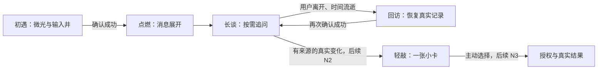

# Ember 动效与前端状态维护 · 2026-10-30

> 此文保留首轮实现记录。后续用户要求桌面精修并明确指定 GSAP，现已升级实际动画引擎；最新实现与验收见 [EMBER-CRAFT-ACCEPTANCE.md](EMBER-CRAFT-ACCEPTANCE.md) 及 [EMBER-PRESENCE-CRAFT.md](EMBER-PRESENCE-CRAFT.md)。下文关于未新增GSAP及手机截图的描述仅对应旧版本。

本次以 `docs/ember-narrative-experience-spec` 的叙事和 `bot/frontend-v6-ember` 的界面为依据；后者与 `bot/design-v6-ember` 同指 e4ba9eb。集成 `bot/hearth-g3-empty-hearth` 的空会话修复，工作分支为 `codex/ember-narrative-motion`。保留原安全合同，不推送远端。

## 实际取舍

新叙事是对已有设计的细化：不再让黯态把整个页面变成暗室，不用线程更新时间或浏览器旧缓存判定互动。仅当前线程服务端历史中已确认的用户消息参与炉温计算。首次打开无历史说“从这里开始”；未来或无效时间不能加热。

| 事件 | 炉温 / 动效 | 数据依据 |
| --- | --- | --- |
| 初遇 | 黯、静止微光 | 无已确认用户消息 |
| 输入、发送等待 | 不加热；输入边界反馈 | 临时 UI 状态 |
| 首次成功 | 旺、800ms 点燃；400ms 输入井位置过渡 | 发送成功并回读历史确认用户消息 |
| 长谈 | 旺，局部呼吸 7s，振幅不超过 3% | 最近成功互动 ≤24h |
| 回访 | 温（24h–7d）或黯（>7d） | 实际小时差；刷新重新读取当前线程历史 |
| 再开口成功 | 1000ms 复燃 | 同上，服务端确认后 |
| 失败 | 保持焰态，恢复草稿、展示错误 | 失败响应或超时 |
| 隐藏页面 / 暂停动效 | 停止循环动画 | visibilitychange / 用户明确开关 |
| 减少动态效果 | 静态终帧，无位置移动动画 | 系统媒体查询 |

查阅本地 gsap-core / gsap-react 技能的作用域、清理和减少动态效果指南；本实现沿用 CSS 并用浏览器 Web Animations API 完成单个 Composer 的 FLIP 过渡，卸载/更新时取消动画，没有新增 GSAP 依赖。

输入井持续挂载，空态展开不替换 textarea；发送过程中只读，中文输入法 Enter 不误发送。异步历史及发送结果检查线程 ID，避免切换后的旧响应覆盖新线程。默认收起线程侧栏，保留历史及业务深链接。炉温数据不写 localStorage，不影响项目健康或权限。

## 叙事节奏

默认只呈现当前对话；来源、风险及运行状态使用明确文字，不能由焰态代替。当前会话旁显著写明“离线演示 · 不连接真实模型”。已有示例建议仍标注演示，不称作真实项目故事。

## 验证与范围

`handoff/EVIDENCE/ember-motion/` 保存真实浏览器初遇、发送失败、成功点燃、手机减少动态效果、温态、久别回访截图以及 motion.webm；温/黯回访的历史时间由测试响应构造，属于合成验收条件。点燃和发送通过隔离 Demo 数据库的真实本地 API 验证。

`node scripts/qa/ember-motion.mjs` 连接 4401 的独立 Demo 服务。数据库使用 ember-motion 专用名称，关闭观察器和自动种子，不读私人目录。测试创建自己的合成线程。

本次完成 L0 / N1 的炉温和动效维护。N0 尚待用户视觉验收，不能自动宣告整套产品周期验收通过；N2 的真实 StoryEpisode、N3 的 Pi 同线程闭环和长期 Agent 是候选后续工作，未扩展实现。没有做全项目无障碍认证、暗色主题设计验收或完整历史 E2E。

合入的线程 migration 已为版本 2，旧 storage 测试仍假设只有版本 1；本次更新了显式版本断言，没有改动 migration 本身。
