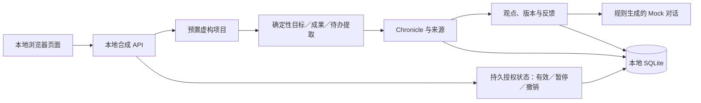

# Hark / Hearth：架构与交付现状

更新于 2026-11-04；源码基线 `c723f8b`。本页是便于理解的架构概览；任务进度、实际证据和适用门槛分别以 [STATUS](../../handoff/STATUS.md)、[任务细项](../../tasks/m1-work-items.json) 和对应验收记录为准。

## 产品方向

Hark 是本地优先的个人项目助手：帮助用户持续了解多个项目，查看目标、成果、待办和有依据的观点，通过对话纠正理解，并在条件成熟时提供研究建议。长期构想包括后台观察、研究、通知和经用户批准的动作；这些不因出现在架构中就表示已经实现。产品和构思见 [项目再发现](../mvp/04-PROJECT-REDISCOVERY.md) 与 [心智生命架构](../mvp/02-MIND-LIFE-ARCHITECTURE.md)。

## 已实现：受控合成闭环

- `pnpm demo` 启动本地浏览器体验，M1-R01～R06 已在隔离的合成环境走通，见 [验收记录](../../handoff/qa/M1-SYNTHETIC-ACCEPTANCE-2026-11-04.md)。页面标识合成数据和 Mock；回答是确定性规则，不是真实模型理解。
- 项目观察授权默认长期有效，直到暂停或撤销；历史限时授权仍遵循原记录。它不等同于执行或外发授权。
- 合成目录发现器未接入当前 API。最近一次修复的证据记录 168 项测试、lint、类型检查和构建通过，最终微调后又复跑 18 项相关测试；详见 [日志](../../handoff/EVIDENCE/m1-moved-child-fix-2026-11-04.txt)。

## 已知阻塞与当前进度

- M0 基础合同 Gate 已通过；M1 合成产品浏览器场景已运行，但独立复审尚未完成，M1→M2 Gate 未通过。
- A-C3 目录读取仍受阻：定向修复处理了已发生的目录移动和句柄复用，但检查与读取之间并发移动仍可在合成场景复现。该实现未接入合成 API，不能据此开放真实目录读取。见 [移动检查记录](../../handoff/qa/M1-A-C3-MOVE-CHECK-2026-11-04.md)。
- 用户已表达授权一个真实项目供只读分析；真实项目连接器、真实项目分析和模型对话尚未接入或验收。避免将真实目录和内容复制到仓库或公开证据。

## 目标架构：尚未实现的部分

用户选定项目文件夹并授予持续读取权限 → 安全的本地观察与来源记录 → 项目记忆和全局盘点 → 基于证据的观点、对话和反馈修订。未来可按资源与授权条件增加空闲调度、公共资料研究、候选过滤和通知。真实写入或执行属于后续能力，需要明确批准、可信执行及结果验证。上述是真实能力路线，不是已完成清单。

## 持续维护

架构或状态变化时更新本页和任务／验收记录；用户授权的本地画布和进度笔记通过忽略的 `data/hark-architecture-target.json` 定位，按 `AGENTS.md` 的维护规则同步。文件缺失时不得推测或搜索其他个人目录。验证状态请保留测试范围、证据路径和实际限制。
