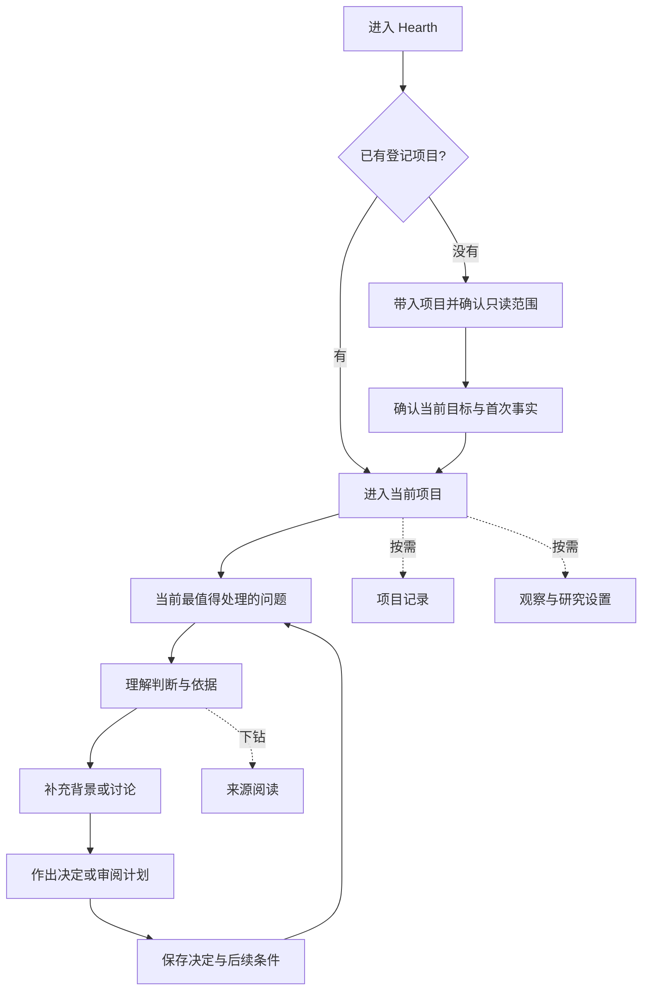

# Hearth · 产品与体验重构蓝图

2026-10-30 · v1 · 产品与交互方案，尚未实现的新结构。

用户已确认的约束：**先带入项目；默认一句判断、按需展开；进入项目先看到当前最值得判断或决定的一件事；火影低存在感，功能与内容优先。**

本轮重新整理功能、信息架构、内容、使用路径与交互。没有改动前端、数据库或运行权限，也不以此替代既有工程阶段门禁。产品事实摘要见根目录 `PRODUCT.md`；安全、数据合同与 `docs/mvp/` 继续生效。

## 1. 要解决的产品问题

Hearth 要帮助用户：**回到一个项目时，看清现在最值得处理的问题，理解理由，作出一个有记录、可继续的决定。**

一个完整的价值循环是：带入项目与目标 → 取得可信事实 → 识别值得弄清的问题 → 在许可内研究 → 提出可反驳判断 → 用户讨论和选择 → 留下决定 → 新证据出现时解释性修订。

用户带来目标、背景和判断权；Hearth 提供与目标有关的事实、研究及建议；双方围绕具体问题逐渐形成可追溯的决定。火影承载空间的温度，内容和行为承载产品能力。

## 2. 当前页面不聚焦的根因

源码与最近构建表明，上一轮改善了项目入口和真实性，但仍保留多套并行组织方式：

| 现有组织方式 | 用户承担的工作 | 重构原则 |
|---|---|---|
| 顶部项目/观察摘要，下方分析卡，再下方聊天 | 自己判断摘要、分析和聊天的关系及阅读顺序 | 以同一个项目问题贯穿判断、依据、讨论和决定 |
| 默认空聊天与“想先看清什么” | 用户主动发问后才开始寻找价值 | 优先给出有依据的当前焦点；没有判断时明确说明缺口 |
| 一个分析结果保留多个展开入口 | 理解“依据”“证据”“观察”“分析入口”分别在哪里 | 用“为什么这样判断”作为主要深入入口，来源与技术详情再下钻 |
| 按线程找回项目工作 | 在消息中重建未完问题和上次决定 | 项目先行，按问题和决定找回；线程作为讨论记录 |
| 页面需要持续解释 Mock、只读、火影与能力范围 | 在开始任务前读大量说明 | 重要限制邻近相关动作；常驻只保留会改变判断或选择的信息 |
| 火影、卡片、标题和输入都拥有明显视觉重量 | 无法迅速识别当前最重要的内容 | 让当前判断拥有唯一主层级，其他内容随任务出现 |

典型实现位置：`ProjectConversation.tsx` 独立呈现判断和分析入口；`RecommendationCard.tsx` 提供两个展开区；`ChatPage.tsx` 仍以消息列表和输入作为页面骨架。问题涉及产品组织方式，单独缩小卡片或换颜色无法解决。

## 3. 功能如何组织成用户能理解的产品

| 概念 | 用户的问题 | 产品含义 | 当前基础及缺口 |
|---|---|---|---|
| 项目 | 我们在关心什么？ | 目标、材料范围和长期记录的归属 | 已有观察项目和最小线程绑定；完整项目经历仍待建设 |
| 目标 | 什么值得现在做？ | 判断相关性和取舍的依据 | 新MVP已要求；当前界面没有完整持久目标流程 |
| 当前问题 | 现在要弄清什么？ | 组织一次判断及其后续讨论 | 对既有 topicKey/观点概念的用户呈现建议；不必另建一个任务管理系统 |
| 判断 | Hearth 怎么看？ | 有版本、有来源、有不确定性的观点 | 已有手动分析结果；完整观点版本与主动生成尚未完成 |
| 依据 | 为什么这样看？ | 项目事实、公开研究、替代解释与缺口 | 已有本地观察与分析引用；研究链待建设 |
| 讨论 | 哪些背景还没考虑？ | 用户补充、追问或反驳判断 | 当前聊天为Mock，不能假称真实推理与长期记忆 |
| 决定 | 我们选择怎样走？ | 采纳、修改、搁置或反驳及原因 | 已有简易分析反馈；不能等同完整决定记录 |
| 计划 | 如果继续，具体做什么？ | 可审阅步骤、风险、范围和验证方式 | 可呈现草案；真实执行仍不包含在当前自动研究权限内 |

这组概念是前台信息组织建议，不要求重新实现已有 Observer、Insight 和 Analysis，也不把网页导航直接变成后端模块列表。

## 4. 全站信息架构

建议一个主要工作空间，加少量按需目的地。顶层不并列展示“聊天、观察、洞察、分析、活动、项目管理”六个功能入口。



| 目的地 | 存在理由 | 默认内容 | 离开方式 |
|---|---|---|---|
| 带入/选择项目 | 建立真实上下文 | 已有项目或仓库路径与范围 | 进入项目；取消不创建假项目 |
| 当前项目工作空间 | 帮用户处理当前问题 | 一句判断、必要限制、下一步 | 展开同一问题、切项目或看记录 |
| 项目记录 | 找回决定及其来由 | 目标、未完问题、决定、观点变化 | 回到所选问题的当前位置 |
| 来源阅读 | 核对某个判断 | 与该判断有关的事实和引用 | 返回原问题、原讨论位置 |
| 观察与研究设置 | 控制产品读什么、能做什么 | 观察范围、启停、来源可用性；研究的独立许可与预算 | 保存或取消后回原处 |

项目切换入口始终可识别；记录是辅助入口；设置降低视觉权重。具体采用顶栏、收起式导航或其他结构，可在后续原型中比较，不把“所有入口都藏在菜单”设为原则。

已有深链接、原始观察页和历史记录保留作为下钻及兼容路径。重构前台不删除数据或证据。

## 5. 第一次使用：让第一次价值来得更早

### 5.1 带入项目

入口直接解释“让 Hearth 帮你看清这个项目的下一步”，主要动作是添加本地项目。品牌欢迎、称呼和演出不占一个必须通过的独立步骤。

填写仓库路径，检查是否可用，确认明确的只读范围。当前网页可复用路径输入；原生目录选择器属于平台能力候选，不能先画成已实现功能。JUnit 配置留在可选来源设置中。

### 5.2 确认关心的方向

只问一件与建议相关的事：“这个项目现在最想做成什么？”允许写一句话，或稍后补充。目标是有意义判断的核心上下文；缺少目标时可以显示有限事实，但不得假称已经知道优先级。

目标记录需要用户确认并可修改，不能把模型从README猜出的方向直接变成权威目标。持久化仍依赖既有 G1 阶段建设。

### 5.3 给出第一项真实反馈

- 取得了什么，就说明取得了什么，例如Git观察与测试证据缺口。
- 有足够依据且模型调用已获适用授权，才展示判断。
- 当前只有手动分析时，清楚给出“查看分析预览”，不暗中启动远端调用。
- 没有模型或研究许可，可以停在可信事实和缺口；不以Mock观点补成真实首轮成功。

公开研究与模型许可在用户需要相应能力时分别说明，不把所有授权、预算与配置堆入首次登记表单。

## 6. 项目主界面的构成

首屏回答三个问题：**现在该关心什么？为什么与我的目标有关？我可以怎样继续？**

### 默认状态：先看到当前判断

```text
Hearth       当前项目 ▾                         项目记录    设置

项目目标的简短上下文                 依据截至时间 / 必要限制

                 一句当前判断

                 一句“为什么此刻值得关注”

                 [ 看看为什么 ]   先放一放

                 补充情况或提出不同看法…
```

这是结构示意，不是视觉定稿。主判断使用页面主标题层级；项目名在导航承担身份，不再在正文重复一整块项目摘要。时间、来源与不确定性服从判断，且重要限制不隐藏。

输入是对当前问题的回应入口，默认克制。用户要从新问题开始时有明确入口；不要求每次浏览或反馈都先输入文字。

### 深入状态：沿同一个问题展开

点击“看看为什么”，主体进入该问题的完整内容，保留标题与当前位置。阅读顺序为：

1. 判断为什么与目标有关；
2. 支持判断的项目事实与研究，分别标来源和时间；
3. 不确定性、替代解释及什么证据会改变判断；
4. 当前讨论与用户补充；
5. 继续审阅方案或记录决定。

不在聊天上方继续加一组永久卡片；不同时铺开来源面板、研究面板、计划面板与聊天窗口。长依据进入可正常滚动的阅读区，来源原文再下钻。返回时保留原来的阅读位置与草稿。

### 决策状态：清楚区分选择与执行

“采纳建议”记录用户的方向；“查看计划”进入方案阅读。计划列范围、步骤、风险、外发及验证。只有真实执行通道已经实现且用户明确发起具体方案时，才能出现相应执行动作；当前不能提供假“开始执行”。

每一状态最多两个同等显著的主要动作。采纳、修改、搁置、反驳均可达，但不把四个选择同时做成首页主按钮。

## 7. 回访与多问题

回访时按以下逻辑恢复焦点：先尊重用户上次明确选择的位置；再看是否有与其目标相关、来源有效的新判断；没有时继续未完问题或决定。不要用全局时间排序悄悄替换用户正在处理的问题。

当一个项目有多个问题，主界面保持一个焦点，其余进入可见但低打扰的待看列表。用户可主动切换；切换不等于采纳、已读或完成。具体排序先采用可解释规则并经真实样本验证，不预造精确分数。

项目记录优先按问题与决定浏览。原始Git事件和逐条消息是进一步的证据；不要求用户从事件流或聊天回放中重新推理“我们上次为什么这样选”。

## 8. 无判断、失败与限制

| 状态 | 主体表达 | 主要动作 | 必须避免 |
|---|---|---|---|
| 没有项目 | 从一个项目开始 | 添加项目 | 空聊天与假项目生命周期 |
| 项目无目标 | 可以查看事实，尚缺关注方向 | 补一句目标 | 用通用摘要冒充相关判断 |
| 没有成功观察 | 尚未取得可用事实 | 查看采集问题/立即检查 | 展示“项目正常” |
| 没有值得提出的新观点 | 本次没有新的判断；可接上次问题 | 继续上次/提出问题 | 生成消息填空、鼓励重复调用 |
| 有事实，未分析 | 事实已取得，判断尚未形成 | 预览本次分析 | 将规则提示标成真实AI观点 |
| 正在研究/分析 | 本次真实任务及可取消状态 | 查看范围/取消 | 用火影证明后台工作 |
| 未配置、无权限、超预算 | 说明具体能力为何受阻 | 按需设置/返回事实 | 隐式联网或Mock回退 |
| 观察暂停/断流 | 说明截至时间和无法判断的区间 | 查看来源设置 | 把没有观察到解释为项目休眠 |
| 判断过期或来源失效 | 原判断保留，显著说明当前限制 | 核对依据/重新预览 | 仍把旧结论当新推荐 |
| 用户搁置 | 明确记录此次选择 | 返回当前项目 | 立即重复提醒 |
| 用户反驳 | 保存理由；说明是否需要重新审视 | 记录补充/继续讨论 | 把拒绝当事实证伪或抹去旧观点 |
| 请求失败/送达不确定 | 保留草稿并说明已知结果 | 核对记录/重试 | 提前显示成功或无条件重复付费 |

重要身份标识须邻近相应内容：本地事实、规则推断、Mock讨论和真实模型分析分清。真实模型的费用与数据外发确认仍在动作发生前完整展示；精简页面不能精简这些实质信息。

## 9. 一条用户故事，贯穿全站

以下为**未来体验示例，非已发生项目事实、研究结果或真实模型输出**：

用户带入一个检索工具项目，确认目标是“下周验证第一版是否可交付”。Hearth 在已有权限内取得当前版本的部分事实，发现验证依据存在缺口。

1. 用户先看到一句有范围的判断：“现在还不能确认这一版可交付，建议先补齐关键验证依据。”旁边保留“尚缺当前版本报告”的必要限制。
2. 点“看看为什么”，看见已取得事实、缺失证据，以及这为何影响交付判断。若尚无公开研究，明确未研究。
3. 用户补充：“这次只需要内部试用。”目标或约束的修改须确认记录，之后重新审视当前判断。
4. 有足够授权与能力后，Hearth给出修订判断及原因；旧版本可查。未具备此能力时原型必须标注待实现。
5. 用户选定“先做内部试用验证”。系统保存决定及验证条件，展示可审阅计划；不自动运行测试或改仓库。
6. 下次回来，先看到尚未完成的决定与最新证据范围。只有新证据真实存在，才说明判断有何变化。

这个故事检验的是项目目标、判断、讨论、决定和回访能否接成同一条路径。拥有一条聊天记录或一张漂亮建议卡还不足以说明这条路径完成。

## 10. 视觉与动效的职责

- 视觉首先区分当前判断、支持内容和辅助导航。用排版、间距和内容顺序建立层级，避免每个功能都拥有独立卡片、标题和装饰。
- 阅读与交互使用稳定、清晰的界面字体；品牌字标和特殊开场可有个性。具体字体、色板和材质待后续真实内容原型决定，本轮不冻结一套新皮肤。
- 火影退到低对比的外围或局部背景，不占正文槽位，不叠在主要文字后制造阅读负担；默认不要求用户理解它的状态。
- 当前项目身份与重要限制可读可查；原始HEAD、指纹、运行ID与长日志放到来源阅读或诊断层。
- 动效只帮助理解进入问题、展开依据、反馈已保存、切换项目；不以长开场阻止任务。火影关闭后整个产品仍完整可用。
- 昼夜与减少动态效果延续同一语义；桌面双尺寸优先，键盘焦点、原生控件与阅读位置恢复纳入验收。

## 11. 功能范围与优先级

| 分类 | 本轮整理后的内容 | 原因 |
|---|---|---|
| 核心，已有基础 | 项目登记、只读事实、范围/新鲜度、手动分析与同意、线程和证据入口 | 支撑第一项可信结果，优先复用 |
| 核心，尚需建设 | 目标/决定、按问题持续的观点、版本/反馈、回访停点 | 决定产品能否帮助用户继续推进 |
| 核心，依阶段门禁建设 | 受限公开研究、观点形成、安静投递、新证据修订 | 已确认MVP核心；缺乏授权与真实证据时不能模拟通过 |
| 增强候选 | 更多项目检索、观点版本对比UI、记录导出、细腻成果光效 | 不阻断一个项目的一条真实闭环 |
| 未来方向 | 自动开发、实验执行、PR、邮件/日历写入、团队与跨端扩展 | 引入额外权限和复杂度，当前不扩围 |
| 从主路径移出 | 独立欢迎演出、全局指标墙、常驻多卡、火效管理、工程日志 | 分散核心任务，放到合适的辅助层或保留为历史资产 |

“当前问题”优先复用既有观点的 topicKey，不顺带增加看板、任务分配、日历或项目管理套件。多项目机制不要求首页出现项目健康排名。

## 12. 实施与验证顺序

### 先验证结构

使用同一个明确标注的合成项目，制作三个连续的低保真可操作场景：**首次带入 → 围绕一条判断深入并决定 → 回访恢复与解释修订**。再补无判断、来源受阻和用户反驳分支。结构验证阶段不接真实外发，也不把演示状态当作业务持久化。

验证用户能否指出当前问题、说明为何与目标有关、找到下一步、理解是否会外发或改项目；同时观察是否把采纳建议误认为已经执行。发现这些问题再改结构，随后确定完整视觉方向。原型不是当前已实现的新页面，本轮尚未制作。

### 再对齐真实能力

沿用 G1-A/B/C → G2 → G3 → G4 → G5：项目/目标/决定及观点存储、授权与研究、可修订判断、真实UI投影、完整闭环。布局原型可先行，不能借此跨越安全或工程门禁。缺失阶段的界面明确未配置/未实现，保留现有可用路径。

### 最后完成视觉系统与真实验收

用真实长度的判断、依据、失败信息和长讨论校准排版及布局，再定组件、颜色、火影与动效。通过可运行的整条故事验证，交付双桌面尺寸、键盘、减少动态、无WebGL、来源失效、切项目隔离与重启恢复的证据。

不能以“界面只有一张卡”“模型写出一句话”作为聚焦或产品完成的证明。聚焦的验收对象是用户当前任务及其理解，产品完成仍需要真实来源、人工价值评审和适用门禁。

## 13. 现有界面如何迁移

| 当前部分 | 建议处置 | 保留边界 |
|---|---|---|
| HearthWelcome | 合并价值说明到带入项目，称呼降为可选偏好 | 不擅删既有浏览器偏好 |
| ProjectsPage | 形成项目入口与范围管理；避免承载所有工作信息 | 保留真实登记、启停与明确确认 |
| ProjectFocus + RecommendationCard | 整合为同一个问题的主内容和深入状态 | 来源、Mock、过期、反馈与失败不丢失 |
| ChatPage | 作为围绕当前问题展开的讨论方式 | 历史只读保留，草稿与项目范围隔离 |
| ObserverDetail / InsightDetail | 下沉为来源核对与诊断入口 | 深链接、原始事实和来源状态继续可达 |
| AnalysisLaunch | 在需要生成/更新判断时出现 | 原有单次预览、排除路径、指纹同意和取消全部保留 |
| ThreadRail | 历史记录兼容层，逐步增加按问题/决定浏览 | 不把线程改名就假装已有观点记忆 |
| EmberAtmosphere | 降低存在感，服从新内容布局 | 不用火势宣称后台状态或进度 |

## 14. 决策状态与后续仍需验证的点

已确认：项目先行、一句判断、当前最值得决定的事优先、火影退居氛围。

本蓝图建议：以项目问题组织工作空间；同一主区域按理解、讨论、决定逐层展开；记录与设置为辅助目的地；首次体验合并到项目接入。

尚需后续原型/数据验证：多个未决问题的选择与切换；用户修改目标后哪些判断需重审；用户阅读旧依据时新判断如何提示；判断标题的长度与必要限制如何共存。本文不预填研究频率、预算或新的执行授权。

## 15. 本轮交付与依据

本次为文档及结构设计交付。检查了产品目标合同、阶段与验收场景、现有源码、上一轮构建截图对应的交付记录；未重跑应用测试，未新增前端页面或交互原型，未调用模型/研究服务，未读取真实项目或私人目录。

依据：`docs/mvp/01-PRODUCT-CONTRACT.md`、`02-MIND-LIFE-ARCHITECTURE.md`、`03-ACCEPTANCE-SCENARIOS.md`、`docs/design/2026-10-30-PROJECT-FIRST-IMPLEMENTATION.md`，以及本轮用户两项选择。旧视觉探索与验证文件作为历史保留，不提升为当前产品承诺。
