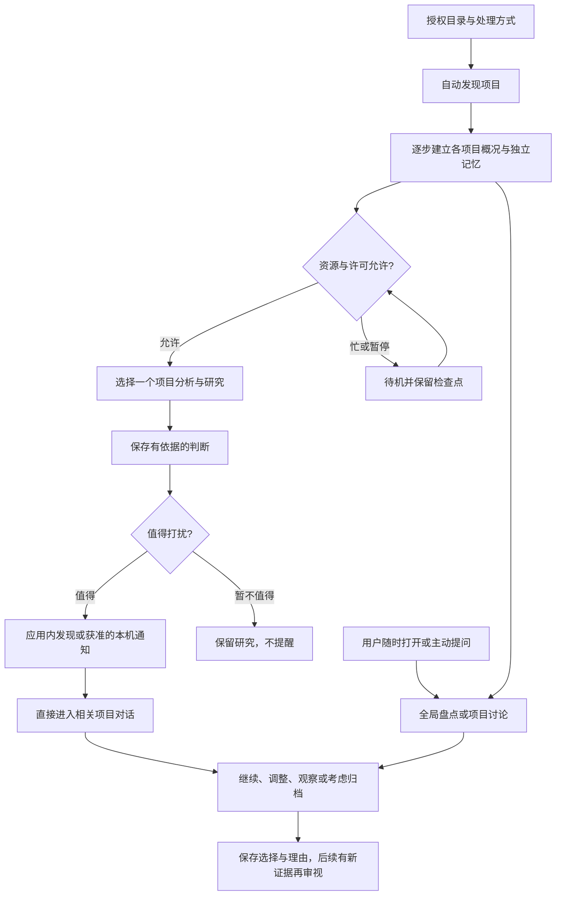

# Hearth · 产品与体验蓝图

2026-10-30 · v2 · 依据用户完整工作场景修订。本文为目标设计，尚未实现的新能力不能由界面假装完成。最新需求详见 [后台项目理解与重新发现](../mvp/04-PROJECT-REDISCOVERY.md)；当前能力见 [实现交付](2026-10-30-PROJECT-FIRST-IMPLEMENTATION.md)。

## 1. 产品围绕什么发生

安装后授权几个目录，Hearth逐步认识其中的新旧项目，分项目保留记忆，空闲时研究相关领域与已有实现。用户随时能聊整个项目集合，也能深入一个项目；有值得重新关注的发现时，系统主动邀请讨论。

主故事：**被搁置的项目重新被认识，外部的新参考让它产生新的可能，用户重新选择下一步。**炉心/火影为低存在感氛围，不承担功能入口或状态真相。

本轮修正v1：项目无需逐个手工登记；全局对话是核心；缺少旧目标不阻止初次了解；多项目与分项目记忆是基础；窗口之外的常驻、资源让路和本机通知必须成为真实产品能力。

## 2. 两种主动性，一条连续体验

后台主动了解，用户主动提问，两条路径使用同一套项目身份、记忆和证据。通知打开、全局盘点选中项目、历史回访都应进入同一个项目讨论上下文。

## 3. 前台只保留少量清楚的目的地

| 目的地 | 用户来做什么 | 默认呈现 |
|---|---|---|
| 对话 | 随时问整个项目集合，或接上次讨论 | 当前范围、自然输入、有价值时的一条发现；不强制先选项目 |
| 发现 | 看Agent在后台找到的机会和取舍建议 | 哪个项目、发现什么、为什么值得现在看；一句判断按需展开 |
| 项目库 | 找回自己做过的东西 | 名称、用途简述、了解覆盖情况、上次讨论/用户选择；按需进入项目记忆 |
| 权限与后台设置 | 控制它能读什么、何时工作、允许哪些研究 | 目录与排除项、模型/外发、研究范围/预算、后台资源与通知偏好 |

项目级对话是全局对话的深入状态，不必再开一套独立聊天应用。来源、研究原文、旧判断和技术日志按需下钻；项目列表不是质量排名或健康仪表盘。

## 4. 首次使用

1. 简短说明价值，选择授权目录并确认只读范围；不要求用户把每个旧项目填成表格。
2. 明确本地/远端处理、公开研究及预算许可，通知可选；已有手动Pi确认保持不变。
3. 后台先列出识别到的项目和初步概况，逐步填充，标记尚未读完或不确定的边界。
4. 用户可以直接提问；系统根据已覆盖部分回答，必要时为当前问题优先继续读取。

项目边界识别不确定时再轻量确认合并、拆分或排除。缺少目标时，从材料形成“可能的用途/原意”并明确待确认；用户不必先回忆完整背景才能得到帮助。初次扫描不运行项目脚本或测试。

安装、后台启用和系统通知授权需要真正实现；当前网页加一个开关不能代表后台已经常驻。

## 5. 日常打开与通知进入

### 主动打开

有有价值的新发现时，主区先呈现一句与具体项目有关的判断，默认一条，不堆卡墙。没有新发现时可以继续上次讨论，或直接问“哪些项目值得重新拾起”。不制造消息填空，也不以闲置时间给项目判死刑。

对话范围可见：全部授权项目，或具体项目。后台了解进度用一行简洁事实说明，例如已识别、已建立概况、等待空闲；计数来自真实记录。用户无需先处理后台状态才能聊天。

### 通知进入

通知在许可及安静政策内发出，包含具体项目与发现。点开后直接恢复该项目概况、当前判断与相关研究，输入位于可继续讨论的位置；不先跳到通用欢迎页或项目选择页。

“稍后看”“不再关注这类建议”应持久生效；相同判断不反复提醒，新的证据才可能产生解释性修订。未允许本机通知时，打开应用仍能查看发现。

## 6. 如何让用户重新掌握旧项目

项目讨论按当前问题取回内容：它当时可能想解决什么、已经做出哪些部分、入口和运行说明在哪里、哪些问题尚未解决、自己此前说过什么、后来有什么参考与判断。没有材料支撑时明确不知道，不能编造搁置原因。

默认给可读概况；用户问到具体实现时，再取得相关文件片段及来源。大目录不等于一次巨大的提示上下文。概况、事实索引、用户选择、研究和观点版本分层持久保存，跨项目盘点先用概况，再按需深入。

来源阅读返回后保留原问题、草稿和位置。用户对历史和目标的纠正优先记录为用户补充；模型猜测不自动覆盖它。

## 7. 判断、讨论与项目处理

一句判断背后应能够展开：支持事实、外部参考、适用目标、差异、未知、反例、建议下一步及会改变判断的条件。可建议继续开发、采用现成方案、保留观察、考虑归档或暂不能判断。

现成工具较完善时，仍需结合学习、个人用途、差异化需求和资源判断；用户不必因为存在同类实现就放弃。系统不能保证“创意独一无二”或“市场已经穷尽”。

全局提问可以给多个项目的可解释候选，说明哪些尚未了解充分，再选一个讨论。主动提醒仍一次聚焦一项有价值的发现。用户可修改、搁置、反驳，决定和理由进入项目记忆。

Hearth里的归档标记、实际移动文件和删除文件分开。后台研究只能提出建议，不能因判断无价值而自动处理用户目录；实际开发、搬迁和删除按独立范围与权限控制，当前不增加通道。

## 8. 忙与闲的真实呈现

前台窗口按需打开，本机服务在启用后维持后台生命周期。忙时停止启动新重任务，保存检查点；空闲再继续。前台对话优先，不能被后台全量扫描拖慢。

“后台待机”“资料未读完”“研究额度已用尽”“观察已暂停”有明确文字，不用火影代替。具体资源阈值、供电策略与频率待实测；默认不包含从系统睡眠唤醒电脑，也不采集屏幕或键盘内容。

资源空闲与用户愿意被打扰分别决定：完成研究不必立即发通知。已在途的模型请求不保证零费用或能撤回外发，状态与恢复需诚实记录。

## 9. 视觉与故事

主视觉让位于项目用途、发现与正在发生的讨论。项目身份明确，一次主动判断一句话，依据按需展开；不让分析摘要、观察状态、常驻卡片和聊天争抢主位。

故事通过产品行为成立：它能帮你想起旧项目，给出真正有用的参考，允许你不同意，下次还能接着聊。品牌暖意、火影和动效都应在关闭后不影响这些功能。具体视觉系统在真实内容和流程验证后决定。

## 10. 核心能力与落地次序

| 分类 | 内容 |
|---|---|
| 核心 | 目录授权与安全发现；多项目身份与独立记忆；找回旧项目；全局与项目对话；空闲调度与恢复；有界外部研究；可修订建议；发现及获准本机通知；用户取舍 |
| 增强候选 | 记忆关系图、复杂筛选、丰富批量整理、导出及更多视觉表现 |
| 后续独立方向 | 自动开发与实验、真实搬迁/删除、PR/邮件/日历写入、多人和跨端 |

先更新旧G0差距与依赖：原来“一个仓库+手动分析”的路径只覆盖部分基础。安装生命周期、目录发现、记忆、调度和真实对话需要单独设计与验证，不再只排前端精修任务。

实现可分可验收的纵切：一个授权目录内认识多个项目 → 对话找回其中一个旧项目 → 空闲时研究并保存一条有来源的建议 → 本机通知直接回到讨论 → 用户作出一次选择 → 全局盘点时能用上该选择。再扩充项目数量、材料类型和调度策略，保留既有安全与阶段门禁。

本轮为需求和设计校正，未制作原型、改动应用或运行后台扫描。实际实现边界继续以当前交付记录为准。
