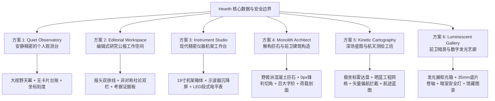

# Hearth UI-03：产品视觉识别与体验重设计方案探索报告

> **阶段**：Phase 1 视觉探索与原型验证（已扩展 6 套方案全矩阵验证）  
> **代码基线**：`codex/ui-refresh-01` (`7b7dd90`)  
> **核心原则**：真实工程事实驱动、零虚构模型态、保留 Pi 显式授权与安全约束、骨架级结构差异（禁止换色套壳）。

---

## 目录
1. [现有前端视觉与布局审计](#1-现有前端视觉与布局审计)
2. [六套视觉概念设计全景](#2-六套视觉概念设计全景)
   - [方案一：Quiet Observatory（安静精密的个人观测台）](#21-方案一quiet-observatory安静精密的个人观测台)
   - [方案二：Editorial Workspace（编辑式排版的研究工作空间）](#22-方案二editorial-workspace编辑式排版的研究工作空间)
   - [方案三：Instrument Studio（现代精密仪器风格的-agent-工作台）](#23-方案三instrument-studio现代精密仪器风格的-agent-工作台)
   - [方案四：Monolith Architect（解构巨石与前卫建筑构造）](#24-方案四monolith-architect解构巨石与前卫建筑构造)
   - [方案五：Kinetic Cartography（深场星图与航天测绘工坊）](#25-方案五kinetic-cartography深场星图与航天测绘工坊)
   - [方案六：Luminescent Gallery（前卫暗房与数字发光艺廊）](#26-方案六luminescent-gallery前卫暗房与数字发光艺廊)
3. [结构化差异证明：六大方案无色骨架对比](#3-结构化差异证明六大方案无色骨架对比)
4. [真实浏览器截图索引（1440px Playwright · 全 48 张产物）](#4-真实浏览器截图索引1440px-playwright--全-48-张产物)
5. [深度对比评估矩阵](#5-深度对比评估矩阵)
6. [综合推荐与 Phase 2 实施建议](#6-综合推荐与-phase-2-实施建议)

---

## 1. 现有前端视觉与布局审计

在进入方案探索前，我们对现有前端（`apps/web`）进行了系统的视觉与交互审计，识别出以下核心症结：

| 维度 | 现有前端现状 | 问题与负面体验 |
| :--- | :--- | :--- |
| **模板同质化 (Template Monotony)** | 每一个页面（首页、项目列表、项目详情、洞察页、设置页）均由三段固定套件拼接：`PageHeader`（粗体大标题 + 浅灰副标题）→ 筛选胶囊条 → 垂直堆叠的圆角白卡片。 | 视觉疲劳严重，各页面缺乏专属的功能气质与识别点；用户无法在 1 秒内通过空间版式感知当前所在频道的任务性质。 |
| **卡片包裹过剩 (Card Fatigue)** | 所有数据都被塞入 `border: 1px solid var(--color-border); border-radius: 12px;` 的同质卡片内。无论是单行指标、代码堆栈、Git 哈希还是测试摘要，均被相同尺寸与边框包裹。 | 页面缺乏呼吸感与主次焦点的纵深，重要的高危异常（如测试断言失败）与常规的已跟踪事实（如未暂存文件数为 0）在视觉重量上毫无差异。 |
| **事实表达乏力 (Unexpressive Git / Telemetry)** | Git 哈希（`c18faa1`）、分支名、JUnit 测试数量等核心工程事实被退化为单行文本或通用标签，缺乏精密仪器的刻度感或研究报告的严谨考证感。 | 感受像一个常规的 CRUD 管理后台，而非具备深度自动化感知、代码守卫能力的个人智能体工作台。 |
| **空态同质且平庸 (Generic Empty States)** | 空态统一为：居中灰色小图标 + `暂无...` + 浅灰色引导文字。 | 错失了传递「代码处于健康基线、智能体在静默守护」的信赖感，反而带给用户「缺少内容、配置未完成」的负面空虚心理。 |
| **信息密度失衡** | 1440px 宽屏下留白未经过结构化规划，导致核心信息水平拉长失真，侧边栏与主信息区比例呆板。 | 阅读视线需要大范围左右跳跃，降低了长久代码审查与日常巡检的舒适度。 |

---

## 2. 六套视觉概念设计全景

为了彻底跳脱常规软件界面的平庸与拘束，本阶段构建了**六套从空间隐喻、骨架栅格、排印节奏到材质光感完全不拘一格的高保真方案**。所有方案均已在 `prototypes/` 落地，并已通过 1440px 真实浏览器全量渲染验收。



---

### 2.1 方案一：Quiet Observatory（安静精密的个人观测台）

*让 Hearth 成为桌面上一座静默远眺的代码气象站与天文台。*

- **设计隐喻**：高海拔现代天文观测台或深空无线电监测站。
- **空间特征**：**彻底去卡片化**。顶部台站物理坐标条（微型雷达呼吸微点）+ 全宽大天幕叙事区（`The Horizon`）+ 发丝瞄准十字标（`+`）聚焦透镜 + 7:5 细线数据台账与垂直时间轴。
- **空态意象**：`天幕清澄 (Baseline Secure)`，安静呈现 0 项未决候选与平稳过境周期，无侵扰感。
- **原型源码**：[prototypes/01-quiet-observatory/](file:///Users/v/new-idea/hark/prototypes/01-quiet-observatory/)

---

### 2.2 方案二：Editorial Workspace（编辑式排版的研究工作空间）

*将代码事实呈现为一份值得细细品读的学术研究公报与头版特刊。*

- **设计隐喻**：《金融时报》(FT) 头版、深度学术研究公报。
- **空间特征**：经典古典报头（`The Hearth Dispatch`）+ 3px 双排线（`Double Folio Rule`）+ **63:37 经典非对称社论双栏** + 首字下沉排版（Drop-Cap）+ 双排线引用警句（Pull Quote）+ 粗细相间学术考据特刊证据板（Evidence Plate）。
- **空态意象**：`纯白卷轴 (Ex Libris · Tabula Rasa)`，典雅藏书票印章 + “今日无战事，工作树平整如新”。
- **原型源码**：[prototypes/02-editorial-workspace/](file:///Users/v/new-idea/hark/prototypes/02-editorial-workspace/)

---

### 2.3 方案三：Instrument Studio（现代精密仪器风格的 Agent 工作台）

*将个人智能体还原为一台具有硬件机架与旋钮刻度的精密声学 / 逻辑分析台。*

- **设计隐喻**：Dieter Rams 的 Braun 音响仪器实验室、Teenage Engineering、工业 19 寸机架。
- **空间特征**：四角机架固定螺丝（`(+)`）+ 顶部数字段码液晶仪表盘 + **沉降式示波器视窗 (Bay 02: Primary Transducer)**（内阴影物理倒角与绿磷波形模拟）+ **硬件通道十段式 LED VU 电平表** + 走带式事件步进器（Step-Sequencer）。
- **空态意象**：`示波器平波待机 (Flatline Waveform)`，通道 100% 全绿，段码屏幕显示 `FAULT REGISTER: 00 · ZERO NETWORK CALLS`。
- **原型源码**：[prototypes/03-instrument-studio/](file:///Users/v/new-idea/hark/prototypes/03-instrument-studio/)

---

### 2.4 方案四：Monolith Architect（解构巨石与前卫建筑构造）

*跳脱所有传统软件界面的束缚，用安藤忠雄清水混凝土、解构主义切角与前卫海报级排版重铸工作台。*

- **设计隐喻**：野兽派现代建筑巨石（Brutalist Architecture）、日本解构主义平面、前卫先锋时装工坊标牌。
- **视觉冲击与空间特征**：
  1. **纯正 0px 锋利解构切角**：拒绝圆角平庸，所有结构块采用 2px 重墨实线与锋利 0px 直角相拼，呈现极具力量感的建筑承重感。
  2. **海报级巨型字阶冲击 (Monumental Typography)**：主标采用紧缩超大号大写字母（`STRUCTURAL MONOLITH`，900 Extra-Black 字重），指标数字以 48px 巨型雕塑形式矗立。
  3. **工业警示带与黑金代码断口 (Hazard Ribbon)**：主断言异常直接挂载工业斜纹危险警示带（45度黑红相间），代码段采用纯黑背底与荧光青柠绿（`#b6ff00`）高压电击对比。
  4. **建筑剖面式项目详情 (Structural Elevation)**：项目页按工程剖面图绘制（Section 01 荷载版本、Section 02 应力测试、Section 03 结构时序日志），标注结构强度百分比。
- **空态意象**：`强固基石 (Basal Stone Stable)`，巨型雕塑三角标 `▲` 居中矗立，标注 `ALL SYSTEMS SOLID // 100% INTEGRITY`。
- **设计 Tokens**：
  - 浅色：工业灰泥 `#eae8e1`，板岩白 `#f7f6f2`，重墨黑 `#0d0e10`，荧光青柠 `#b6ff00`，危险朱红 `#ff2a00`。
  - 深色：黑曜石采石场 `#0a0a0c`，玄武岩板块 `#141519`，强光银白 `#f2f3f7`，高压激光绿 `#c8ff00`。
- **原型源码**：[prototypes/04-monolith-architect/](file:///Users/v/new-idea/hark/prototypes/04-monolith-architect/)

---

### 2.5 方案五：Kinetic Cartography（深场星图与航天测绘工坊）

*不再把代码视作呆板的文件列表，而是将代码库具象化为深场雷达星轨与航天飞控蓝图。*

- **设计隐喻**：JPL / NASA 深空测控站（Deep Space Network）、航天轨道力学图、工程晒蓝图纸（Blueprint）。
- **视觉冲击与空间特征**：
  1. **极坐标雷达深场星图 (Polar Coordinate Scope)**：核心区域直接嵌入动态极坐标测绘盘，同心圆轨道环（`r1`, `r2`, `r3`）与正交坐标轴交织，代码库化作具有轨道高程与偏心率的天体节点：
     - `hark` 位于 100% 稳定绿色标称轨道，附带信标微光呼吸；
     - `pindou` 呈现多普勒频移警报红点，产生偏航扰动报警。
  2. **蓝图毫米方格底纹**：背景全域铺设高精度晒蓝毫米网格，四个角落点缀十字对齐测绘准星（`+`）。
  3. **航天蓝图式项目详情 (Orbital Trajectory Dossier)**：项目详情页转化为飞行测控航迹图（Trajectory Waypoints），展示每一次 Git 提交在时空轨道中的进位航标与测试信道频宽。
- **空态意象**：`深空澄澈 (Deep Space Clear)`，极坐标雷达盘所有节点全部锁定于绿色正轨，`0 FAULT DETECTED`。
- **设计 Tokens**：
  - 浅色：晒蓝图纸底色 `#e8eef5`，测控台白 `#ffffff`，深墨蓝 `#0a223a`，矢量青 `#0077b6`，轨道绿 `#008f5a`。
  - 深色：深空黑 `#05080f`，夜航座舱 `#0b111e`，荧光矢量青 `#00f0ff`，航标橙 `#ffaa00`，偏航红 `#ff3355`。
- **原型源码**：[prototypes/05-kinetic-cartography/](file:///Users/v/new-idea/hark/prototypes/05-kinetic-cartography/)

---

### 2.6 方案六：Luminescent Gallery（前卫暗房与数字发光艺廊）

*将代码事实置于当代艺术双年展的聚光灯下，化身为具有光影通透感与底片质感的策展大厅。*

- **设计隐喻**：瑞士前卫艺术馆、摄影暗房安全灯、当代数字艺术策展橱窗（Fondation Cartier）。
- **视觉冲击与空间特征**：
  1. **通透发光展柜 (Luminescent Vitrines)**：展品被安置在具有柔和光晕（Ambient Glow）与磨砂微晶边缘的立体展台上，顶部带有紫罗兰至朱砂红的极光渐变发光线条。
  2. **光学参数刻度 (Optical Aperture Ledger)**：将复杂的工程指标转化为艺术摄影参数（光圈 f/1.4 代表敏锐巡检、曝光时间 2.41s 代表测试速度、ISO 100 代表干净工作树）。
  3. **35mm 胶片带式提交卷轴 (35mm Filmstrip)**：项目详情页中，Git 提交历史化作一条**两端带有胶片齿孔（`▪ ▪ ▪ ▪ ▪ ▪ ▪ ▪`）的 35mm 胶卷底片**，将代码版本赋予手工显影的匠心仪式感。
- **空态意象**：`纯白立方 (The Pristine White Cube)`，艺术馆名作展台留白，斜体衬线题词“所有底片均已显影固定，光影纯粹”。
- **设计 Tokens**：
  - 浅色：石膏白 `#f8f7f4`，展柜纯白 `#ffffff`，炭墨黑 `#18181b`，策展紫罗兰 `#7c3aed`，暗室朱砂 `#e11d48`。
  - 深色：天鹅绒暗房黑 `#09090b`，暗晶展柜 `#121216`，夜光紫 `#a78bfa`，安全灯玫红 `#fb7185`，显影翠绿 `#34d399`。
- **原型源码**：[prototypes/06-luminescent-gallery/](file:///Users/v/new-idea/hark/prototypes/06-luminescent-gallery/)

---

## 3. 结构化差异证明：六大方案无色骨架对比

即使在完全去除颜色、阴影与字体后，六套方案在空间栅格与信息组织上的骨架差异依然极其分明：

```
+----------------------------------------------------------------------------------------------------+
| 方案一：Quiet Observatory (开放天幕 + 十字透镜 + 7:5 细线数据台账)                                 |
| [Station Bar: Coords // Radar Pulse                                            [Nav] [Theme Toggle]|
| [Open Horizon: Large Narrative Typography . . . . . . . . . . . . . . .  [Metrics Ledger: 3-Col] ] |
| -------------------------------------------------------------------------------------------------- |
| [01 Focal Lens: Hairline Box with Crosshairs (+) + Severe Badge + Evidence Pills + Focus Link]     |
| -------------------------------------------------------------------------------------------------- |
| [Left 58%: Station Hairline Table Ledger]       | [Right 42%: Vertical Single-Rule Transit Stream]  |
+----------------------------------------------------------------------------------------------------+

+----------------------------------------------------------------------------------------------------+
| 方案二：Editorial Workspace (大报头双排线 + 非对称 63:37 社论专栏 + 首字下沉)                      |
| [Vol. IV · No. 42                        THE HEARTH DISPATCH                        Oct 29, 2026]  |
| ============================== Double Folio Rule (3px double) ==================================== |
| [Left 63% Lead Editorial Article]               | [Right 37% Marginal Column]                      |
| - Kicker: Special Dispatch                      | - Project Dossier Header                         |
| - Headline: Large Serif Monograph               |   * Folio I. hark [Clean]                        |
| - Drop-Cap Paragraph: First Letter 52px tall    | - Dispatch Docket Header                         |
| - [Pull Quote: Centered between Double Rules]   |   * Annotated Timecode & Monograph Notes         |
| - [Evidence Plate: Double Boxed Citation]       |                                                  |
+----------------------------------------------------------------------------------------------------+

+----------------------------------------------------------------------------------------------------+
| 方案三：Instrument Studio (19寸机架固定螺丝 + 模块化仪器箱格 + 沉降示波器)                           |
| [(+) Chassis Screw     HEARTH // MK-IV CONSOLE · CLK: 0.33Hz      [01] [02] [03]     (+) Screw]    |
| ================================================================================================== |
| [Digital Segment Ribbon: Recessed LCD Strip [0142 CYCLES] [02 CH] [01 FAULT] [99.7% ACCURACY]   ] |
| -------------------------------------------------------------------------------------------------- |
| [BAY 02: Primary Signal Transducer (Sunken Bezel Box with Inset Shadows)]                          |
| [BAY 01: Channel Matrix with 10-Segment VU Meter Bars [■■■■■■■■■■] ]                               |
| [BAY 03: Step-Sequencer Tape Deck with Hardware Timecode]                                          |
+----------------------------------------------------------------------------------------------------+

+----------------------------------------------------------------------------------------------------+
| 方案四：Monolith Architect (解构巨石 + 0px锋利切角 + 超大字阶雕塑 + 工业警示带)                    |
| [DATUM AXIS 127.0.0.1:4317                                    [01] [02] [03] [THEME: LIGHT]       ] |
| +------------------------------------------------------------------------------------------------+ |
| | MEGA SLAB: STRUCTURAL MONOLITH: 1 FAULT CAPTURED . . . . . . . . . . . [02 PYLONS] [01 FAULT]  | |
| +------------------------------------------------------------------------------------------------+ |
| [Left 62% Hazard Monolith with Red Hazard Stripes] | [Right 38% Vertical Concrete Pylons]          |
| - Hazard Ribbon /// Raw Brutal Code Block ///      | - Monolith Pylon 01: HARK (348 PASS)          |
| - Action Dock with Sharp Brutal Primary Button     | - Load Telemetry Timeline                     |
+----------------------------------------------------------------------------------------------------+

+----------------------------------------------------------------------------------------------------+
| 方案五：Kinetic Cartography (深场极坐标雷达盘 + 晒蓝网格 + 偏航矢量拦截板)                         |
| [FLIGHT CONTROL BAR: AZ: 042° · EL: +61° · RANGE: 0.33Hz . . . . . . . . . . .  [01] [02] [03]     ] |
| +------------------------------------------------------------+-----------------------------------+ |
| | RADAR HUD: Deep Field Mission Narrative                    | [POLAR SCOPE: Concentric Rings]   | |
| | Active Nodes: 2 | Perturbation: 1 Fault | Integrity: 99.7% | - Node Alpha (Green stable orbit) | |
| |                                                            | - Node Beta (Red perturbed orbit) | |
| +------------------------------------------------------------+-----------------------------------+ |
| [TARGET INTERCEPT DOCKET: Doppler Anomaly Box & Raw Stack Trace]                                   |
| [Left 50%: Orbital Ephemeris Table]          | [Right 50%: Realtime Telemetry Doppler Stream]      |
+----------------------------------------------------------------------------------------------------+

+----------------------------------------------------------------------------------------------------+
| 方案六：Luminescent Gallery (发光展柜光箱 + 35mm底片卷轴 + 艺术展厅双区)                           |
| [CURATORIAL MASTHEAD: Hearth Lumina                       [Main Hall] [Catalogue] [Insights]     ] |
| +------------------------------------------------------------------------------------------------+ |
| | LIGHTBOX VITRINE: Glowing Top Border Line (Violet to Safelight Gradient)                       | |
| | Exhibition Title: Serif Monograph . . . . . . . . . . . . . [02 VITRINES] [01 SAFELIGHT] [99.7%]| |
| +------------------------------------------------------------------------------------------------+ |
| [Focal Artwork Vitrine: Soft Ambient Shadow Box + Safelight Tag + Negative Film Strip Snippet]    |
| [Left 55%: Catalogue Raisonné Artwork List]  | [Right 45%: Darkroom Chemical Exposure Log]         |
+----------------------------------------------------------------------------------------------------+
```

---

## 4. 真实浏览器截图索引（1440px Playwright · 全 48 张产物）

全矩阵截图由 Playwright 在真实 Chromium 浏览器（1440px 视口，双倍视网膜清晰度）下渲染生成，已全部存入 [docs/design/screenshots/](file:///Users/v/new-idea/hark/docs/design/screenshots)：

### 4.1 方案一：Quiet Observatory (个人观测台)
- **首页内容态**：[Light](file:///Users/v/new-idea/hark/docs/design/screenshots/01-quiet-observatory-home-light.png) / [Dark](file:///Users/v/new-idea/hark/docs/design/screenshots/01-quiet-observatory-home-dark.png)
- **首页基线空态**：[Light](file:///Users/v/new-idea/hark/docs/design/screenshots/01-quiet-observatory-home-empty-light.png) / [Dark](file:///Users/v/new-idea/hark/docs/design/screenshots/01-quiet-observatory-home-empty-dark.png)
- **项目详情态**：[Light](file:///Users/v/new-idea/hark/docs/design/screenshots/01-quiet-observatory-project-detail-light.png) / [Dark](file:///Users/v/new-idea/hark/docs/design/screenshots/01-quiet-observatory-project-detail-dark.png)
- **项目未探测空态**：[Light](file:///Users/v/new-idea/hark/docs/design/screenshots/01-quiet-observatory-project-detail-empty-light.png) / [Dark](file:///Users/v/new-idea/hark/docs/design/screenshots/01-quiet-observatory-project-detail-empty-dark.png)

### 4.2 方案二：Editorial Workspace (研究公报)
- **首页内容态**：[Light](file:///Users/v/new-idea/hark/docs/design/screenshots/02-editorial-workspace-home-light.png) / [Dark](file:///Users/v/new-idea/hark/docs/design/screenshots/02-editorial-workspace-home-dark.png)
- **首页基线空态**：[Light](file:///Users/v/new-idea/hark/docs/design/screenshots/02-editorial-workspace-home-empty-light.png) / [Dark](file:///Users/v/new-idea/hark/docs/design/screenshots/02-editorial-workspace-home-empty-dark.png)
- **项目详情态**：[Light](file:///Users/v/new-idea/hark/docs/design/screenshots/02-editorial-workspace-project-detail-light.png) / [Dark](file:///Users/v/new-idea/hark/docs/design/screenshots/02-editorial-workspace-project-detail-dark.png)
- **项目未探测空态**：[Light](file:///Users/v/new-idea/hark/docs/design/screenshots/02-editorial-workspace-project-detail-empty-light.png) / [Dark](file:///Users/v/new-idea/hark/docs/design/screenshots/02-editorial-workspace-project-detail-empty-dark.png)

### 4.3 方案三：Instrument Studio (精密仪器)
- **首页内容态**：[Light](file:///Users/v/new-idea/hark/docs/design/screenshots/03-instrument-studio-home-light.png) / [Dark](file:///Users/v/new-idea/hark/docs/design/screenshots/03-instrument-studio-home-dark.png)
- **首页基线空态**：[Light](file:///Users/v/new-idea/hark/docs/design/screenshots/03-instrument-studio-home-empty-light.png) / [Dark](file:///Users/v/new-idea/hark/docs/design/screenshots/03-instrument-studio-home-empty-dark.png)
- **项目详情态**：[Light](file:///Users/v/new-idea/hark/docs/design/screenshots/03-instrument-studio-project-detail-light.png) / [Dark](file:///Users/v/new-idea/hark/docs/design/screenshots/03-instrument-studio-project-detail-dark.png)
- **项目未探测空态**：[Light](file:///Users/v/new-idea/hark/docs/design/screenshots/03-instrument-studio-project-detail-empty-light.png) / [Dark](file:///Users/v/new-idea/hark/docs/design/screenshots/03-instrument-studio-project-detail-empty-dark.png)

### 4.4 方案四：Monolith Architect (解构巨石 · 全新突破方案)
- **首页内容态**：[Light](file:///Users/v/new-idea/hark/docs/design/screenshots/04-monolith-architect-home-light.png) / [Dark](file:///Users/v/new-idea/hark/docs/design/screenshots/04-monolith-architect-home-dark.png)
- **首页基线空态**：[Light](file:///Users/v/new-idea/hark/docs/design/screenshots/04-monolith-architect-home-empty-light.png) / [Dark](file:///Users/v/new-idea/hark/docs/design/screenshots/04-monolith-architect-home-empty-dark.png)
- **项目详情态 (建筑剖面)**：[Light](file:///Users/v/new-idea/hark/docs/design/screenshots/04-monolith-architect-project-detail-light.png) / [Dark](file:///Users/v/new-idea/hark/docs/design/screenshots/04-monolith-architect-project-detail-dark.png)
- **项目未探测空态**：[Light](file:///Users/v/new-idea/hark/docs/design/screenshots/04-monolith-architect-project-detail-empty-light.png) / [Dark](file:///Users/v/new-idea/hark/docs/design/screenshots/04-monolith-architect-project-detail-empty-dark.png)

### 4.5 方案五：Kinetic Cartography (深场星图 · 全新突破方案)
- **首页内容态 (极坐标雷达盘)**：[Light](file:///Users/v/new-idea/hark/docs/design/screenshots/05-kinetic-cartography-home-light.png) / [Dark](file:///Users/v/new-idea/hark/docs/design/screenshots/05-kinetic-cartography-home-dark.png)
- **首页基线空态**：[Light](file:///Users/v/new-idea/hark/docs/design/screenshots/05-kinetic-cartography-home-empty-light.png) / [Dark](file:///Users/v/new-idea/hark/docs/design/screenshots/05-kinetic-cartography-home-empty-dark.png)
- **项目详情态 (航迹蓝图)**：[Light](file:///Users/v/new-idea/hark/docs/design/screenshots/05-kinetic-cartography-project-detail-light.png) / [Dark](file:///Users/v/new-idea/hark/docs/design/screenshots/05-kinetic-cartography-project-detail-dark.png)
- **项目未探测空态**：[Light](file:///Users/v/new-idea/hark/docs/design/screenshots/05-kinetic-cartography-project-detail-empty-light.png) / [Dark](file:///Users/v/new-idea/hark/docs/design/screenshots/05-kinetic-cartography-project-detail-empty-dark.png)

### 4.6 方案六：Luminescent Gallery (发光艺廊 · 全新突破方案)
- **首页内容态 (微光光箱展品)**：[Light](file:///Users/v/new-idea/hark/docs/design/screenshots/06-luminescent-gallery-home-light.png) / [Dark](file:///Users/v/new-idea/hark/docs/design/screenshots/06-luminescent-gallery-home-dark.png)
- **首页基线空态**：[Light](file:///Users/v/new-idea/hark/docs/design/screenshots/06-luminescent-gallery-home-empty-light.png) / [Dark](file:///Users/v/new-idea/hark/docs/design/screenshots/06-luminescent-gallery-home-empty-dark.png)
- **项目详情态 (35mm胶卷卷带)**：[Light](file:///Users/v/new-idea/hark/docs/design/screenshots/06-luminescent-gallery-project-detail-light.png) / [Dark](file:///Users/v/new-idea/hark/docs/design/screenshots/06-luminescent-gallery-project-detail-dark.png)
- **项目未探测空态**：[Light](file:///Users/v/new-idea/hark/docs/design/screenshots/06-luminescent-gallery-project-detail-empty-light.png) / [Dark](file:///Users/v/new-idea/hark/docs/design/screenshots/06-luminescent-gallery-project-detail-empty-dark.png)

---

## 5. 深度对比评估矩阵

下表对全部六个方案进行了系统性横向评估：

| 方案 | 视觉冲击力与前卫度 | 日常使用抗疲劳度 | 5 秒内核心态势感知 | 设计独特性辨识度 | 推荐使用场景 |
| :--- | :--- | :--- | :--- | :--- | :--- |
| **01 Quiet Observatory** | ★★★★☆ | ★★★★★ (顶尖) | ★★★★★ | 极高（天幕台账） | 长期全天候挂在副屏、追求极度安静低干扰 |
| **02 Editorial Workspace** | ★★★★☆ | ★★★★☆ | ★★★★☆ | 极高（古典报业） | 重度代码质量评审、注重考据严谨度 |
| **03 Instrument Studio** | ★★★★☆ | ★★★★☆ | ★★★★★ (极快) | 高（Braun 硬件） | 音频/硬件爱好者、偏爱直观电平刻度 |
| **04 Monolith Architect** | **★★★★★ (极强)** | ★★★★☆ | ★★★★★ | **无与伦比 (野兽派)** | **追求强烈先锋感、极简建筑雕塑与大字阶冲击** |
| **05 Kinetic Cartography** | **★★★★★ (极强)** | ★★★★☆ | ★★★★★ | **极其跳脱 (航天测控)** | **喜爱极坐标雷达、空间轨道感与航天蓝图可视化** |
| **06 Luminescent Gallery** | **★★★★★ (极强)** | ★★★★★ | ★★★★☆ | **艺术馆典藏 (通透发光)** | **追求当代艺术馆的高雅留白、35mm胶片与微光氛围** |

---

## 6. 综合推荐与 Phase 2 实施建议

### 6.1 前卫跳脱方案推荐

如果您希望 Hearth **彻底摆脱任何平庸软件工具的既视感，具备一眼难忘的高级设计感与艺术质感**：

1. **先锋硬核首选：方案四 Monolith Architect（解构巨石与前卫建筑构造）**
   - 彻底打破“白色圆角卡片”的惯性，用超大字阶、清水混凝土灰泥与 0px 锋利切角构建出如建筑丰碑般坚不可摧的工程守护信赖感；
   - 工业警示条纹与荧光青柠绿的高压电击对比，让异常在 1 秒内夺目而出，令人极其有掌控欲。
2. **极客航天首选：方案五 Kinetic Cartography（深场星图与航天测绘工坊）**
   - 将工作台直接升维为飞控雷达盘，用极坐标轨道节点表达代码健康度，将原本枯燥的代码列表转化为充满未来感的深空测绘图；
   - 晒蓝工程网格底纹与航迹剖面图极其适合对精密航天工业美学有偏好的工程师。
3. **当代艺廊首选：方案六 Luminescent Gallery（前卫暗房与数字发光艺廊）**
   - 极为考究的纯白展柜与暗房安全灯对比，35mm 胶片带齿孔的提交卷轴让人爱不释手，每一条代码记录都被当作艺术品般珍藏；
   - 呼吸感与留白极佳，兼具极高的艺术品味与阅读舒适度。

### 6.2 Phase 2 推进流程
等待您从这六套方案中（尤其重点关注 04、05、06）选定心仪的方向后，我们将立即进入正式生产代码工程实施，将选定方向沉淀为全套 CSS Design Tokens，并逐页重塑生产前端。
