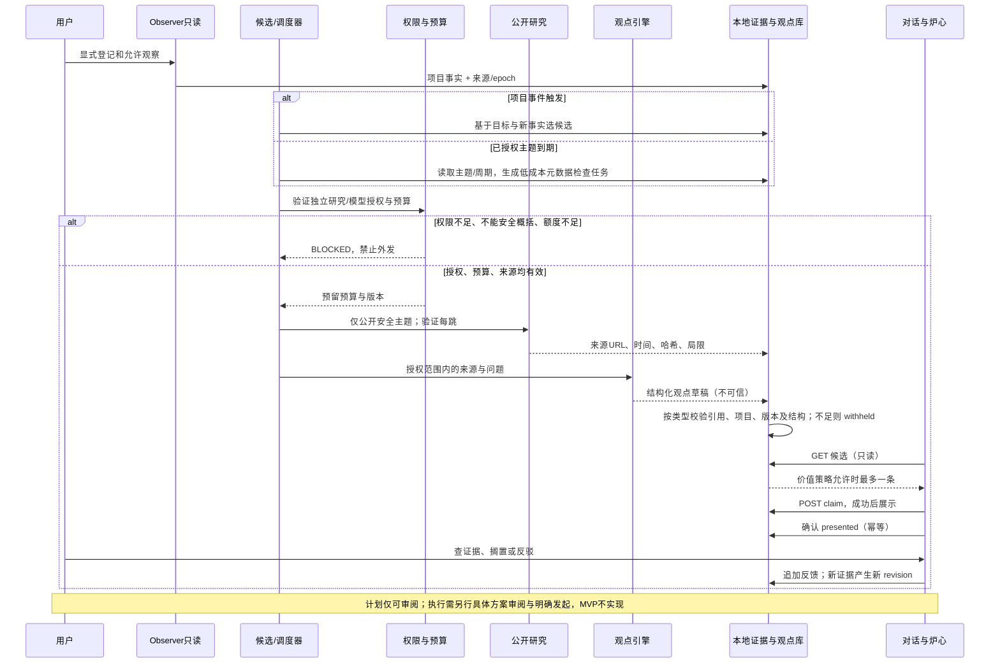
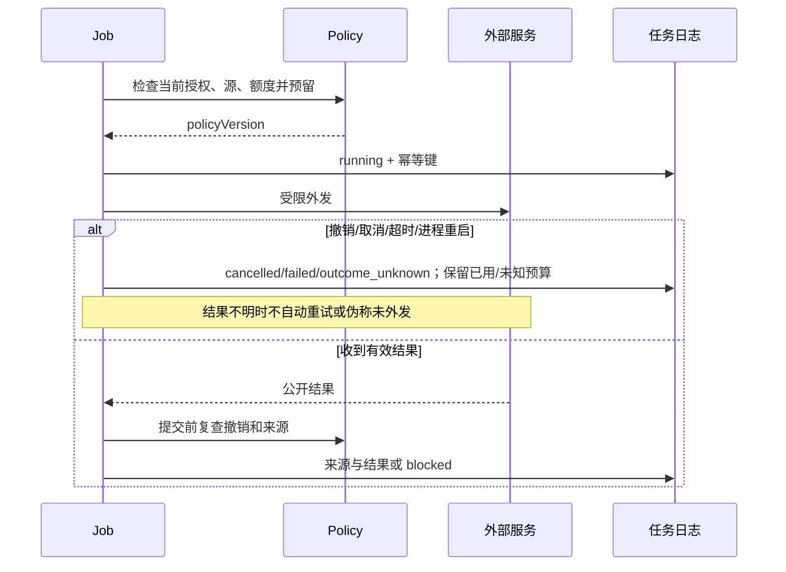

# G0 · 需求、接口与技术决策合同

> 审查后修订提案 v0.2；G0 审查结论为 CONDITIONAL_PASS，修订版尚待再次审阅。不是已上线 API、迁移、授权或执行许可。严格 Zod、项目隔离、最小权限和旧安全合同不可降低。

## 1. 需求及边界

| ID | 必须达到的可观察行为 | 源码落点（提议） | 验收 |
|---|---|---|---|
| R1 | 用户显式登记项目及可观察的 source；项目/目标/决定与线程独立 | `packages/project-observer` 只读端口 + 新 Chronicle 存储；`apps/server` | 真实登记、跨项目拒绝、pause/gap/restart |
| R2 | 事实保留类型化来源和时间；仅观察流使用 epoch；未知与暂停不可伪装成安静或健康 | Observer read port + 新 Evidence Ledger | 真实只读观察及 N07/N08/N17 |
| R3 | 与目标有关的事件驱动候选，以及授权主题下独立于项目变动的定期公开发现；独立于模型质量门禁 | Insight + 新候选选择器 | 相关性规则可解释、无新信息静默，N09/N15/N24 |
| R4 | 默认关闭；仅已授权的公开检索、模型与指定用途在范围及额度内运行；本地防泄露、可取消 | 新 ResearchPolicy/Job 与 public-only adapter | N01–N05/N12/N13 + 一次真实公开访问日志 |
| R5 | 观点事实/推断/引用/反证/局限/计划分开，持久版本及反馈 | 新 Opinion/Revision/Feedback；可借 Pi 安全机制 | N06/N07/N10/N11，重启保留、不覆盖 |
| R6 | 主界面最多一条非打扰主观点；读取、展示确认和反馈分开，用户可查证及搁置/反驳 | 新 ProactivePolicy + 对话页面 | N09/N10/N23/N24，用户输入焦点不被抢 |
| R7 | Flame/Story 同源且不能反推事实；无关联时中性；交互反馈短暂独立 | 新 Narrative 投影 + 现有 `EmberAtmosphere` | N08/N16–N21，桌面及无障碍证据 |
| R8 | 计划草案不携带执行权；无明确具体发起不得动仓库、跑项目实验或外部写 | 新 server 授权域及旧路径真实模式隔离 | N11/N12/N22；断言无副作用，不只检查 UI |
| R9 | 用户反馈和新证据产生有原因的新版本，稳定恢复和去重 | Opinion service + 持久化 | H1 新证据→版本变化→重启后重放 |

## 2. ADR（本轮方案，待审阅）

**ADR-01 身份。** `HearthProjectId` 是新的持久身份，关联一个或多个显式授权 `ProjectSource`；真实 Observer 项目 id 作为 `(kind=observer, externalId)`，Demo id 作为 `(kind=demo, externalId)`，禁止隐式互换。`ThreadProjectBinding` 多对多并声明当前 focusedProjectId；单线程可全局/多关联，缺少绑定或跨域查询必须失败关闭。先新增表及显式用户确认的绑定路径，不自动把历史 Demo id 改成真实 id。切换时取消或按项目隔离异步请求，服务端再检验 scope。

**ADR-02 类型化证据与来源。** `EvidenceRef` 是带 `kind` 的判别联合：`ObserverEvidenceRef` 绑定 `(projectId, observerSourceId, epoch, eventId)`、观察时间与质量；仅观察流有 epoch、watermark 和 source reset。`ResearchSourceRef` 绑定 `(projectId, researchSourceId)`，记录规范 URL、访问时间、内容哈希及版本/发表时间（如有）、可用性与授权；URL 不属于 Observer、不可伪造 epoch。`UserDecisionRef` 绑定 `(projectId, decisionId, revision)` 与记录时间及撤回状态，由用户决定版本控制。三者均检验当前项目范围、来源存在和适用的权限/可信度，但不能互换其身份或语义。公开引用只能证明获取记录，不能证明私人项目事实；用户决定是用户选择，不是对外部命题的客观证明。来源失效时保留历史引用并明确标记 unavailable/withdrawn/stale，严禁跨项目借用，不跨库虚构外键。若引用无法解析或权限不再有效则 withheld；类型校验不等于内容事实正确。

**ADR-03 观点。** Opinion 为 `(projectId, topicKey)` 身份和当前版本指针；OpinionRevision 单调递增、不可变，事务内 CAS `expectedRevision` 防丢更新；用户反馈单独 append，拒绝计划不是事实证伪。revision 需要事实/推断、可追溯证据、反例或明确缺失、局限、建议、可证伪条件和不可执行 Plan 草案。引用缺失/跨项目、观察流旧 epoch 或研究来源不可用、决定已撤回时 withheld；Schema 校验只能验证结构和引用合法性，不证明结论真实或有用。

**ADR-04 双授权与网络。** 观察授权、公开研究授权、模型使用授权、执行授权彼此独立；默认全关闭（新能力），不继承 UI 偏好、旧 Analysis 单次批准或 Demo 权限。授权含项目/source、provider/recipient、用途、允许域、预算/次数/时间窗、可撤销与版本。模型必须有单独授权；不得为了自动研究绕过已有逐次外发预览合同，若需预授权必须先单独评审数据范围与授权方式。用户可一次持久批准项目的公开研究主题、边界、允许来源、频率、预算、期限与撤销方式；Hearth 可在范围内自行提出问题、构造脱敏查询并检索，无需逐词再批准。仅公开可表达的主题可外发；无法证明搜索词属于授权范围、无法安全概括或超范围时 BLOCKED 并请求新的范围确认。自动过滤不证明绝对安全。公开研究授权不包含自动模型调用或私有项目数据外发；这些须有独立明确授权，且既有 Pi 的逐次上下文确认不得被静默取消。服务端在每次出站前重新校验持久授权、预算、取消、源状态与 policyVersion；配额在事务内预留并记账，重启时未知结果为 unknown，不自动重复付费或计为成功。拦截 localhost/private/link-local/metadata IP、非 HTTPS、重定向越域、DNS 重绑定和超大响应；最终解析及每跳都需验证，有界超时/大小/次数；不接个人账号、不执行网页脚本。研究来源/网页/README/模型输出均不可信，绝不当指令或调用工具；日志不存秘密、绝对路径、源码或原始敏感文本。

**ADR-05 调度与恢复。** 在既有进程增设持久 bounded scheduler，区分 `(a) event`：可信项目事实、目标或决定改变；`(b) topic`：项目的持久授权研究主题到达所选周期，**即使本地无 Git 变动也可检查**。主题扫描默认关闭，仅在明确授权的领域、provider/来源、频率、额度和有效期内运行；先限额查询公开元数据并按规范 URL/版本/哈希去重，只有出现新且可能相关的资料才进入深入研究候选；无变化不调用模型或生成观点，按 quiet policy 静默。主题和 query 必须先做范围及隐私检查；不把敏感本地事件或资料塞入查询。周期、最低间隔、来源与上限均配置化并需实际成本验证，不能假定免费。

两条触发线使用各自稳定 idempotency key、扫描 watermark 和有限并发/预算；跨事件和主题产生同一来源时去重关联，不重复研究/打扰。任务持久租约，重启后未确认外发为 `outcome_unknown`、不得盲重试或伪称零费用。授权到期/撤销、网络失败、配额耗尽和取消均停止后续调用并记录原因；断线不能凭空推进 watermark。观察状态与动画暂停无关。

**ADR-06 投影。** 服务端 `NarrativeState` 单一投影同时生成 Story 和 Flame 的纯展示输入；无有效项目是中性，`disabled/unavailable/gap/unknown/stale` 单独表达，不编造 dormancy 或成功；金色仅经有证据的里程碑语义授权，不能由全部卡完成推出。焦点、打字等仅短时动效，不改变事实或状态。历史视觉形态只是资源，不代表线性等级。所有信息有文字替代。

**ADR-07 执行。** MVP 的真实模式无真实执行入口，计划默认 `executable=false`；旧 Demo 动作只在服务端确认的隔离合成模式中存在。G1-A 须审查并保护线程模拟执行、`/cards/:id/execute`、`/approvals/:runId` 以及 Orchestrator 直接调用、恢复和所有可能副作用路径；真实、未知/失效模式对不允许动作服务端拒绝，不能仅隐藏 UI 或信任客户端 demo/risk。对取消及只读诊断等非执行动作按最小权限逐项审查，不一概关闭造成无法停止已有工作。将来扩展必须另审每个方案版本、目标、作用域、风险/预算、失效与发起人，持久化一次性授权并在执行前重验；既有 `ApprovalGrant` 不是后台研究令牌。批准“保存计划”不等于发起执行。

## 3. 最小数据合同（概念性 Zod；非现有实现）

所有外部请求、源适配器、模型输出以 `z.object({...}).strict()` 解析；id、字符串、数组、URL、时间和文本都须有上限；`projectId` 由服务端授权上下文确定并与请求交叉校验。以下伪类型体现必需字段，具体字段长度和版本在 G1 首个实现提交固化：

```ts
type ObserverEvidenceRef = { kind: 'observer'; projectId: Id; observerSourceId: Id; epoch: number; eventId: Id; observedAt: ISODate; quality: 'observed'|'stale'|'unknown' };
type ResearchSourceRef = { kind: 'research'; projectId: Id; researchSourceId: Id; accessedAt: ISODate; contentHash: string; availability: 'available'|'stale'|'unavailable' };
type UserDecisionRef = { kind: 'decision'; projectId: Id; decisionId: Id; revision: number; recordedAt: ISODate; status: 'active'|'withdrawn' };
type EvidenceRef = ObserverEvidenceRef | ResearchSourceRef | UserDecisionRef;
type Project = { id: Id; createdAt: ISODate; state: 'active'|'deleting'|'deleted' };
type GoalRevision = { projectId: Id; goalId: Id; revision: number; statement: string; author: 'user'; createdAt: ISODate };
type Decision = { id: Id; projectId: Id; goalRevisionId?: Id; kind: string; userReason?: string; at: ISODate };
type ObserverSource = { id: Id; projectId: Id; enabled: boolean; epoch: number; lastObservedAt?: ISODate; freshness: 'fresh'|'stale'|'unknown'|'gap'|'disabled'|'unavailable' };
type TopicScope = { id: Id; projectId: Id; version: number; publicTopic: string; boundaries: string[]; enabled: boolean; intervalSeconds: number; expiresAt: ISODate };
type ResearchPolicy = { projectId: Id; version: number; enabled: boolean; topicScopeId: Id; providerId: string; allowedDomains: string[]; maxRequests: number; maxCost: number; windowEndsAt: ISODate; revokedAt?: ISODate };
type ResearchJob = { id: Id; projectId: Id; policyVersion: number; dedupeKey: string; trigger: { kind: 'event'; refs: EvidenceRef[] } | { kind: 'topic'; topicScopeId: Id; scheduledWindow: string }; status: 'proposed'|'eligible'|'running'|'completed'|'blocked'|'failed'|'cancelled'|'outcome_unknown'; reservedUnits: number; usedUnits: number; startedAt?: ISODate; endedAt?: ISODate };
type ResearchSource = { id: Id; jobId: Id; projectId: Id; canonicalUrl: HttpsUrl; accessedAt: ISODate; contentHash: string; title: string; limitations: string[] };
type Opinion = { id: Id; projectId: Id; topicKey: string; currentRevision: number; status: 'draft'|'ready'|'presented'|'acknowledged'|'deferred'|'withdrawn' };
type OpinionRevision = { id: Id; opinionId: Id; projectId: Id; version: number; facts: EvidenceRef[]; inferences: string[]; counterEvidence: EvidenceRef[]; uncertainties: string[]; opinion: string; whyNow: string; alternatives: string[]; changeMyMindWhen: string[]; researchSourceIds: Id[]; proposedPlanId: Id; createdAt: ISODate };
type ProposedPlan = { id: Id; projectId: Id; revisionId: Id; versionHash: string; steps: string[]; risks: string[]; validation: string[]; executable: false };
type Feedback = { id: Id; projectId: Id; revisionId: Id; choice: 'accept'|'modify'|'defer'|'challenge'; reason?: string; deferUntil?: ISODate; createdAt: ISODate };
type Delivery = { projectId: Id; revisionId: Id; dedupeKey: string; status: 'eligible'|'claimed'|'presented'|'delivery_uncertain'|'suppressed'; claimId?: Id; leaseUntil?: ISODate; presentedAt?: ISODate; reason?: string };
```

约束：`UNIQUE(opinion_id,version)`、`UNIQUE(project_id,topic_key)`、`UNIQUE(project_id,dedupe_key)`；外部请求需使用稳定 idempotency key，不允许没有明确授权、无触发来源的默认自动任务；周期主题任务以已授权 TopicScope + 时间窗口为触发，不要求伪造项目事实。研究结论缺乏已核验来源或无事实-推断区分时不得 ready/presented。`counterEvidence` 可为空，但必须在 `uncertainties` 明确说明未获得；计划始终不可执行。实际费用若无法可靠测量则显示 unknown、阻止继续使用以货币计价的预算，不填 0。

## 4. API 草案及状态变化

沿用 `/api/v1`、loopback 与 CSRF。GET 仅读取，不制造建议/写聊天历史。所有写操作必须验证 session/origin/CSRF、项目授权、body schema、幂等键及当前版本；跨项目同样返回不可访问，避免信息泄漏。

| 方法 | 路由草案 | 关键合同 |
|---|---|---|
| GET | `/life/projects/:id` | 授权检查；返回同一 NarrativeState + 新鲜度/来源，失败明确 unknown，不返回其他项目 |
| GET | `/opinions?projectId=`、`/opinions/:id` | 分页、当前版本、证据与历史；scope 校验，按证据类型明示失效原因 |
| POST | `/opinions/:id/feedback` | 幂等键 + revision/版本并发控制；独立于呈现确认；仅记录反馈/用户决定，不触发执行 |
| GET/PUT | `/research/policy?projectId=` | 显示实际 provider、用途、允许域、预算和外发范围；版本竞争 409，撤销阻止后续请求 |
| POST | `/research/:id/cancel` | 幂等；请求取消与实际停止分开报告 |
| GET | `/proactive?projectId=` | 仅读取并返回最多一条 eligible；不可证明时为空，不写聊天、delivery 或审计 |
| POST | `/proactive/:revisionId/claim` | 事务性抢占项目/表面短租约，冲突返回不可展示；需要授权、幂等键、版本校验 |
| POST | `/proactive/:revisionId/presented` | 可见后客户端确认，幂等键绑定 claim/revision，成功只写一次 presented；不是用户已读证明 |

`ResearchJob`: proposed → eligible → running → completed/blocked/failed/cancelled/outcome_unknown；每一步有触发、授权、预算和原因。`Opinion`: draft → ready → presented → acknowledged/deferred，新增证据创建 revision 或 withdrawn；`presented` 仅在实际展示确认成功后以事务或确定性投影更新，不由 GET 改写。允许保存反馈但不暗示已执行。所有状态持久化，非法转换拒绝。

**投递语义。** GET 返回候选仅表示可读取，不代表显示或已读。客户端显示前以 POST 原子 claim；同一 project/surface 同时只能有一个有效租约（跨 revision 也互斥），租约绑定 revision、窗口会话及 idempotency key。DOM 真正可见、文档前台且不遮挡用户输入时，客户端以独立 POST 确认 `presented`（服务端接收的是客户端声明，不证明用户看过）；确认幂等并持久化。服务端验证调用方权限后先查询既有幂等结果，已提交的 ack 即使租约随后到期也可重试并返回原结果；未提交且租约已过期的 ack 不再生效，状态标记未确认；刷新/窗口崩溃后租约到期可重新竞争，其他候选保留在历史中。显示后但确认前崩溃无法严格证明是否显示，恢复可重复一次，记录 `delivery_uncertain`，不承诺跨崩溃绝对恰好一次；去重/冷却与用户反馈独立持久化，避免无限重复、不能丢观点。服务端校验 claim 归属、租约、revision、授权、撤销与反馈；已搁置/已被其他窗口确认则拒绝新的展示。后续需用多标签、取消、ack 丢失及崩溃测试验证，不将此提案写成现有能力。是否增加显式用户研究触发 API 在 G2 合同细化，不创建自动执行 API。

## 5. 迁移、删除与恢复

- 建议独立的 Chronicle SQLite（显式 migration 和 schema_version、WAL、foreign_keys、busy_timeout）；不更改/覆盖现有 Observer、Insight、Analysis 库。真实和 Demo 必须使用独立数据库及 source namespace。旧端口是只读集成，不批量拷贝私人原文。
- 新库内部用复合外键保护 project 与 revision；跨库删除无法由 SQLite 外键保证，设计持久 deletion journal：先标 `deleting` 并拒绝读写/新任务，撤销授权并取消 job，幂等清理新库项目内容和有效引用，再由现有删除协议分别清理源，最后确认 tombstone；崩溃从 journal 恢复，任何一步失败保持 blocked，审计只留脱敏的删除事件。具体清理/保留范围在用户发起删除时展示，不能声称远端已清理。
- 观察源重置/epoch 变化时冻结该观察流旧引用并标失效，不自动将其重新指向新数据；保留可审计历史但不参与新结论。明确备份/回滚、迁移中断与恢复测试；不读取或删除真实私人目录。

## 6. 关键时序





## 7. 可落地的边界 Schema 草案

以下为 G1/G2 的设计合同，不是已经运行的代码。持久化记录也需解析对应版本，且需要数据库事务内的业务校验；`id` 和 `iso` 将复用既有契约，防止格式分叉。

```ts
const ObserverEvidenceRef = z.object({
  kind: z.literal('observer'), projectId: IdSchema, observerSourceId: IdSchema,
  epoch: z.number().int().nonnegative(), eventId: IdSchema,
  observedAt: IsoDateTimeSchema, quality: z.enum(['observed', 'stale', 'unknown']),
}).strict();
const ResearchSourceRef = z.object({
  kind: z.literal('research'), projectId: IdSchema, researchSourceId: IdSchema,
  accessedAt: IsoDateTimeSchema, contentHash: z.string().regex(/^[a-f0-9]{64}$/),
  availability: z.enum(['available', 'stale', 'unavailable']),
}).strict();
const UserDecisionRef = z.object({
  kind: z.literal('decision'), projectId: IdSchema, decisionId: IdSchema,
  revision: z.number().int().positive(), recordedAt: IsoDateTimeSchema,
  status: z.enum(['active', 'withdrawn']),
}).strict();
const EvidenceRef = z.discriminatedUnion('kind', [ObserverEvidenceRef, ResearchSourceRef, UserDecisionRef]);
const FeedbackInput = z.object({
  expectedRevision: z.number().int().positive(),
  choice: z.enum(['accept', 'modify', 'defer', 'challenge']),
  reason: z.string().trim().min(1).max(2000).optional(),
  deferUntil: IsoDateTimeSchema.optional(),
}).strict().superRefine((value, ctx) => {
  if (value.choice === 'challenge' && !value.reason)
    ctx.addIssue({ code: 'custom', message: 'challenge requires a reason' });
  if ((value.choice === 'defer') !== Boolean(value.deferUntil))
    ctx.addIssue({ code: 'custom', message: 'defer requires deferUntil only' });
});
const TopicScopeInput = z.object({
  projectId: IdSchema, expectedVersion: z.number().int().nonnegative(),
  publicTopic: z.string().trim().min(1).max(256),
  boundaries: z.array(z.string().trim().min(1).max(256)).min(1).max(16),
  enabled: z.boolean(), intervalSeconds: z.number().int().positive(),
  expiresAt: IsoDateTimeSchema,
}).strict();
const ResearchPolicyInput = z.object({
  expectedVersion: z.number().int().nonnegative(),
  enabled: z.boolean(), topicScopeId: IdSchema, providerId: z.string().min(1).max(128),
  allowedDomains: z.array(z.string().min(1).max(253)).max(16),
  maxRequests: z.number().int().min(0).max(100),
  maxCost: z.number().finite().nonnegative(), windowEndsAt: IsoDateTimeSchema,
}).strict();
```

以上只是结构下限：实现必须额外校验 ID 实际所属 scope、来源存在/可访问及按类型适用的 epoch/版本、domain 精确规范化和最终连接地址、主题范围与最小周期、预算单位/上限、有效期、Provider 的独立模型授权、对同一反馈的幂等性与 revision CAS。不能靠 schema、散列或私有词正则单独宣称引用真实或外发安全。`maxCost` 缺少可靠成本计量时不允许绕过限制；Provider 不可用就 BLOCKED。模型输出的全部数组、字符串与 URL 同样需有界的严格 schema，前述 OpinionRevision 字段及跨引用校验必须作为实现必测合同。
