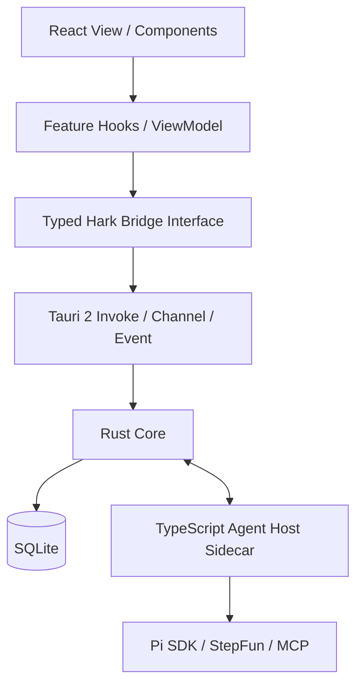

# Hark R1 · 桌面前端产品需求与接口预留合同（Frontend PRD）

> **文档类型**：前端专项 PRD + 交互规范 + 前后端接口预留合同  
> **版本**：v1.0 · 2026-11-06 · **待产品负责人确认，非已实现证明**  
> **上位合同**：`Hark-R1-Desktop-Personal-Agent-PRD-v0.5.1.md`  
> **适用范围**：R1 macOS / Windows Tauri 桌面前端；包含与 Rust Core / Pi Agent Host 的接口边界  
> **不在本文件中承诺实现**：Rust 数据库、文件扫描算法、Pi Session 内部机制、MCP 搜索引擎、真实 OS 观察器  
> **当前项目方式**：拟在原 Hark GitHub 仓库保留历史，重新建立 R1 工程；本文件不沿用旧合成演示的界面骨架。

---

## 0. 一页结论

**Hark 的前端不是项目管理工作台，而是人与一个持续理解项目的 Agent 共同思考的桌面空间。对话就是炉心。**

R1 必须让用户在桌面上完成：

1. 打开 Hark → 选择真实本地文件夹 → 在同一确认页确认项目边界、只读目录与首次模型初读；
2. 进入中央对话空间 → 看见「正在认识项目」的真实进度；
3. Agent 在真实初读完成后**主动说出第一句话**：项目理解、依据/未知、一个具体引导问题；
4. 用户自然对话、检索来源、查看观点，纠正或接受建议；
5. 切换 Workspace、关闭和重新打开窗口后恢复原来的对话与记忆；
6. 低打扰使用系统托盘、通知、权限和模型设置，不把技术运行状态变成全天候 Dashboard。

**界面总原则**：一个主窗口、一个主要对话面、一个背景火光；默认不常驻左侧导航和右侧详情栏。所有辅助能力以临时菜单、抽屉、Sheet 或对话内可展开内容出现。

### 0.1 已确认的产品决策

- Desktop-First：Tauri 2 + React + TypeScript；主界面不是浏览器网站。
- 对话优先；首次 Workspace 认识完成后由 Agent 发起第一条消息。
- 一个项目 Workspace 对应一个逻辑 Agent、专属会话与长期记忆；可添加多个 Workspace。
- 默认一个文件夹一个项目；多独立项目候选在**导入前让用户确认**；Monorepo 不因多包而自动拆分。
- 火焰是可观察项目事实的叙事投影，不使用消息数量、签到、活力百分比和「添柴」作为项目进度。
- 用户在 Workspace 级启用模型后正常连续对话，不逐轮弹出完整 Prompt 外发审阅。
- 项目写入/执行工具不属于 R1；真实操作审批与模型对话授权分开。
- SQLite 和 Pi Session 由后端管理；前端只有视图与操作入口，不拥有第二份业务权威。

### 0.2 前端实现建议（待通过体验/工程验证，不应冒充上位决定）

- Vite、React 严格 TypeScript、pnpm；具体依赖版本在开工时锁定。
- CSS 设计令牌 + 轻量组件原语；可采用 Tailwind CSS 与 Radix 类无障碍交互基础组件，但**禁止直接套用默认后台仪表盘样式**。
- Tauri typed Bridge：命令/查询走 `invoke`；长时间运行的进度/模型流走 Channel；应用级失效通知走 Event。是否使用 TanStack Query 作为视图缓存可由前端负责人决定。
- 火焰优先 CSS/SVG/Canvas 的轻量绘制策略；若复杂动效实测需要，可局部使用 GSAP/Motion。不为视觉引入持续高 CPU 渲染。
- 主题初始方案采用暖白日间 / 近黑夜间 + 玻璃后橙色火影；本地时间切换是历史设计建议，允许用户覆盖且不影响项目业务状态。

---

## 1. 设计依据、优先级和冲突裁决

| 来源 | 继承内容 | 与本 PRD 的关系 |
|---|---|---|
| R1 总 PRD v0.5.1 §0、§2–4、§5.5、§11、§13 | 产品目标、首次 Agent 主动开场、Workspace 隔离、功能与验收 | **最高业务优先级** |
| GitHub `NARRATIVE.md`（2026-10-31 叙事修订） | 「对话即炉心」、火在磨砂玻璃之后、昼夜氛围、火光只反映可信状态 | **视觉和叙事主要依据** |
| `docs/EMBER-STORY-SYSTEM.md` | 同一火光场、动效暂停、减少动态效果、背景时停止持续渲染 | 参考；**旧的按消息次数计算火势已被后续叙事推翻，不采用** |
| `docs/design/2026-10-30-MEMORY-FOLD.md` | 在对话流中以小型「记忆折页」表达旧念头及其来源 | 可以作为细节交互，不另起一套产品页面 |
| `docs/02-UX.md` 和旧 UI-02 工作台 | 可访问性、错误态、证据、操作反馈与基础桌面尺寸 | **不继承默认侧栏、Home/Projects/Activity 多工作台结构** |
| `docs/design/PRODUCT-EXPERIENCE-BLUEPRINT.md` | 对话、来源、项目、授权、后台注意力和业务状态的映射 | 作为功能层参考，旧能力状态不等于新 R1 已实现 |

冲突优先顺序：**当前用户确认的 R1 总 PRD → 本专项 PRD 已确认项 → 最新 `NARRATIVE.md` → 可复用的旧设计文档**。新文档引用老原型是为了继承有效经验，不是要求移植原应用源代码。

---

## 2. 产品叙事：打开的是一段能够接续的对话

### 2.1 情感与交互目标

Hark 不像一个“项目安全大屏”，也不是一个指令输入终端。用户打开它，应该感到自己回到一个**始终理解同一项目历史、但尊重未知和选择**的地方。

- **第一眼**：一个安静的中央空间，暖白/深黑底色，玻璃后有柔和火影。输入和开场内容在视觉上处于同一个空间。
- **第一次授权文件夹后**：空白聊天框转化为真实的认识过程；Agent 主动介绍项目，而非等待用户问“你是谁”。
- **继续对话**：消息从中心自然展开；火光退到背景，不压住文字，不变成固定吉祥物。
- **发现值得关注的事**：Agent 用一段短话说清“为什么现在值得讨论”，展开才看到证据、版本和反例。
- **再次打开**：恢复先前的项目话题和最后阅读位置；不重复欢迎，不以“你很久没来”制造负罪感。

### 2.2 火焰叙事与状态的硬边界

火焰由后端 `NarrativeState`（或等价权威 ViewModel）决定**基础表达**；前端只决定**短暂交互反馈**。

| 层 | 由谁决定 | 视觉行为 | 不代表什么 |
|---|---|---|---|
| 环境光 | UI 时间/主题设置 | 白天暖白、夜晚近黑，橙色火影在磨砂玻璃之后 | 项目进度、AI 是否工作 |
| 项目火势 | Rust/Hark 计算的 `narrative` | `unknown / ember / gentle / bright / milestone` 等受控阶段 | 分数、签到、模型调用数量 |
| 暂时响应 | UI 交互状态 | 输入聚焦收拢、请求等待轻呼吸、确认保存短暂扩散 | 数据已入库、项目执行成功 |
| 业务结果 | 后端真实状态 | 文字、状态图标、来源和可恢复操作 | 绝不能仅由颜色或火势表达 |

**禁止**：用聊天条数、连续登录天数、按钮点击次数、动画帧数来推进项目火势。没有可信叙事状态时，使用中性余光，不猜测“项目沉睡/健康/失败”。

### 2.3 火光形态（视觉建议）

可以采用如下渐进形态，而不是对每个技术事件新造动画：

- `neutral / unknown`：低亮度中性火影；配文字说明“尚未建立项目状态”。
- `ember`：低伏微光，表达已有项目但当前可靠活动有限；不指责用户。
- `gentle`：稳定小火，表达当前有可信活动。
- `bright`：舒展火光，表达近期确有可引用的项目进展。
- `milestone`：更沉稳的金色暖光，仅用于服务端明确的已验证里程碑。

**阶段命名、阈值与映射由后端最终敲定**。前端不能用上述名称硬编码推算业务规则；未知阶段应优雅回退到 `neutral`。

### 2.4 视觉上的「记忆折页」

在已有项目的首次认识或回访顶部，可选择性显示一个很小的折页式记忆入口：一句过去的真实决定/旧念头 + 来源时间。默认折叠，展开显示更详细原文和来源。它不是公告牌，不常驻长对话顶部，不自动生成励志文字。

- 只有后端返回可信记录才出现；没有记录时不造假。
- 记录属于当前 Workspace；切换 Workspace 不携带上一空间的折页。
- 折页作为**对话内容的一部分**，随着消息滚动消失，不能盖住输入。
- 用户可以展开、关闭、跳到来源；历史日期与有效期不要混淆。

---

## 3. 信息架构：一座炉心，按需打开其他东西

### 3.1 顶层结构

```text
Hark Desktop Main Window
├── App Frame（窗口安全区/拖拽区/主题环境）
│   ├── Quiet Header
│   │   ├── Workspace Switcher（当前项目/全局范围）
│   │   ├── Context Status（轻量状态：观察中/待确认等）
│   │   └── More Menu（项目、历史、设置、帮助、退出）
│   └── Conversation Hearth（主路由/默认页面）
│       ├── Fire Atmosphere（视觉背景层）
│       ├── Conversation Timeline（历史 + 首次 Agent 开场）
│       ├── Inline Artifacts（证据、观点、记忆折页、工具状态）
│       └── Composer（固定/稳定停靠于底部）
├── On-demand Surfaces
│   ├── Workspace Picker / Add Folder
│   ├── Boundary Review / Import Confirmation
│   ├── Source Inspector（证据与原文细节）
│   ├── Opinion Detail（观点、反例、反馈）
│   ├── History / Memory Search
│   ├── Workspace Settings / Permissions
│   └── App Settings / Runtime Status
└── Native Desktop Layer（由 Tauri/Rust 负责）
    ├── Tray/MenuBar
    ├── OS Notification
    └── Window hide/restore/quit
```

**导航禁令**：默认不出现传统 240px 左侧工具栏、不出现主页统计区 + 项目卡网格 + Activity 右轨。需要细节时才临时打开对应面板；Esc/关闭按钮应返回原对话及焦点位置。

### 3.2 窗口与尺寸

- **主要桌面测试尺寸**：1440×900、1280×800；兼容 1024×768。具体最小窗口尺寸由 Tauri 宿主配置。
- 正常对话最大可读宽度建议 **760–840px**，长文本不横跨整个桌面；开场与火焰场可使用更宽的环境容器。
- 中央时间线自适应、输入区稳定可见；长代码块横向滚动，不使整页横向溢出。
- 右侧 Inspector 建议 **360–440px** 的临时 Sheet / Drawer；打开时对话区可以适度缩窄，窄窗口则覆盖显示。
- 顶部交互条低密度：当前 Workspace、一个状态提示、一个菜单入口。用渐进披露代替永久占位。
- 不以手机响应式界面作为 R1 主目标，但窗口缩小时仍需可操作。

### 3.3 主要页面线框（信息层，不代表最终美术稿）

**A. 首次启动 / 未绑定项目**

```text
┌──────────────────────────────────────────────────────────────────────────┐
│  Hark                                                        ⋯          │
│                                                                          │
│                         [玻璃后的一点余火]                               │
│                                                                          │
│                    从一个你正在关心的项目开始。                            │
│               选一个文件夹，我会先认识它，再和你聊。                       │
│                                                                          │
│                        [ 选择项目文件夹 ]                                 │
│                          已有项目？[打开]                                 │
│                                                                          │
└──────────────────────────────────────────────────────────────────────────┘
```

**B. 已选择文件夹，导入前确认**

```text
┌──────────────────────────────────────────────────────────────────────────┐
│  ← 返回                                      认识这个文件夹              │
│                                                                          │
│  已选择：/…/projects/hark                                                 │
│  初步判断：一个项目（可更改）                                              │
│  ┌───────────────────────────────────────────────────────────────────┐  │
│  │ ● Hark  [建议作为一个 Workspace]                                  │  │
│  │    发现依据：README、Cargo.toml、package.json…                   │  │
│  │    [展开识别依据]  [这是多个项目]                                 │  │
│  └───────────────────────────────────────────────────────────────────┘  │
│  只读范围 / 默认排除                   [查看]                              │
│  □ 允许将必要项目片段发送给已配置 StepFun，完成首次智能理解                │
│  联网搜索：未启用（可后续设置）                                            │
│                                                                          │
│                              [开始认识项目]                              │
└──────────────────────────────────────────────────────────────────────────┘
```

**C. 已绑定项目，Agent 主动开场 / 日常对话**

```text
┌──────────────────────────────────────────────────────────────────────────┐
│  [Hark ▾]                   正在理解项目 / 已更新               [⋯]       │
│                                                                          │
│                  [模糊玻璃后的火影，背景不挡文字]                           │
│                                                                          │
│                    Hark · 已完成首次认识                                  │
│      我阅读了 README 和核心配置，认为这是一个……                             │
│      我目前可以确认……，但……仍未验证。                                     │
│      [查看依据]  [纠正理解]                                                │
│      你更希望我们先讨论架构，还是先梳理现有实现？                           │
│                                                                          │
│                 ─────── 对话自然向下展开 ───────                           │
│                                                                          │
│          ┌─────────────────────────────────────────────────┐             │
│          │  继续聊聊这个项目…                            [↑]│             │
│          └─────────────────────────────────────────────────┘             │
└──────────────────────────────────────────────────────────────────────────┘
```

**D. 观点出现（仍在对话内）**

```text
Hark：我注意到当前的长期记忆实现可能仍依赖会话历史。

┌ 观点：把项目决定存入 Workspace Memory ──────────────────────────────┐
│ 依据 2 · 不确定性 1 · 最近核验 …                                      │
│ 简述：……                                                             │
│ [查看依据和反例] [有帮助] [反驳] [搁置]                                │
└──────────────────────────────────────────────────────────────────────────┘
```

### 3.4 视图切换和层级规则

- Workspace 切换是**主对话范围切换**，不是打开另一个 Dashboard。
- 同 Workspace 的对话历史可通过搜索/历史抽屉打开，回到当前对话无硬切页跳跃。
- 证据阅读遵循：消息中轻量引用 → Inline Peek → 完整 Inspector。一般不打开新浏览器窗口。
- 设置项允许成为独立全屏/模态区域，但必须提供明显的返回对话操作。
- 跨项目汇总是未来可扩展能力；R1 不允许前端以一个 Workspace 的上下文冒充「全局 Agent」。

---

## 4. 关键用户旅程与交互细则

### 4.1 Onboarding：文件夹 → 边界确认 → 主动开场

**首次体验的关键不是配置表单，而是尽快看到 Agent 真的理解了文件。**

1. 用户通过系统文件夹选择器选择根目录；前端仅收集路径选择，不直接读取任意文件内容。
2. Rust 返回有界初扫的候选结果：默认单项目；明显多项目时给复选列表与简短识别依据；不确定时允许单项目导入。
3. 同一确认页展示「只读目录范围」「排除项」「模型初读」三个独立语义；不额外弹逐文件授权。
4. 用户确认后才创建持久 Workspace；如果创建多个，选择一个作为当前聚焦空间。
5. UI 在对话页呈现实时阶段：**扫描结构 → 阅读关键资料 → 生成理解 → 首条消息已保存**。内容不是模拟等待动画。
6. 完成后显示 Agent **一条短消息**，带来源、未知和一个具体引导问题。消息来源必须为已保存会话事件，而不是仅从流式最终文本拼接。
7. 未配置模型或用户未授权时，显示 `local_scan_card`；用户之后启用模型才生成 `agent_opening_message`，并把前者折叠为证据附件，不重复介绍。
8. 用户中断或 App 关闭：页面依赖后端恢复的 `onboardingRun`，不可在 React 挂载时盲目重新触发扫描；重试必须幂等。

**一个根目录检测多个子 Workspace**：导入前确认；各 Agent 的首条消息分别保存在自己的对话里，但只有当前 Workspace 自动展示，不抢输入焦点、不连续触发多条通知。

### 4.2 普通对话与输入

- 输入框支持多行编辑；Enter 发送、Shift+Enter 换行（具体可调整但须有键盘提示）；中文输入法合成期间 Enter 不发送。
- 发送后本地立即显示排队/待确认状态；后端返回持久消息 ID 才标记已接受；流式内容只属于当前 `runId`。
- 支持显示模型正在回复、工具正在搜索/读取、用户取消、超时、服务断开等明确状态。
- **停止生成**不是“删除会话”：取消只停止当前模型 Run，已保存消息和工具结果按后端事实显示。
- 每个 Workspace/Conversation 的草稿分隔保存；R1 至少保证 Workspace 间切换不串草稿，是否在完全退出后保留未发送草稿由宿主实现并在 UI 如实告知。
- 模型错误不能悄悄回退到 Mock 内容。没有 Provider 时直接显示不可用与设置入口。
- 允许一键复制消息文本、来源与适当的引用；Markdown、代码块和长列表可读且安全。

### 4.3 观点卡与记忆回执

- 观点是独立业务实体，卡片显示 `summary`、状态、简短依据数、`uncertainties` 概况；点击展开 `evidence / counterArguments / uncertainties / suggestedNextStep`。
- 观点动作：接受/有帮助、反驳、搁置、修改建议，后端返回新的持久状态后才显示已保存。
- 若 Pi 在本轮成功调用 `memory_propose_change` 并得到 Rust 成功回执，UI 可显示“已记下决策 · 查看 / 撤销”，但**不得仅因为 AI 在文字中说‘记住了’就显示已入库**。
- 用户的明确决策和 Agent Opinion 必须视觉区分；旧版本、争议、过期可展开查看，不能用一个绿色勾代表事实验证。

### 4.4 搜索与证据

- Pi MCP 或 Hark Tool 返回的搜索结果仅由后端归一为可显示 `EvidenceRef`；前端不直接连接 GLM、MCP Server 或网页 Reader。
- 来源展示区别：`file_read`、`git_observation`、`web_snippet`、`web_fulltext`、`user_decision`、`conversation` 等。
- 网站仅被搜索到标题与摘要时，明确“只见搜索摘要”；正文确实读到时才显示“已阅读原文”。
- 过期/不可访问/权限撤销/来源冲突应有明确文字，不展示虚假可点击的证据。
- 查看本地文件来源时由 Rust 返回被授权的片段与元数据；不要通过 `file://` 直接打开绝对路径绕过工作空间访问控制。

### 4.5 Workspace 切换 / 多项目导入

- Workspace Picker 展示项目名称、必要状态和一个搜索框；多工作空间时仍默认选中当前对话。
- 添加子目录 Workspace 时，前端显示父空间排除与历史保留的明确说明，用户确认后一次请求提交；不能先在 UI 本地排除、再异步建新空间造成假成功。
- 跨 Workspace 切换时：取消或解除旧工作空间的 UI Stream 订阅；草稿、引用、Opinion Inspector 全部绑定其源 Workspace ID；不把 A 的视觉消息放到 B。
- 若后台 Agent 仍在 A 工作，允许 A 的工作继续，但只在 A 的视图中呈现输出；B 不自动继承它的等待态。

### 4.6 关闭窗口 / 后台 / 通知

- 关闭主窗口默认行为必须在第一次使用时可理解：与“退出应用”“暂停观察”严格区分；真正生命周期由 Rust 控制。
- 托盘菜单最小集合：打开 Hark、当前观察状态、暂停/恢复、退出。不要将全部页面搬进托盘。
- 通知来自可信状态变化并关联具体 `workspaceId`/`conversationId`；点击直接回到正确对话/相关观点，不新建重复欢迎消息。
- 后端声明观察 `paused / unauthorized / unavailable` 时不能用“安静无事”代替。火焰也不得错误地变暗代表项目停滞。

---

## 5. 前端页面与组件需求矩阵

| 编号 | 组件/界面 | 主要责任 | R1 验收 |
|---|---|---|---|
| FE-01 | `AppShell` / `HearthCanvas` | 单窗口、主对话、玻璃火光与窗口安全区域 | 无常驻工作台侧栏；主阅读清晰 |
| FE-02 | `WorkspacePicker` | 当前工作空间 / 搜索 / 添加根目录 | 多工作空间切换不串状态 |
| FE-03 | `FolderOnboarding` | 目录选择、边界候选确认、模型初读开关 | 完成真实导入并展示正确权限范围 |
| FE-04 | `OnboardingProgress` | 读取/分析/保存/等待授权/失败/恢复 | 明确且真实的状态，刷新/重启不重复触发 |
| FE-05 | `ConversationTimeline` | 历史消息、模型流、工具状态、首条开场 | 一条可继续的对话，不复制消息 |
| FE-06 | `Composer` | 输入、发送、停止、草稿隔离 | IME、快捷键、取消和失败后可恢复 |
| FE-07 | `FlameAtmosphere` | 非遮挡火影、受控反馈、静态回退 | reduced motion、隐藏窗口资源控制 |
| FE-08 | `OpinionInlineCard` | 结构化观点、反例、用户反馈 | 状态来自后端回执，保留历史 |
| FE-09 | `EvidenceInspector` | 来源片段、阅读深度、失效/不确定性 | 无伪造全文和越权原文 |
| FE-10 | `MemoryFold` | 短历史记忆折页，按需展开 | 后端无数据则不显示 |
| FE-11 | `HistorySearch` | 会话、决策、历史观点按范围查找 | 中文关键词可检索真实后端返回记录 |
| FE-12 | `WorkspaceSettings` | 目录、排除项、模型/搜索启用、观察暂停、撤销 | 权限显示与后端一致 |
| FE-13 | `AppSettings` | 主题/动效、通知、开机启动、运行状态 | 不跨越 Rust 生命周期权限 |
| FE-14 | `AttentionNotice` | 低打扰通知与未处理发现入口 | 不连续刷卡、不抢输入 |
| FE-15 | `ErrorBoundary / OfflineState` | Backend/Sidecar 失联和重试 | 故障不伪装正常，不自动转 Demo |

**组件原则**：按照产品语义拆分，不按每个数据库表生成页面；减少 `Card / Panel / PageHeader` 机械重复。对话中只有观点、来源和记忆等确有语义的内容需要独立组件外观。

---

## 6. 视觉系统与设计令牌

### 6.1 视觉语言

**关键词**：留白、柔和、可读、温度、缓慢、真实、克制。火是空间背后的自然光源，不是用户需要操作的对象；前端的可靠性来自清楚的文字状态，不来自更丰富的动效。

- 主背景：日间暖白、夜间近黑。避免整屏杂色渐变、霓虹线和大面积卡片网格。
- 唯一主要暖色光：玻璃后的橙色火影；按钮等强调色可以与其协调，但不抢主视觉。
- 正文字色与背景满足实际对比度；火影的低频变化必须位于文本背后并适当遮罩。
- 中文字体优先系统 UI 字体栈；段落阅读适度行距，代码使用平台等宽字体。旧设计中的少量中文衬线可以用于「记忆折页」或短叙事标题，不能整页混用。
- 用排版层级而不是密集边框建立信息秩序。

### 6.2 初始 Token（**仅建议初稿，需视觉样机和对比度测试确认**）

```css
:root {
  --canvas-day: #f7f5ef;
  --canvas-night: #101013;
  --surface-day: rgba(255, 255, 255, 0.72);
  --surface-night: rgba(26, 26, 29, 0.72);
  --text-day: #272522;
  --text-night: #ece8e0;
  --muted-day: #6c6964;
  --muted-night: #a9a39b;
  --ember-core: #e88e47;
  --ember-soft: #f1bb7c;
  --focus-ring: #c27537;
  --semantic-error: #b74a46;
  --semantic-success: #3d8068;
  --content-max: 800px;
  --inspector-width: 400px;
  --corner-sm: 10px;
  --corner-md: 16px;
  --motion-fast: 160ms;
  --motion-normal: 220ms;
}
```

颜色在明暗主题的可读性、焦点环和语义状态中均需实测；不要把上述初稿当作品牌规范已冻结。

### 6.3 动效合同

- 允许：火影低频呼吸、输入焦点短暂回应、已保存事件的有限反馈、Workspace 切换的柔和过渡。
- 禁止：消息量驱动火势增大、无限“正在思考”旋转、对话失败仍显示成功确认光。
- `prefers-reduced-motion` 或 App 内暂停动效：停止持续动画，使用静态火影；**不停止真实观察与对话任务**。
- 主窗口隐藏时停止或降低持续视觉渲染；恢复时直接映射真实状态，不重放历史成功动效。
- 性能目标通过真机验证：CPU/内存及窗口隐藏后的渲染负担，不设未经验证的硬性 FPS/RSS 数值。

### 6.4 主题

历史叙事建议：07:00–18:59 日间暖白、19:00–06:59 夜间近黑；仅切换环境，不改变业务状态、消息与焦点。R1 建议提供“自动 / 明亮 / 深色”的用户覆盖选项；如果自动时间切换影响可用性，以用户设定优先。此项为视觉策略，不属于后端数据核心。

---

## 7. 前后端边界：必须从第一天预留

### 7.1 只允许一条前端数据通路



**禁止组件直接**：读取 SQLite 文件、使用 Node `fs` 读取用户项目、调用 StepFun API、连接 GLM MCP 或绕开 Rust Core 请求本地文件内容。API Key 不进入 React 或浏览器本地存储。前端可以显示服务状态/凭据是否存在，但不能取得凭据明文。

### 7.2 Bridge 设计原则

1. 用 `HarkBridge` 定义**前端依赖的稳定业务接口**；Tauri 是其中一个实现，不向页面泄漏 `invoke` 的命令字符串。
2. 查询和命令区分：查询 `get* / list*`；改变状态 `create* / update* / cancel*`。文件夹选择器只是选择路径，授权创建由 Rust 确认。
3. 长任务必须返回 `runId`，供取消、订阅进度、恢复；流式输出不得只靠 React 内存状态认定已保存。
4. 前后端共享一份版本化类型契约，并使用运行时验证（Zod 或等价方法）。**前端类型定义不是 Rust 实现已经存在的证明**。
5. 错误始终以稳定 `code` 返回可恢复操作，不能依赖正则匹配错误英文字符串。
6. 支持 `getSnapshot` / `getConversation` 主动重同步，防止窗口隐藏、Event 丢失或重新挂载导致视图长期失真。
7. 每次请求都要被当前 Workspace 作用域约束；作用域由后端根据可信会话和 ID 校验，不相信前端仅靠隐藏组件实现隔离。
8. 前端可有 `DevPreviewBridge`，只用于 Storybook/单元测试和显式开发预览；**生产构建绝不能在真实调用失败后无提示切入 Mock**。

### 7.3 建议的 TypeScript 领域契约（前后端协商起点）

> 下列结构是**产品需求对应的候选接口合同**，由 Rust 与前端团队在第一轮 API 对齐时冻结；禁止照此假设后台已实现。

```ts
export type ID = string;
export type ISODateTime = string;
export type WorkspaceId = ID;
export type ConversationId = ID;
export type RunId = ID;

export interface ContractEnvelope {
  schemaVersion: "hark.ui.v1";
  requestId: ID;
}

export type ServicePermission = "disabled" | "enabled" | "unavailable";
export interface WorkspaceSummary {
  id: WorkspaceId;
  name: string;
  rootDisplayPath: string;       // 仅显示值，不授予文件访问能力
  lifecycle: "active" | "archived" | "unavailable";
  agentStatus: "idle" | "reading" | "analyzing" | "responding" | "error";
  currentConversationId?: ConversationId;
  lastObservedAt?: ISODateTime;
  overviewFreshness: "fresh" | "stale" | "unknown";
  modelPermission: ServicePermission;
  searchPermission: ServicePermission;
}

export interface RootCandidate {
  candidateId: ID;
  relativePath: string;
  suggestedName: string;
  classification: "single_project" | "independent_project" | "module" | "uncertain";
  reasons: string[];
  selectable: boolean;
}

export interface RootPreview {
  previewId: ID;               // 临时结果；不是持久 Workspace
  displayPath: string;
  scanStatus: "in_progress" | "ready" | "partial" | "failed";
  candidates: RootCandidate[];
  uncoveredReasons: string[];
  recommendedMode: "single" | "select_candidates" | "review_needed";
}

export interface OnboardingRun {
  id: RunId;
  workspaceId: WorkspaceId;
  stage:
    | "boundary_review" | "reading" | "analyzing" | "waiting_for_model_auth"
    | "message_ready" | "completed" | "paused" | "cancelled" | "failed";
  progressText: string;         // 文案可见，但不能伪装为真实文件计数
  scanReadCount?: number;
  scanTotalEstimate?: number;
  latestErrorCode?: string;
  localScanCardMessageId?: ID;
  openingMessageId?: ID;
  lastUpdatedAt: ISODateTime;
}

export type MessageRole = "user" | "assistant" | "system_notice";
export type MessageKind =
  | "text" | "local_scan_card" | "agent_opening_message"
  | "opinion_card" | "memory_receipt" | "tool_status";

export interface ConversationMessage {
  id: ID;
  workspaceId: WorkspaceId;
  conversationId: ConversationId;
  role: MessageRole;
  kind: MessageKind;
  content: string;
  persistedAt: ISODateTime;
  status: "persisted" | "cancelled" | "incomplete";
  runId?: RunId;
  sourceRefs?: ID[];
  opinionId?: ID;
  memoryOperationId?: ID;
}

export interface EvidenceRef {
  id: ID;
  workspaceId: WorkspaceId;
  kind: "file_read" | "git_observation" | "web_snippet" | "web_fulltext"
    | "user_decision" | "conversation" | "external_document";
  title: string;
  displayLocation: string;
  observedAt?: ISODateTime;
  availability: "available" | "stale" | "restricted" | "unreadable";
  verificationLevel: "metadata" | "snippet" | "partial_text" | "full_text";
}

export interface OpinionView {
  id: ID;
  workspaceId: WorkspaceId;
  revision: number;
  summary: string;
  evidenceRefs: ID[];
  counterArguments: string[];
  uncertainties: string[];
  suggestedNextStep?: string;
  status: "active" | "shelved" | "disputed" | "superseded" | "stale";
  lastUpdatedAt: ISODateTime;
}

export interface NarrativeState {
  availability: "known" | "unknown";
  flame: "neutral" | "ember" | "gentle" | "bright" | "milestone";
  basisRefs: ID[];
  observedAt?: ISODateTime;
  stale: boolean;
}

export interface HarkUIError {
  code: string;                 // 稳定错误码，详见 7.7
  message: string;              // 用户可读文案或供本地化使用的描述
  requestId?: ID;
  retryable: boolean;
  details?: Record<string, unknown>; // 不含敏感路径/密钥等
}
```

**原则**：前端接收对象应尽量是“可直接解释的用户态”，而不是数据库原始行或 Pi SDK 的私有内部类型。`unknown` 与 `stale` 必须有明确枚举，不能用 `null` 的任意组合猜测。

### 7.4 HarkBridge 方法清单（待 Rust/前端联签）

| 用户场景 | 建议方法 | 类型 | 返回 / 说明 |
|---|---|---|---|
| App 启动 | `getAppSnapshot()` | Query | `AppSnapshot`：版本、已配置服务、工作空间摘要、当前窗口初始状态 |
| 选择目录后初扫 | `previewRoot(path)` | Command（只读） | `RootPreview` / `previewId`，不会创建 Agent |
| 确认导入 | `confirmImport({ previewId, selectedCandidates, permissions, requestId })` | Command | 导入的 Workspace ID 数组和初次 `runId`；幂等 |
| 工作空间列表 | `listWorkspaces()` | Query | `WorkspaceSummary[]` |
| 当前 Workspace | `getWorkspace(id)` | Query | 工作空间详情、权限、概览、叙事状态 |
| 创建子空间/父空间排除 | `createChildWorkspace(...)` | Command | 一次提交父排除与新空间；失败不出现半成功 |
| 归档/暂停观察 | `updateWorkspaceState(...)` | Command | 持久状态及版本 |
| Onboarding 状态 | `getOnboardingRun(runId)` | Query | 可用于重启后恢复 |
| 历史消息 | `getConversation(conversationId, cursor?)` | Query | 按页返回已持久化消息、`nextCursor` |
| 输入并启动 Pi | `startAgentTurn(input, onEvent)` | Command + Channel | **调用前**创建并传入 Channel，返回 `runId` 与已接受消息 ID |
| 取消一次运行 | `cancelAgentTurn(runId)` | Command | 后端真实取消状态 |
| 已运行任务回访 | `getRunStatus(runId)` + `getConversation(...)` | Query | 窗口重开/断线后回读持久状态；可结合应用级 Event 获知状态变化 |
| 观点详情和反馈 | `getOpinion(id)` / `submitOpinionFeedback(...)` | Query/Command | 含修订版本与成功回执 |
| 记忆来源 | `getMemoryRecord(id)` | Query | 记忆内容、类型、来源/版本与撤销入口 |
| 检索历史 | `searchWorkspaceMemory({ workspaceId, query, kinds, cursor })` | Query | 按作用域过滤的结果和引文 |
| 查看证据 | `getEvidence(id)` | Query | 可见片段、来源类型、新鲜度与不可读原因 |
| 服务权限 | `getWorkspacePermissions(id)` / `setWorkspacePermissions(...)` | Query/Command | 当前模型/联网/观察配置与版本 |
| App 运行状态 | `getRuntimeStatus()` | Query | Core、Pi Sidecar、观察器及可恢复错误 |
| 叙事状态 | `getNarrativeState(workspaceId)` | Query | `NarrativeState`；不由 UI 算法推导 |
| 轻量通知 | `subscribeAppEvents(onEvent)` | Event | Workspace 更新、权限变化、通知目标、会话更新 |

**建议不向 UI 暴露**：`run_bash`、`edit_project_file`、`arbitrary_sql`、`open_any_path`、`send_raw_mcp_request`。这些不是为了降低前端开发难度而暂时隐藏，而是不在 R1 授权范围内。

### 7.5 Bridge TypeScript 接口示例

```ts
export interface HarkBridge {
  getAppSnapshot(): Promise<AppSnapshot>;
  previewRoot(path: string): Promise<RootPreview>;
  confirmImport(input: ConfirmImportInput): Promise<ConfirmImportResult>;
  listWorkspaces(): Promise<WorkspaceSummary[]>;
  getWorkspace(workspaceId: WorkspaceId): Promise<WorkspaceDetail>;
  getOnboardingRun(runId: RunId): Promise<OnboardingRun>;
  getConversation(conversationId: ConversationId, cursor?: string): Promise<MessagePage>;
  startAgentTurn(input: StartAgentTurnInput, onEvent: (event: RunStreamEvent) => void): Promise<StartAgentTurnResult>;
  getRunStatus(runId: RunId): Promise<RunStatus>;
  cancelAgentTurn(runId: RunId): Promise<RunStatus>;
  getOpinion(opinionId: ID): Promise<OpinionView>;
  submitOpinionFeedback(input: OpinionFeedbackInput): Promise<OpinionView>;
  getEvidence(evidenceId: ID): Promise<EvidenceDetail>;
  searchWorkspaceMemory(input: MemorySearchInput): Promise<MemorySearchPage>;
  getWorkspacePermissions(id: WorkspaceId): Promise<WorkspacePermissions>;
  setWorkspacePermissions(input: WorkspacePermissionsUpdate): Promise<WorkspacePermissions>;
  getNarrativeState(id: WorkspaceId): Promise<NarrativeState>;
  getRuntimeStatus(): Promise<RuntimeStatus>;
  subscribeAppEvents(onEvent: (event: AppEvent) => void): Promise<() => void>;
}
```

其中 `AppSnapshot` 等未展开的 DTO 必须在双方联签时生成严格类型及运行时 Schema；**此接口是占位合同，不是可直接 `tsc` 通过的完整 SDK 包**。

### 7.6 流式事件、持久化和重连

建议模型输出 Channel 事件采用统一事件信封：

**Tauri 2 的 Channel 实现约束**：`tauri-bridge.ts` 在调用 `invoke` **之前**构造 `Channel<RunStreamEvent>`、设置 `onmessage`，并将 Channel 作为命令参数传给 Rust；`startAgentTurn(input, onEvent)` 是隐藏该细节的前端业务封装。**不能假设先启动 Run，随后凭 `runId` 就能重新订阅同一条 Channel**。窗口重新挂载时，以 `getRunStatus + getConversation` 恢复持久事实；需要继续接收未结束 Run 的事件，可以使用额外的应用级 Event 或后端明确实现的重新附着协议，但 R1 不强制重放所有 Token。

```ts
export interface RunStreamEvent {
  schemaVersion: "hark.ui.v1";
  workspaceId: WorkspaceId;
  conversationId: ConversationId;
  runId: RunId;
  seq: number;                 // 单 run 单调递增
  type:
    | "run_started" | "text_delta" | "tool_started" | "tool_completed"
    | "memory_committed" | "run_completed" | "run_cancelled" | "run_failed";
  payload: Record<string, unknown>; // 实现中使用类型判别联合替换
}
```

- `runId + seq` 去重、排序；前端不得假定应用挂起后所有事件都能收到。前端若在 `invoke` 启动 Run 时收到部分事件早于 Promise 返回，需要临时按 `requestId` 缓存并在拿到 `runId` 后对齐。
- `text_delta` 只是**临时生成视图**；`run_completed` 不自动等于消息已持久化，后端必须提供 `messageId` / 最终结果引用，再调用 `getConversation` 核对。
- UI 接收“模型已经返回，但消息保存状态未知”时明确提示，禁止显示成功确认动画或重复盲发。
- 切换 Workspace 后，不将旧 run 的增量追加到新 Workspace；允许后台继续任务并在回访时从持久历史恢复。
- 对需要从序号恢复的后端，可扩展 `getRunEvents(runId, afterSeq)`；第一版直接在断线时回读持久消息和 Run 状态即可，不强制实现通用事件溯源总线。
- 模型/工具阶段必须来自真实运行事件，不能由 UI 固定延时模拟。

### 7.7 最小错误码与 UI 行为

| Error Code（建议） | UI 表现 | 可做操作 |
|---|---|---|
| `WORKSPACE_NOT_FOUND` | 当前空间已归档或不存在 | 返回 Workspace Picker |
| `SCOPE_DENIED` | 文件/记忆超出授权范围 | 查看范围、重新选择，不自动放宽 |
| `MODEL_NOT_CONFIGURED` | 尚未配置 StepFun / Provider | 打开模型设置 |
| `MODEL_PERMISSION_REQUIRED` | 尚未授予当前工作空间模型初读/对话权限 | 显示独立授权开关 |
| `SEARCH_PERMISSION_REQUIRED` | 联网搜索未启用 | 仅在用户想联网时引导开启 |
| `ONBOARDING_WAITING` | 仍在认识项目 | 继续查看进度、取消 |
| `RUN_ALREADY_ACTIVE` | 当前对话有未结束 Run | 返回已有 `runId` 或提示等待/取消 |
| `SOURCE_STALE` | 证据已过期，不能当最新事实 | 重新读取/标记待核验 |
| `SOURCE_UNREADABLE` | 网页动态空壳/本地文件暂不可读 | 展示限制与重试 |
| `CONFLICT_REVISION` | 观点/权限已被其他操作更新 | 回读后再次确认 |
| `SIDECAR_UNAVAILABLE` | Agent Host 不可用 | 重试启动/展示错误详情 |
| `OPERATION_CANCELLED` | 用户或后台取消 | 保留已持久历史；重新发起须显式操作 |
| `CONNECTION_LOST` | Stream 断开 | 从后端回读持久状态 |

错误码名称是联签建议；重要的是**稳定的机器可判别语义**。不要把“只有扫描卡片”误当成“模型已经理解”；不要把没有事件误当成“正常空闲”。

### 7.8 数据新鲜度、权限和项目切换

- `AppSnapshot` 是进入应用时的基线；Change Event 负责提示哪些数据需要重新获取，不能单靠持久订阅保持真实。
- 与后端交互的所有读/写请求绑定 `workspaceId` 或明确的全局作用域；SQLite 中的全局记忆不是前端可枚举的所有 Workspace 私有数据。
- 被排除子目录的历史证据可以留在历史里，但当前项目视图必须显示“已移出当前范围”，不能继续作为当前来源自动引用。
- 用户撤销模型/搜索/目录权限后：当前 UI 刷新权限快照；后端停止相关请求；未保存生成内容不能被 UI 冒充已完成。
- `opinion` 和 `memory` 的“撤销/修订”返回版本和操作回执；前端不要自己维护独立的意见数据库。

---

## 8. 前端工程结构建议

```text
apps/desktop/
├── src/
│   ├── app/
│   │   ├── App.tsx
│   │   ├── app-shell.tsx
│   │   └── routes.tsx
│   ├── features/
│   │   ├── onboarding/
│   │   ├── workspace/
│   │   ├── conversation/
│   │   ├── opinions/
│   │   ├── memory/
│   │   ├── evidence/
│   │   └── settings/
│   ├── bridge/
│   │   ├── HarkBridge.ts       # 仅接口与领域 DTO
│   │   ├── tauri-bridge.ts     # invoke/Channel/Event 唯一入口
│   │   ├── dev-preview.ts      # 只用于显式开发预览
│   │   └── schemas.ts          # DTO 运行时校验
│   ├── components/
│   │   ├── hearth/
│   │   ├── primitives/
│   │   └── feedback/
│   ├── state/
│   ├── styles/
│   │   ├── tokens.css
│   │   └── themes.css
│   └── tests/
└── src-tauri/                # Rust 业务/IPC 由后端团队负责
```

建议前端不直接依赖 `packages/agent-host` 或 Pi SDK 包；跨语言接口定义放在独立 `packages/contracts` 或等价独立路径中，由单一版本源生成/验证类型。

### 8.1 前端状态划分

| 状态 | 权威 | 前端持有方式 |
|---|---|---|
| 工作空间身份/许可/观察状态 | Rust/SQLite | Query 缓存 + Event 失效 |
| 会话消息、意见、记忆回执 | Rust/SQLite | 后端回读、分页及按需缓存 |
| 当前生成 Token | Pi Run 的流式临时数据 | React/Feature State，完成后与持久消息对账 |
| 草稿、面板开合、滚动位置 | 前端本地视图 | UI State；按 Workspace/Conversation 隔离 |
| 模型/搜索可用性 | Rust/Agent Host | 只读状态 + 明确错误 |
| 火势基础阶段 | 后端 NarrativeState | 后端快照；UI 仅做动效插值 |
| 动效暂停/主题 | 用户 UI 偏好 | 本地设置或 Rust Settings（如需跨设备/重启一致） |

### 8.2 不为前端便利扩张后端

接口应围绕真实用户旅程，而不是一上来建设通用 RPC、动态表单引擎、全局事件总线或“万能 Tool Gateway”。新增后端字段必须回答它支持哪条交互和哪项验收。

---

## 9. 前端与后端并行开发的交接协议

### 9.1 先冻结的四份接口资产

1. **DTO Schema**：`Workspace / RootPreview / OnboardingRun / ConversationMessage / Opinion / Evidence / NarrativeState`。
2. **Command Catalog**：明确每个 `HarkBridge` 方法的请求、成功返回、错误码和幂等性。
3. **Stream Protocol**：`runId + seq + type`、消息持久化回读、取消与重连。
4. **Capability Matrix**：后端真实支持什么、前端只可预览什么、哪些服务未配置。

在 Rust 实现前，由前后端 Agent 对每份接口进行一次**短对齐**。一旦进入开发，改变接口必须同步修改契约测试，不能让 UI 从错误提示字符串猜业务状态。

### 9.2 DevPreviewBridge 规则

为了让前端先行设计，可以构造显式预览适配器，但必须满足：

- 启动命令或 URL 明示 `DEV PREVIEW / SYNTHETIC`，生产构建不可启用。
- 预览数据按真实 DTO schema 生成，不单独发明一套前端形状。
- 可以模拟“扫描中/模型不可用/流式失败/来源失效”等**状态**，不得在生产失败时假装切入演示。
- 至少一个 E2E 场景必须通过真 Tauri Invoke + 实际 Rust Core + 实际授权本地文件夹完成，不靠 Mock 证明产品能力。
- 如果后端尚无某接口，前端展示明确的 unavailable，而不是把功能藏起来或伪装已经完成。

### 9.3 建议的实施次序（以垂直功能为单位，不按时间推测进度）

| 切片 | 前端交付 | 依赖的后端合同 | 真实验证 |
|---|---|---|---|
| FE-A · 炉心与启动 | Tauri Shell、单页布局、主题、静态火影、Workspace 占位 | AppSnapshot、窗口/托盘最小接口 | 真机开关窗口，UI 可操作 |
| FE-B · 认识项目 | 目录选择、候选确认、Onboarding 进度、Agent 首条消息 | previewRoot、confirmImport、OnboardingRun、持久消息 | 真实项目导入，Agent 先开场 |
| FE-C · 对话与来源 | 持久消息、流、停止、证据 Inspector | startAgentTurn、Channel、getConversation、getEvidence | 真 StepFun 轮次及一次来源阅读 |
| FE-D · 专属记忆与观点 | Opinion、记忆回执、回访、检索 | getOpinion、feedback、Memory 收据、search | 用户决定跨重启可回忆并纠正 |
| FE-E · 桌面陪伴 | 多 Workspace 切换、设置、暂停、通知、托盘与异常恢复 | Workspace/Settings、App Events、Native lifecycle | Mac+Windows 关闭窗口、通知和退出 |

**前端 Agent 的工作标准**：每个切片都必须提供可观察行为、测试证据和真实后端对接状态；可以让便宜模型做局部组件，但核心接口与复杂 Run 状态由高能力模型复审。

---

## 10. 页面与交互的状态矩阵

| 场景 | 应显示 | 不得出现 |
|---|---|---|
| 没有 Workspace | 选择文件夹主入口、温和中性火影 | 虚构欢迎消息、预置项目冒充真实 |
| 初扫尚未完成 | 读取范围与真实阶段、取消/返回 | 固定百分比假进度 |
| 发现多个项目 | 识别依据、候选勾选、Monorepo 单项目选项 | 静默创建多个 Agent |
| 未启用 StepFun | 本地概况、模型授权入口 | 冒充已由 Pi 深度分析 |
| 首次 Agent 正在分析 | 真实运行状态、可中断与错误处理 | 无限转圈、虚构项目结论 |
| 首次消息已保存 | 有来源的简短开场与问题 | 重复欢迎/再创建会话 |
| 日常流式回复 | 临时文本、工具阶段、停止 | 将流式片段当已持久消息 |
| 记忆写入成功 | “已记下”回执 + 撤销/查看 | 仅凭模型口头声明显示成功 |
| 来源仅为搜索摘要 | 明确 Snippet 标记 | “已经阅读原文” |
| 观察暂停/目录不可达 | 明确 paused/unavailable | 火焰自行推断项目休眠 |
| 换 Workspace | 正确空间的消息、草稿、观点 | 前一空间的流/证据继续显示 |
| Sidecar 故障 | 可读错误、状态回读、重试 | 静默切换到 Mock |
| Window Hidden | 后端任务按真实授权继续；停止视觉动画 | 继续不必要的高频渲染 |
| 完全退出 | 明确退出意图，宿主负责关闭进程 | 前端自行调用未授权 Shell 命令 |

---

## 11. 无障碍、质量与平台验收

### 11.1 可访问性

- 必须支持键盘完整操作：选择文件夹、确认导入、输入、展开证据、切换 Workspace、反馈观点、退出 Inspector。
- 输入法 IME 合成过程中不得误发送；焦点环明显且与主题兼容。
- 语义化结构：可访问消息列表、明确的按钮标签与状态 `aria-live`；流式增量避免每 Token 播报干扰读屏器。
- 尊重系统减少动态效果和 App 内动效暂停；静态火影不阻断读屏、键盘或文字信息。
- 动画/火光/颜色不是成功、失效、暂停或未知状态的唯一载体。
- 弹层打开后焦点受控、关闭后焦点回到原触发点；危险操作有明确文本确认。

### 11.2 设计和性能验证

- 1440×900、1280×800、1024×768 的开场、长对话、导入、搜索、设置与 Inspector 截图。
- macOS/Windows 字体回退、窗口拖动区域、标题栏、安全区、系统缩放与托盘行为分别核验。
- 主窗口隐藏后不持续做高频动效；多 Workspace 数量增长时仍保持列表快速响应。
- 消息区虚拟列表或分页按实际性能引入，不为十条消息先造复杂滚动框架。
- 代码块复制、Markdown 链接、证据的外链访问必须尊重系统 API 与许可，不支持不可信 HTML 原样执行。

### 11.3 前端必须通过的真实旅程

**Journey 1：首次认识**  
安装/启动 → 授权真实文件夹 → 选择导入边界 → 模型授权 → 真实扫描/初读 → Agent 首先开口 → 展开一个真实文件来源。

**Journey 2：长期对话**  
继续真实 Pi + StepFun 对话 → 产生结构化观点 → 用户反馈 → 记忆写入回执 → 关闭/重新打开 → 恢复旧对话与已记录决定。

**Journey 3：Workspace 隔离**  
加入第二个文件夹 → 切换两个 Workspace → 消息/草稿/引用/观点不混合 → 父子目录排除场景有正确 UI 确认。

**Journey 4：故障与真实状态**  
关闭 StepFun 权限 / Sidecar 不可用 / 网络搜索仅有摘要 / 来源过期 → 明确降级，无 Mock 冒充，无假成功。

**Journey 5：桌面生命周期**  
关闭主窗口 → 托盘恢复 → 授权观察状态恢复 → 收到一次真实通知并跳回正确对话 → 完全退出不留未知子进程。

这五条用于前端体验验收；不代表后端正确性、跨平台打包和 Memory Engine 的全部测试已被它们覆盖。

### 11.4 对测试的要求

- Component：初次开场、非模型扫描卡、观点卡、折页、来源级别、失效状态、缩放与键盘操作。
- Contract：Bridge DTO Schema、错误码、取消、消息 ID、分页、AppSnapshot 再同步、无重复首次消息。
- Stream：增量乱序/重复、窗口隐藏、切 Workspace、工具阶段与完成冲突、消息落库未知。
- Desktop E2E：至少一条真实 Tauri↔Rust↔Pi 回路，Mac 和 Windows 分别提供相关证据。
- Visual：白天/夜晚/减少动态效果，以及 1440、1280 和 1024 宽度下可读性。

---

## 12. 前端 R1 完成定义（DoD）

前端部分可声明完成必须**同时满足**：

- [ ] 不是静态展示，而是可安装 Tauri 桌面应用的真实 React UI；
- [ ] 对话优先单页，无默认工作台侧栏和无意义统计卡；
- [ ] 授权文件夹后无需用户输入，即可看到真实项目读取进度与 Agent 首条消息；
- [ ] 导入前能确认多独立项目候选；Monorepo 不因 UI 假设被拆分；
- [ ] Workspace、Conversation、Opinion、Memory 来源/状态与后端权威一致；
- [ ] StepFun/Pi 真流式对话、取消、状态回读和失败处理均已接通；
- [ ] 本地和联网来源可区分阅读级别，来源未知与不可用不编造；
- [ ] 记忆写入/用户反馈只有在后端回执成功后才显示已保存；
- [ ] 至少两 Workspace 的数据、草稿与流视图不会串线；
- [ ] 火焰、主题和动画符合叙事，关闭动画仍可完整使用；
- [ ] 关闭窗口、托盘恢复、通知跳转与完全退出符合真实宿主行为；
- [ ] 在 1440×900、1280×800 和 1024×768 可读，支持键盘与减少动效；
- [ ] 开发预览与真实产品模式严格区分，无失败时默默 Mock 降级；
- [ ] 前后端合同版本、错误码、流事件类型、源数据权限均有可审查的自动化测试；
- [ ] 真实安装/运行证据以及已知限制已归档，且用户实际体验验收通过。

**R1 的前端不应被额外需求阻塞**：Gmail 全量邮箱、多个搜索引擎选择器、复杂技能市场、项目执行控制台、移动端、实时协同、复杂火焰物理模拟、巨大管理后台。

---

## 13. 待产品/工程确认的问题与默认处理

| ID | 问题 | 默认建议 | 谁确认 |
|---|---|---|---|
| FE-O1 | 品牌对外展示最终为 `Hark` 还是保留内部 `Hearth` 称谓 | App 对外用 Hark，视觉叙事用“炉心” | 产品 Owner |
| FE-O2 | 白天/夜晚自动切换或遵循 OS 主题 | 保留 `auto/light/dark` 可覆盖选择；本地时间只控制氛围 | 产品 Owner + 前端 |
| FE-O3 | 火焰制作技术（CSS/SVG/Canvas/GSAP） | 先静态+低频火影，性能不足再换方式 | 前端实测 |
| FE-O4 | 全局跨项目对话在 R1 的入口 | R1 默认只处理明确选中的 Workspace；全局功能另立范围 | 产品 Owner |
| FE-O5 | 首次开场及后续对话的具体消息块 Schema | `MessageKind` 联签后冻结，不复制 Pi 内部消息结构 | Rust/Agent Host/前端 |
| FE-O6 | 生产环境窗口关闭默认隐藏还是完全退出 | 提供可理解提示，默认按桌面常驻产品逻辑隐藏；支持完全退出 | Rust/产品 Owner |
| FE-O7 | 在线模型未启用时是否允许用户输入问题 | 允许输入并说明模型不可用，不发远程请求；本地扫描可查看 | 产品 Owner |
| FE-O8 | 观点反馈的动作词与确认体验 | 采用“有帮助/反驳/搁置/修正”，结果即时回读 | 产品 Owner |
| FE-O9 | `NarrativeState` 业务含义与可用阶段 | Rust Core 提供可信快照；前端只映射，不自造计算公式 | Rust/产品 Owner |

上述未定事项不能被编码 Agent默默决定后反向修改上位 PRD；若未影响用户数据安全，允许以建议默认方案先做界面样例并请 Owner 选择。

---

## 14. 给编码 Agent 的直接执行约束

**可以直接委托前端 Agent：**

> 以本文件为唯一前端需求入口，且服从 Hark R1 总 PRD v0.5.1 的业务边界；建立 Tauri 2 + React + TypeScript 的单页对话式桌面前端。先实现可运行的炉心布局及 `HarkBridge` 类型接口；使用显式 DevPreviewBridge 验证交互状态，同时与后端联签 Command/Event/DTO 合同。不得照搬旧 Home/Projects/Activity Dashboard，不允许从项目目录自动运行脚本，不允许前端直接读取 SQLite/调用 Pi/访问 MCP。每个阶段输出真实界面截图、错误态、键盘/动效验收、当前已接入与尚未接入的 API 清单。开始真实集成后，生产界面不得使用 Mock 兜底或宣称未实现能力已完成。

### 14.1 每个前端任务包必须包含

- **范围**：需要实现的用户旅程、组件、接口及允许修改的文件；
- **依赖**：明确后端是否已有相关命令/DTO；不可用时使用显式预览状态；
- **交付**：代码、运行截图/录屏、自动化测试、真实与预览差异；
- **验收**：可以通过界面完成的实际步骤和失败态；
- **回滚**：独立提交/小 PR，不覆盖无关模块；
- **保真**：不以模拟响应替代真实模型和项目证据验收。

---

## 附录 A：来源链接

- 上位 PRD：本次会话交付 `Hark-R1-Desktop-Personal-Agent-PRD-v0.5.1.md`。
- Hark 最新叙事：[NARRATIVE.md](https://github.com/EchoTouch-moon/hark/blob/master/NARRATIVE.md)。
- 火影历史交互映射：[EMBER-STORY-SYSTEM.md](https://github.com/EchoTouch-moon/hark/blob/master/docs/EMBER-STORY-SYSTEM.md)（**需按最新叙事剔除旧消息热度规则**）。
- 项目体验映射：[PRODUCT-EXPERIENCE-BLUEPRINT.md](https://github.com/EchoTouch-moon/hark/blob/master/docs/design/PRODUCT-EXPERIENCE-BLUEPRINT.md)。
- 记忆折页探索：[2026-10-30-MEMORY-FOLD.md](https://github.com/EchoTouch-moon/hark/blob/master/docs/design/2026-10-30-MEMORY-FOLD.md)。
- 旧 UX 合同：[docs/02-UX.md](https://github.com/EchoTouch-moon/hark/blob/master/docs/02-UX.md)（工作台布局不继承）。
- Tauri 官方前端配置：[Frontend Configuration](https://v2.tauri.app/start/frontend/)（SPA/React 推荐 Vite）。
- Tauri 官方 IPC 概念：[Inter-Process Communication](https://v2.tauri.app/concept/inter-process-communication/)（Commands / Events）。
- Tauri 官方 Channel 示例：[Plugin Commands](https://github.com/tauri-apps/tauri-docs/blob/v2/src/content/docs/develop/Plugins/index.mdx)。

## 附录 B：与总 PRD 的职责映射

| 本文前端需求 | 上位文档对应 |
|---|---|
| 首次文件夹导入、Agent 先开口 | 总 PRD §3.1–3.3、§3.8、FR-03/FR-13/FR-14 |
| 单页对话与火焰 | 总 PRD §2.2–2.3、§5.5、FR-16 |
| 对话、观点、记忆回执 | 总 PRD §3.4、§7、§9、FR-05/FR-08/FR-09/FR-19–21 |
| Pi/MCP 不直接暴露给前端 | 总 PRD §5.2–5.5、§6、§10.3 |
| 工作空间/模型/搜索授权 | 总 PRD §3.2、§11、FR-11 |
| 后台通知与生命周期 | 总 PRD §3.6、§10、FR-10/FR-12 |
| 真实端到端验收 | 总 PRD §13、FR-01–22 |

---

**状态声明**：本文为产品和接口规划，不代表新 Tauri 前端、`HarkBridge`、Rust API 或真实 Pi 集成已经完成。所有候选 TypeScript 类型应在真实联签与版本锁定后才视为可执行代码合同。
